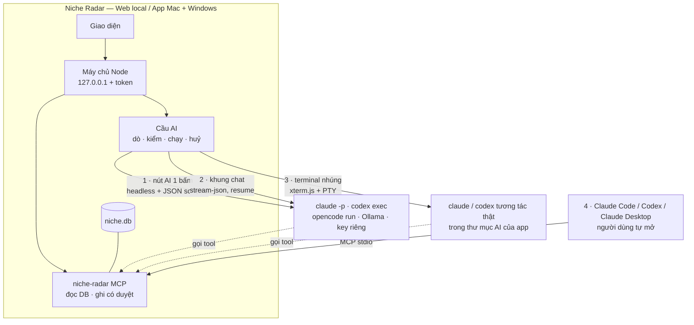

# Phase 26 · AI của bạn — Claude Code, Codex, Ollama chạy ngay trong app

> **Không bán AI, không tự build AI, không trả tiền AI thay người dùng.** App gọi AI người dùng **đã trả tiền sẵn**
> (gói Claude, ChatGPT / Codex) hoặc AI chạy trên máy (Ollama). Học đúng câu của Wow Keywords:
> *"No second subscription — runs on the AI you already pay for."*

Chưa làm · plan 2026-10-26 · gộp Phase 26.6, 26.3, 26.4, 26.7

**Hiện có — đỡ được 70 % việc.**

- **Lớp AI chung (Phase 6)** `web/src/lib/ai/providers.ts`: mọi việc AI đi qua 1 hàm `Ask(system, user, schema) → JSON + số đo`.
  Đã có 2 tuyến: Claude API (key) và Ollama. Các việc AI hiện có (chủ đề than, tóm tắt, test bán trước, Feature Gap)
  **chỉ cần thêm tuyến mới là chạy**, không sửa việc nào.
- **Job file (tuyến B)**: xuất `.json` → Claude in Chrome / Claude Code đọc → dán kết quả lại. Chạy thật 5 niche, mọi câu
  trích khớp nguyên văn — nhưng phải tay đưa file qua lại.
- **Markdown Viewer** (`apps/ACTIVE/desk-apps/markdown-viewer`, `src-tauri/src/pro/claude.rs` + `src/pro/claude.ts`):
  đã chạy `claude -p --output-format stream-json` bằng **login của người dùng, không key**, tìm `claude` ở mọi chỗ cài
  (kể cả app mở từ Dock không có PATH của Terminal, Windows `claude.exe` / `claude.cmd`), khung chat có resume phiên,
  báo lỗi chưa đăng nhập. **Copy cách làm này sang Node, không viết lại từ đầu.**
- **CarMD Utils**: chạy skill Claude headless (`claude -p "/<skill>" --allowedTools …`) từ trong app.

**Cần xong trước:** không. Bước 0 làm song song với [Hoàn thiện Web](hoan-thien-web.md). Phase 26 xong thì
[Phase 27](phase-27-ai-tinh-nang.md) mới có máy để chạy.

## 4 cách AI vào app — một bộ máy

| Cách | Người dùng thấy gì | Dùng cho | Đợt |
|---|---|---|---|
| **1 · Nút AI 1 bấm** | bấm "Tóm tắt bằng Claude Code" → vòng xoay → kết quả vào khối | mọi việc AI có khuôn ([Phase 27](phase-27-ai-tinh-nang.md)): chủ đề than, tóm tắt, chấm, gom | đợt 1 |
| **2 · Khung chat** | khung bên phải: "Niche nào trong project này đáng làm nhất?" → trả lời có trích mã nguồn | hỏi dữ liệu bằng lời (thay Phase 26.4) | đợt 1 |
| **3 · Terminal nhúng** | tab Terminal trong app, `claude` chạy thật, đã nối sẵn dữ liệu + skill | người rành muốn tự lái: viết research, spec, chạy skill `/app-demand` | đợt 2 |
| **4 · MCP cho AI bên ngoài** | nút "Thêm vào Claude Code / Codex / Claude Desktop" 1 bấm | người quen làm trong Claude Code / Claude Desktop của họ (Wow Keywords: "Give your AI agent access to your keywords") | đợt 1 |

**Claude in Chrome** giữ làm đường dự phòng (job file như hiện tại, thêm trang `/ai-brief` dễ đọc cho extension) —
không đầu tư thêm, vì app không gọi được extension, phải người bấm.

## Bước 0 — đo trước khi xây (1–2 ngày)

Chạy **bài thử chuẩn của Phase 6** (110 review 1–2★ `budget tracker` → chủ đề than + câu nguyên văn, kiểm bằng cùng
một hàm) trên từng tuyến. Ghi: chạy được không · JSON đúng khuôn mấy lần / 5 · câu trích khớp · thời gian · máy cần gì.

| Tuyến | Lệnh headless (đã xem `--help` trên máy 2026-10-26) | Cần đo |
|---|---|---|
| Claude Code 2.1.269 | `claude -p --output-format stream-json --verbose --json-schema <schema> --strict-mcp-config --mcp-config <file> --allowedTools "mcp__niche-radar__*" --no-session-persistence` | JSON đúng khuôn 5/5? lỗi chưa đăng nhập / hết lượt trả ra sao |
| Codex 0.162.0 | `codex exec --json --output-schema <file> --ephemeral --skip-git-repo-check -s read-only` | như trên · đọc được MCP không |
| OpenCode | `opencode run …` — **máy chưa cài, chưa xem cờ** | cài thử, ghi cờ thật |
| Gemini CLI | `gemini -p …` — máy có cài | có đáng thêm không (Wow Keywords không có) |
| Ollama | HTTP `localhost:11434` — đã có code | thử model mới hơn llama3.1 8B (Phase 6 đo kém: 1 chủ đề / 110 review) |
| Key riêng (BYOK) | Claude API — đã có code | chạy thật lần đầu khi có key |

**Ghi nhớ khi đo**

- **Không dùng `--bare`** của Claude Code: chế độ này chỉ nhận `ANTHROPIC_API_KEY`, bỏ OAuth → người dùng gói Claude
  sẽ báo chưa đăng nhập
- Tuyến nào JSON sai khuôn > 1/5 hoặc câu trích khớp < 95 % → không bật, ghi lý do (như Phase 6 đã bỏ Ollama)
- Ghi bảng kết quả vào chính trang này kèm ngày, như Bước 0 Phase 6

## Làm gì

### 26.1 · Cầu AI (máy chủ Node)

- **Dò AI trên máy:** cổng sang Node đúng thứ tự tìm của Markdown Viewer — chỗ cài thường gặp → `nvm` → shell đăng nhập
  (`$SHELL -lic "command -v claude"`); Windows: `claude.exe` native → `npm\claude.cmd` (chạy `node cli.js`, không qua
  `.cmd`) → `where`. Làm tương tự cho `codex`, `opencode`, `ollama`
- **Kiểm tra thật:** nút **Kiểm tra** hỏi 1 câu ngắn có schema; "Sẵn sàng" chỉ khi trả JSON đúng. Lỗi gọi đúng tên:
  *chưa cài* (kèm lệnh cài 1 dòng) · *chưa đăng nhập* (mở Terminal chạy `claude` 1 lần) · *hết lượt / rate limit*
  (kèm giờ thử lại nếu CLI báo) · *key sai*
- **Tuyến mới = `Ask` mới:** `claudeCodeAsk`, `codexAsk`, `opencodeAsk` cùng chữ ký với `claudeAsk` / `ollamaAsk` → mọi
  việc AI cũ chạy được ngay, test bằng `Ask` giả như hiện có
- **Hàng đợi:** 1 việc AI chạy một lúc (không bắn 10 tiến trình `claude` làm cạn lượt của người dùng), nút **Dừng** giết
  tiến trình, thoát app thì dọn hết tiến trình con (đã có bài học "server mồ côi" ở Phase 17)
- **Báo trước khi chạy:** "Chạy bằng Claude Code của bạn · ~42k token · tính vào gói Claude của bạn". Tuyến key riêng
  thì ước tiền + `--max-budget-usd` làm trần

### 26.2 · Thư mục AI của app

Một thư mục cố định cho mọi tiến trình AI làm việc (cwd): `~/Library/Application Support/niche-radar/ai/` (Windows:
`%APPDATA%\niche-radar\ai\`), app tự tạo:

- `CLAUDE.md` + `AGENTS.md` (Codex đọc file này): Niche Radar là gì, dữ liệu nằm đâu, luật "AI không đưa số, mọi câu
  phải có mã nguồn"
- `.mcp.json`: trỏ tới niche-radar MCP
- `.claude/skills/`: bộ skill chọn niche (đúng thứ đã hứa gửi kèm email dùng thử — `/app-demand`, quy trình chọn niche),
  bản tiếng Anh

Nhờ vậy khung chat, terminal nhúng và Claude Code bên ngoài **cùng hiểu một kiểu** về dữ liệu.

### 26.3 · niche-radar MCP (gộp Phase 26.3)

- Server MCP stdio, chạy bằng Node đi kèm app, đọc `niche.db`
- **Tool chỉ đọc** (theo [Phase 26.3](../web/phase-26-3-mcp.md)): `search_niches` · `get_research` · `get_explore` ·
  `list_projects` / `get_project` · `get_competitor` · `get_complaints` · `get_gaps` (Reddit / Q&A / GitHub) · `get_decision`.
  Mọi kết quả kèm mã nguồn (id lượt tra, ngày, link) để AI trích lại được; cắt bớt + báo "còn X dòng"
- **Tool ghi — chỉ 3, đợt 2:** `collect_to_project`, `start_research` (chạy tra niche mới), `save_ai_result` (ghi kết
  quả vào khối, đi qua cùng hàm kiểm trích dẫn của app). Không có tool xoá
- **Nút "Thêm vào …" 1 bấm** trong Cài đặt → AI: chạy `claude mcp add niche-radar …` / ghi `~/.codex/config.toml` /
  ghi file cấu hình Claude Desktop — hiện lệnh sẽ chạy trước, bấm mới ghi. Trang Cách dùng có lệnh tay cho Cursor,
  Windsurf

### 26.4 · Khung chat (gộp Phase 26.4)

- Mở ở mọi trang (Research, Project, Gap) — câu hỏi kèm ngữ cảnh "đang xem gì" (như `contextFor` của Markdown Viewer)
- Chạy `claude -p … --output-format stream-json --resume <phiên>` trong thư mục AI, chỉ được dùng tool MCP chỉ đọc +
  Read → **không sửa file, không chạy lệnh**
- Hiện từng bước (gọi tool gì) như Markdown Viewer; mã nguồn trong câu trả lời bấm được → nhảy tới đúng dòng dữ liệu
- Codex: cùng khung, chạy `codex exec --json` (đo ở Bước 0 xem resume được không)

### 26.5 · Terminal nhúng — "hết nước chấm" (đợt 2)

- Tab **Terminal** trong app: `xterm.js` ở giao diện + PTY ở máy chủ (`node-pty`; nếu không đóng gói được vào sidecar
  Tauri thì dùng crate `portable-pty` bên Rust), mở `claude` hoặc `codex` tương tác thật, cwd = thư mục AI
- Có sẵn nút lệnh mẫu: "Viết research cho project này", "/app-demand niche đang xem", "So 3 niche tuần này"
- Đây là **AI có quyền như Terminal thật** → chỉ mở khi người dùng bật trong Cài đặt, có dòng cảnh báo, không bao giờ
  có ở bản demo trên web

### 26.6 · Cài đặt → AI (gộp Phase 26.6, 26.7)

- Danh sách AI dò được, trạng thái từng cái, nút Kiểm tra, chọn **AI mặc định** + chọn AI riêng cho từng việc
- Sổ dùng AI: mỗi lần chạy ghi việc gì · niche nào · tuyến · token · thời gian (không ghi nội dung)
- Không nối AI nào → mọi nút AI hiện "Nối AI để dùng" + link Setup; phần không AI chạy đủ
- Bước "Nối AI" trong Setup lần đầu ([Phase 23](../web/phase-23-setup.md)) — Wow Keywords bắt buộc nối 1 AI;
  mình **cho bỏ qua** vì phần không AI vẫn có giá trị

**Luật an toàn — máy chủ local mở được AI và Terminal thì phải khoá kỹ**

- Máy chủ chỉ nghe `127.0.0.1`; mọi `/api/ai/*` và kết nối Terminal cần **token sinh mỗi lần mở app**; kiểm
  `Host` + `Origin` (chặn trang web lạ trong trình duyệt gọi vào localhost — DNS rebinding)
- Nội dung review / Reddit / GitHub là **chữ không tin được** (có thể chứa câu lừa AI): việc 1 bấm và khung chat **không
  có** tool ghi file / chạy lệnh, nên câu lừa không làm hại được; kết quả luôn đi qua hàm kiểm của app
- Key riêng chỉ trên máy (Keychain ở app Mac, Credential Manager ở Windows, `.env.local` ở Web), không vào log, không
  vào gói xuất
- App **không** đăng nhập thay, không đọc file đăng nhập của Claude / Codex — chỉ gọi CLI người dùng đã tự đăng nhập

**Rủi ro phải kiểm trước khi bán**

- **Chính sách nhà cung cấp:** Anthropic không cho bên thứ ba *cung cấp* đăng nhập Claude.ai hoặc hạn mức gói Claude cho
  sản phẩm của họ khi chưa được duyệt. App mình chỉ chạy `claude` mà người dùng tự cài + tự đăng nhập (như Wow Keywords,
  Markdown Viewer) — nhưng phải đọc lại điều khoản Anthropic + OpenAI ngay trước khi bán, ghi kết luận + ngày vào trang
  này. Đường luôn hợp lệ nếu có vấn đề: **MCP cho AI bên ngoài** (người dùng tự mở Claude Code) + **key riêng**
- **CLI đổi cờ:** Claude Code / Codex ra bản liên tục → khi dò, ghi số phiên bản; test chạy với bản giả (fake CLI in ra
  stream-json mẫu) để biết ngay khi định dạng đổi
- **Windows:** `node-pty` + ConPTY, đường dẫn có dấu cách, `.cmd` — thử trên Windows 11 thật ở [Phase 35](phase-35-windows-app.md)

**Xong khi**

- Bảng Bước 0 điền đủ các tuyến đã thử, có số đo + ngày
- Máy có Claude Code đã đăng nhập: mở app → Cài đặt → AI hiện "Sẵn sàng" sau 1 câu hỏi thử, **không cần key**
- Claude Code chưa đăng nhập → báo "chưa đăng nhập" + cách sửa trong ≤ 10 giây, không quay vòng mãi
- Việc "chủ đề than" cũ chạy 1 bấm qua Claude Code và qua Codex, ≥ 95 % câu trích khớp nguyên văn trên 3 niche
- Khung chat trả lời đúng 5/5 câu kiểm (số khớp UI, mã nguồn có thật) trên DB thật
- Claude Code bên ngoài thêm MCP bằng nút 1 bấm, gọi được mọi tool đọc; thử gọi tool ghi ở đợt 1 → bị chặn
- Gọi `/api/ai/*` không token hoặc từ Origin lạ → 403 (có test)
- Tắt hết AI → toàn bộ test không AI vẫn xanh; kiểm log: không lần gọi AI nào tính tiền vào tài khoản của mình
- Terminal nhúng (đợt 2): mở `claude` trong app Mac + Windows, gõ được, thoát app không để tiến trình mồ côi

**Không làm ở phase này**

- Bán lượt AI, gói AI kèm license, tự trả tiền AI cho người dùng
- Tự chạy model AI kèm trong app (tải model to vào bộ cài)
- Tool xoá dữ liệu qua MCP
- AI tự đổi điểm, kết luận, trạng thái Project mà người dùng chưa duyệt
- Chia sẻ AI cho team

[← Hoàn thiện Web](hoan-thien-web.md) · [Plan bán app](plan-ban-app.md) · [Phase 27 →](phase-27-ai-tinh-nang.md)
