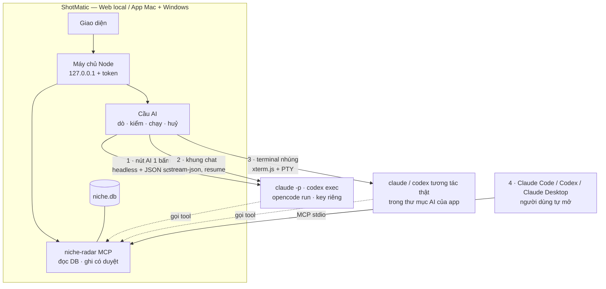

# Phase 27 · AI của bạn — Claude Code, Codex chạy ngay trong app

> **Không bán AI, không tự build AI, không trả tiền AI thay người dùng.** App gọi AI người dùng **đã trả tiền sẵn**
> (gói Claude, ChatGPT / Codex) hoặc key riêng. Học đúng câu của Wow Keywords:
> *"No second subscription — runs on the AI you already pay for."*

Xong 2026-10-27 · 26.1–26.4 + 26.6 phần đầu · Terminal nhúng, sổ dùng AI → Backlog 23

**Hiện có — đỡ được 70 % việc.**

- **Lớp AI chung (Phase 6)** `web/src/lib/ai/providers.ts`: mọi việc AI đi qua 1 hàm `Ask(system, user, schema) → JSON + số đo`.
  Đã có tuyến Claude API (key). Các việc AI hiện có (chủ đề than, tóm tắt, test bán trước, Feature Gap)
  **chỉ cần thêm tuyến mới là chạy**, không sửa việc nào.
- **Job file (tuyến B)**: xuất `.json` → Claude in Chrome / Claude Code đọc → dán kết quả lại. Chạy thật 5 niche, mọi câu
  trích khớp nguyên văn — nhưng phải tay đưa file qua lại.
- **Markdown Viewer** (`apps/ACTIVE/desk-apps/markdown-viewer`, `src-tauri/src/pro/claude.rs` + `src/pro/claude.ts`):
  đã chạy `claude -p --output-format stream-json` bằng **login của người dùng, không key**, tìm `claude` ở mọi chỗ cài
  (kể cả app mở từ Dock không có PATH của Terminal, Windows `claude.exe` / `claude.cmd`), khung chat có resume phiên,
  báo lỗi chưa đăng nhập. **Copy cách làm này sang Node, không viết lại từ đầu.**

**Cần xong trước:** không. Bước 0 làm song song với [Hoàn thiện Web](hoan-thien-web.md). Phase 27 xong thì
[Phase 28](phase-28-ai-tinh-nang.md) mới có máy để chạy.

## 4 cách AI vào app — một bộ máy

| Cách | Người dùng thấy gì | Dùng cho | Đợt |
|---|---|---|---|
| **1 · Nút AI 1 bấm** | bấm "Tóm tắt bằng Claude Code" → vòng xoay → kết quả vào khối | mọi việc AI có khuôn ([Phase 28](phase-28-ai-tinh-nang.md)): chủ đề than, tóm tắt, chấm, gom | đợt 1 |
| **2 · Khung chat** | khung bên phải: "Niche nào trong project này đáng làm nhất?" → trả lời có trích mã nguồn | hỏi dữ liệu bằng lời (thay Phase 27.4) | đợt 1 |
| **3 · Terminal nhúng** | tab Terminal trong app, `claude` chạy thật, đã nối sẵn dữ liệu + skill | người rành muốn tự lái: viết research, spec, chạy skill `/app-demand` | đợt 2 |
| **4 · MCP cho AI bên ngoài** | nút "Thêm vào Claude Code / Codex / Claude Desktop" 1 bấm | người quen làm trong Claude Code / Claude Desktop của họ (Wow Keywords: "Give your AI agent access to your keywords") | đợt 1 |

**Claude in Chrome** giữ làm đường dự phòng (job file như hiện tại, thêm trang `/ai-brief` dễ đọc cho extension) —
không đầu tư thêm, vì app không gọi được extension, phải người bấm.

## Bước 0 — đo trước khi xây (1–2 ngày)

Chạy **bài thử chuẩn của Phase 6** (110 review 1–2★ `budget tracker` → chủ đề than + câu nguyên văn, kiểm bằng cùng
một hàm) trên từng tuyến. Ghi: chạy được không · JSON đúng khuôn mấy lần / 5 · câu trích khớp · thời gian · máy cần gì.

| Tuyến | Lệnh headless (đã xem `--help` trên máy 2026-10-26) | Cần đo |
|---|---|---|
| Claude Code 2.1.269 | `claude -p --output-format stream-json --verbose --json-schema <schema> --strict-mcp-config --mcp-config <file> --allowedTools "mcp__niche-radar__*" --no-session-persistence` | JSON đúng khuôn 5/5? lỗi chưa đăng nhập / hết lượt trả ra sao |
| Codex 0.162.0 | `codex exec --json --output-schema <file> --ephemeral --skip-git-repo-check -s read-only` | như trên · đọc được MCP không |
| OpenCode | `opencode run …` — **máy chưa cài, chưa xem cờ** | cài thử, ghi cờ thật |
| Gemini CLI | `gemini -p …` — máy có cài | có đáng thêm không (Wow Keywords không có) |
| Key riêng (BYOK) | Claude API — đã có code | chạy thật lần đầu khi có key |

### Kết quả Bước 0 (đo 2026-10-26, MacBook M1 Pro 16 GB)

Bài thử: lượt tra #14 `budget tracker`, **110 review 1–2★** của 6 app top → `complaintThemes()` (cùng prompt, schema, hàm
kiểm câu trích như Phase 6). Mỗi tuyến chạy **5 lần**. Lệnh: `npx tsx scripts/ai-bench.ts 14 <claude-code|codex> - 5`.
Hai tuyến mới nằm ở `web/src/lib/ai/cli.ts` (`claudeCodeAsk`, `codexAsk`, `loginStatus`) — cùng chữ ký `Ask` nên mọi
việc AI cũ chạy được ngay.

| | Codex 0.162.0 | Claude Code 2.1.269 |
|---|---|---|
| Đăng nhập | gói ChatGPT | gói Claude Pro · model mặc định `claude-sonnet-5` |
| JSON đúng khuôn | 5/5 | 5/5 |
| Câu trích khớp nguyên văn | 150/150 (100 %) | 120/120 (100 %) |
| Số chủ đề mỗi lần | 10 · 10 · 10 · 10 · 10 | 9 · 8 · 8 · 8 · 7 |
| Thời gian mỗi lần | 23 · 37 · 37 · 64 · **387** giây · trung vị 37 | 112 · 91 · 99 · 80 · 130 giây · trung vị 99 |
| Token vào / ra | ~30k / 1,4–2,2k | 28–33k / 8,5–13,8k |
| Tiền của mình | 0 đ | 0 đ |
| Quyết | **bật** | **bật** |

So với job Claude (tuyến B, Phase 6): 10 chủ đề, 22/22 câu khớp, nhưng vài phút và phải có người đưa file → giữ làm dự phòng.

Chủ đề hai bên **cùng ý chính**: bị trừ tiền / khó huỷ đăng ký (Rocket Money), không đồng bộ ngân hàng (Wallet), hỗ trợ
toàn bot, ứng tiền bị từ chối (Cleo, Albert), quảng cáo dày, mất giao dịch. Codex tách mịn hơn (10 chủ đề, thêm "thiếu
tính năng"); Claude Code gộp thành 7–9.

**Lỗi đo thật** (`loginStatus` + chạy thử với thư mục cấu hình trống):

| Tình huống | Claude Code | Codex |
|---|---|---|
| Chưa cài | báo "Máy chưa cài Claude Code" sau 4 ms | báo "Máy chưa cài Codex" sau 6 ms |
| Chưa đăng nhập — chạy thẳng | báo đúng "chưa đăng nhập" sau 0,8 giây | báo đúng nhưng **sau 20 giây** |
| Chưa đăng nhập — kiểm trước | `claude auth status` JSON `loggedIn`, 0,3 giây | `codex login status` exit 1, 0,06 giây |
| Hết lượt | chưa gặp thật — test bằng CLI giả (`tests/ai-cli.test.ts`) | như bên trái |

**Rút ra cho phần xây (A2.1):**

- Nút **Kiểm tra** gọi `loginStatus` trước (dưới 1 giây) rồi mới hỏi thử — không để Codex treo 20 giây
- `claude auth status` có **email + tên tổ chức** của người dùng → chỉ đọc `loggedIn`, cách đăng nhập, loại gói; không lưu, không log
- Chạy **sạch**: thư mục tạm trống, Claude Code `--tools "" --strict-mcp-config --setting-sources ""`, Codex
  `--ignore-user-config --ignore-rules -s read-only`. Không có cờ này Codex nạp cả MCP của máy (lỗi đăng nhập Vercel,
  Atlassian) và tốn thêm token nền
- Mỗi việc AI chạy **1–2 phút** (Claude Code) → UI phải có thanh tiến độ + nút Dừng, không bắt người dùng nhìn vòng xoay im
- Codex có lần chậm bất thường (387 giây — lúc đó 2 tuyến chạy cùng lúc) → đặt hạn 10 phút / việc, quá hạn thì dừng + báo
- Claude Code ra nhiều token hơn (8–14k vs 1,4–2,2k) vì model nghĩ lâu hơn → thử `--effort low` khi làm A2.1, đo lại cùng bài
- `--json-schema` (Claude Code) và `--output-schema` (Codex) đều cho JSON đúng 10/10 lần → **không cần** thử lại / sửa JSON bằng prompt

**Chưa đo ở Bước 0:** OpenCode (máy chưa cài) · Gemini CLI · key riêng · MCP + khung chat (đo khi
làm A2.3 / A2.4). Mới đo **1 niche** — chạy thêm 2 niche khi làm việc 1 bấm ở Phase AI cho từng tính năng.

**Ghi nhớ khi đo**

- **Không dùng `--bare`** của Claude Code: chế độ này chỉ nhận `ANTHROPIC_API_KEY`, bỏ OAuth → người dùng gói Claude
  sẽ báo chưa đăng nhập
- Tuyến nào JSON sai khuôn > 1/5 hoặc câu trích khớp < 95 % → không bật, ghi lý do
- Ghi bảng kết quả vào chính trang này kèm ngày, như Bước 0 Phase 6

## Làm gì

### 26.1 · Cầu AI (máy chủ Node)

- **Dò AI trên máy:** cổng sang Node đúng thứ tự tìm của Markdown Viewer — chỗ cài thường gặp → `nvm` → shell đăng nhập
  (`$SHELL -lic "command -v claude"`); Windows: `claude.exe` native → `npm\claude.cmd` (chạy `node cli.js`, không qua
  `.cmd`) → `where`. Làm tương tự cho `codex`, `opencode`
- **Kiểm tra thật:** nút **Kiểm tra** hỏi 1 câu ngắn có schema; "Sẵn sàng" chỉ khi trả JSON đúng. Lỗi gọi đúng tên:
  *chưa cài* (kèm lệnh cài 1 dòng) · *chưa đăng nhập* (mở Terminal chạy `claude` 1 lần) · *hết lượt / rate limit*
  (kèm giờ thử lại nếu CLI báo) · *key sai*
- **Tuyến mới = `Ask` mới:** `claudeCodeAsk`, `codexAsk`, `opencodeAsk` cùng chữ ký với `claudeAsk` → mọi
  việc AI cũ chạy được ngay, test bằng `Ask` giả như hiện có
- **Hàng đợi:** 1 việc AI chạy một lúc (không bắn 10 tiến trình `claude` làm cạn lượt của người dùng), nút **Dừng** giết
  tiến trình, thoát app thì dọn hết tiến trình con (đã có bài học "server mồ côi" ở Phase 17)
- **Báo trước khi chạy:** "Chạy bằng Claude Code của bạn · ~42k token · tính vào gói Claude của bạn". Tuyến key riêng
  thì ước tiền + `--max-budget-usd` làm trần

### 26.2 · Thư mục AI của app

Một thư mục cố định cho mọi tiến trình AI làm việc (cwd): `~/Library/Application Support/niche-radar/ai/` (Windows:
`%APPDATA%\niche-radar\ai\`), app tự tạo:

- `CLAUDE.md` + `AGENTS.md` (Codex đọc file này): ShotMatic là gì, dữ liệu nằm đâu, luật "AI không đưa số, mọi câu
  phải có mã nguồn"
- `.mcp.json`: trỏ tới niche-radar MCP
- `.claude/skills/`: bộ skill chọn niche (đúng thứ đã hứa gửi kèm email dùng thử — `/app-demand`, quy trình chọn niche),
  bản tiếng Anh

Nhờ vậy khung chat, terminal nhúng và Claude Code bên ngoài **cùng hiểu một kiểu** về dữ liệu.

**Kết quả 26.2 (2026-10-26) — xong**

- Code `web/src/lib/ai/ai-dir.ts`; khối **Cài đặt → Thư mục AI** (`AiDirSection.tsx`) hiện đường dẫn, lệnh `cd … && claude`
  để copy, từng file và việc của nó
- Thư mục: Web dev `web/data/ai` · app Mac `~/Library/Application Support/niche-radar/ai` (theo `NR_DATA_DIR`)
- App tạo `CLAUDE.md`, `AGENTS.md`, `.mcp.json`, 2 skill tiếng Anh `/app-demand` · `/compare-niches`. Chữ nằm trong code để
  esbuild gói vào app Mac, không đọc file mẫu
- File có dòng `niche-radar:auto` = của app, mỗi lần mở ghi bản mới nhất (đổi đường dẫn DB thì `.mcp.json` tự sửa). Người dùng
  xoá dòng đó = file của họ, app không ghi đè, khối Cài đặt ghi "bạn đã sửa"
- Test `tests/ai-chat.test.ts`: tạo đủ file, chạy lần 2 không đổi gì, cập nhật file của app nhưng không đụng file người dùng

### 26.3 · niche-radar MCP (gộp Phase 27.3)

- Server MCP stdio, chạy bằng Node đi kèm app, đọc `niche.db`
- **Tool chỉ đọc** (theo [Phase 27.3](../web/phase-27-3-mcp.md)): `search_niches` · `get_research` · `get_explore` ·
  `list_projects` / `get_project` · `get_competitor` · `get_complaints` · `get_gaps` (Reddit / Q&A / GitHub) · `get_decision`.
  Mọi kết quả kèm mã nguồn (id lượt tra, ngày, link) để AI trích lại được; cắt bớt + báo "còn X dòng"
- **Tool ghi — chỉ 3, đợt 2:** `collect_to_project`, `start_research` (chạy tra niche mới), `save_ai_result` (ghi kết
  quả vào khối, đi qua cùng hàm kiểm trích dẫn của app). Không có tool xoá. Bộ đủ: [Phase 28.2](../web/phase-28-2-mcp-write.md)
- **Nút "Thêm vào …" 1 bấm** trong Cài đặt → AI: chạy `claude mcp add niche-radar …` / ghi `~/.codex/config.toml` /
  ghi file cấu hình Claude Desktop — hiện lệnh sẽ chạy trước, bấm mới ghi. Trang Cách dùng có lệnh tay cho Cursor,
  Windsurf

**Kết quả 26.3 (2026-10-26) — đợt 1 xong: 10 tool chỉ đọc + nút Thêm 1 bấm cho Claude Code, Codex**

- **Server:** `web/src/mcp/server.ts` (stdio) + `web/src/mcp/tools.ts`. Tool: `search_niches` · `get_research` ·
  `get_complaints` · `get_evidence_pack` · `list_explorations` · `get_explore` · `list_projects` · `get_project` ·
  `get_decision` · `get_gaps` (reddit / qa / github). Dùng lại đúng hàm của web, không query thứ hai. Mọi kết quả có
  `Research #id · niche · nước · ngày` + link store / Trends; quá 20 000 ký tự thì cắt + báo "còn X ký tự".
- **Chỉ đọc thật:** mở `niche.db` read-only + `PRAGMA query_only`, không migrate. Test: lệnh ghi qua kết nối này → lỗi.
  Ghi chú riêng của project chỉ trả khi gọi `includeNotes: true`. Chưa có tool ghi (để đợt 2)
- **Nút Thêm:** Cài đặt → **Cho AI của bạn đọc dữ liệu (MCP)**. Mỗi CLI hiện trạng thái (Đã thêm · Chưa thêm · Đang trỏ
  bản cũ · Máy chưa cài) và **đúng lệnh sẽ chạy** — bấm mới chạy `claude mcp add -s user …` / `codex mcp add …` (có bản cũ
  thì gỡ trước). Claude Desktop / Cursor / Windsurf: thêm nút 1 bấm cùng ngày (xem dưới)
- **Nút Thêm cho Claude Desktop / Cursor / Windsurf (2026-10-26):** 3 app này không có lệnh `mcp add` → gộp khối
  `mcpServers["niche-radar"]` vào `claude_desktop_config.json` (Mac `~/Library/Application Support/Claude/`, Windows
  `%APPDATA%\Claude\`) · `~/.cursor/mcp.json` · `~/.codeium/windsurf/mcp_config.json`. Trang hiện đường dẫn file + khối sẽ
  ghi, bấm mới ghi. Chỉ đụng khối `niche-radar`, giữ mọi server / khoá khác, sao lưu `….bak-niche-radar`, ghi qua file tạm rồi
  đổi tên; file lỗi JSON (có chú thích…) → báo "File cấu hình lỗi", không ghi. Chưa có thư mục app → "Máy chưa cài".
  Code `web/src/lib/ai/mcp-config.ts`, test `tests/mcp.test.ts`
- **Chạy ở đâu:** Web dev → Node + `tsx` chạy thẳng `src/mcp/server.ts`; app Mac → Node đi kèm + `server/mcp.cjs`
  (`build-mac.sh` gói bằng esbuild và thử `tools/list` trước khi ký). Luôn kèm `NICHE_DB` tuyệt đối
- **Chạy thật trên DB thật (2026-10-26):** bấm Thêm ở cả 2 → `mcp get` báo đúng; hỏi "So 3 niche tôi tra gần nhất — niche
  nào đáng làm nhất, trích nguồn từng số":

| | Claude Code 2.1.269 | Codex 0.162.0 |
|---|---|---|
| Thời gian | 56 giây · 12 lượt | 36 giây · 4 lần gọi tool |
| Tool đã gọi | search_niches, list_explorations, get_explore, get_research… | search_niches, get_evidence_pack × 3 |
| Số trích kiểm tay | Research #25 điểm 3.8 "yếu", Tiền 3.5, Cạnh tranh 4.7, Nhu cầu 5.0 · #13 điểm 5.7 — **khớp DB** | Research #30 Trends giảm, #32 Trends TB 5/100 — có link nguồn từng câu |

- Hai AI hiểu "3 niche gần nhất" khác nhau (Claude Code lấy 3 lượt Explore, Codex lấy 3 Research) — mô tả tool nên nói rõ
  hơn nếu thấy lặp lại. Thử 2 câu mẫu còn lại khi làm khung chat (26.4)
- Test: `web/tests/mcp.test.ts` (14 test: từng tool, chặn ghi, cắt kết quả, lệnh add, gỡ bản cũ, API 403 khi Origin lạ);
  thử tay: `npx tsx scripts/mcp-smoke.ts [niche.db]`

### 26.4 · Khung chat (gộp Phase 27.4)

- Mở ở mọi trang (Research, Project, Gap) — câu hỏi kèm ngữ cảnh "đang xem gì" (như `contextFor` của Markdown Viewer)
- Chạy `claude -p … --output-format stream-json --resume <phiên>` trong thư mục AI, chỉ được dùng tool MCP chỉ đọc +
  Read → **không sửa file, không chạy lệnh**
- Hiện từng bước (gọi tool gì) như Markdown Viewer; mã nguồn trong câu trả lời bấm được → nhảy tới đúng dòng dữ liệu
- Codex: cùng khung, chạy `codex exec --json` (đo ở Bước 0 xem resume được không)

**Kết quả 26.4 (2026-10-26) — code xong, chạy thật Codex trên DB thật**

- Code `web/src/lib/ai/chat.ts` (chạy CLI, đọc luồng sự kiện) + `ChatPanel.tsx` (nút **Hỏi AI** ở mọi trang, bản demo tĩnh không có)
  + API stream NDJSON; thử ngoài UI: `npx tsx scripts/chat-smoke.ts <claude-code|codex> "<câu hỏi>"`
- **Chỉ đọc:** Claude Code chỉ được Read + Skill + tool `niche-radar` (MCP strict, bỏ cấu hình riêng của người dùng); Codex chạy
  sandbox read-only, bỏ config riêng, MCP truyền bằng `-c`. Câu hỏi đi qua stdin (không lộ trên `ps`)
- Câu hỏi kèm "đang xem gì" (`[Đang xem: Research #25]`), hiện từng bước gọi tool, `Research #id` / `Project #id` / `Explore #id`
  trong câu trả lời bấm được → nhảy tới đúng trang; hỏi tiếp giữ phiên (`--resume`); nút Dừng giết tiến trình
- 3 câu mẫu: so 3 niche gần nhất · đối thủ của niche đang xem bị chê gì · project nào có bàn quyết định
- Nhật ký AI ghi việc · tuyến · token · thời gian, không ghi câu hỏi / câu trả lời; Claude Code / Codex tính $0 (vào gói người dùng)
- **Chạy thật (2026-10-26, Codex 0.162.0, `web/data/niche.db`):** "Có bao nhiêu niche đã tra? Kể 3 cái mới nhất, kèm nguồn" →
  16 giây, 1 lần gọi `search_niches`, trả "32 lượt tra" + Research #32 / #31 / #30 — **khớp DB** (đếm `runs` = 32)
- **Lỗi bắt được khi chạy thật:** lần đầu DB chưa chạy migration 0019 → tool báo `no such column: apps.content_rating`. Sửa:
  MCP so số migration lúc mở, DB cũ thì báo "dữ liệu cũ hơn bản app — mở app ShotMatic 1 lần rồi thử lại" (+ test)
- Test `tests/ai-chat.test.ts` (8 test chung với 26.2: tham số 2 tuyến, đọc luồng 2 kiểu, Dừng, lỗi đăng nhập, API 400/403, nhật ký không có nội dung)
- **Chưa làm:** thử Claude Code qua khung chat trong UI + 2 câu mẫu còn lại; screenshot khung chat ở 1340 / 375

### 26.5 · Terminal nhúng — "hết nước chấm" (đợt 2)

- Tab **Terminal** trong app: `xterm.js` ở giao diện + PTY ở máy chủ (`node-pty`; nếu không đóng gói được vào sidecar
  Tauri thì dùng crate `portable-pty` bên Rust), mở `claude` hoặc `codex` tương tác thật, cwd = thư mục AI
- Có sẵn nút lệnh mẫu: "Viết research cho project này", "/app-demand niche đang xem", "So 3 niche tuần này"
- Đây là **AI có quyền như Terminal thật** → chỉ mở khi người dùng bật trong Cài đặt, có dòng cảnh báo, không bao giờ
  có ở bản demo trên web

### 26.6 · Cài đặt → AI (gộp Phase 27.6, 27.7)

- Danh sách AI dò được, trạng thái từng cái, nút Kiểm tra, chọn **AI mặc định** + chọn AI riêng cho từng việc
- Sổ dùng AI: mỗi lần chạy ghi việc gì · niche nào · tuyến · token · thời gian (không ghi nội dung)
- Không nối AI nào → mọi nút AI hiện "Nối AI để dùng" + link Setup; phần không AI chạy đủ
- Bước "Nối AI" trong Setup lần đầu ([Phase 24](../web/phase-24-setup.md)) — Wow Keywords bắt buộc nối 1 AI;
  mình **cho bỏ qua** vì phần không AI vẫn có giá trị

**Kết quả 26.6 (2026-10-26) — đang làm, phần đầu code xong**

- ✅ Nút **Chạy bằng AI** dùng chung (`web/src/components/AiRunButton.tsx`, icon đũa phép) + ô chọn AI có trên máy, mặc định là tuyến ở
  Cài đặt; gắn vào Chủ đề than, Tóm tắt, Test bán trước, Feature Gap. API `GET /api/ai/choices`, các việc AI nhận `{ route }`
- ✅ Tuyến **Gemini CLI** (`geminiAsk`) trong Cài đặt + Kiểm tra máy — cần `GEMINI_API_KEY` vì tài khoản Google cá nhân bị chặn cho CLI
  (`IneligibleTierError`, đo 2026-10-26); khung chat chưa chạy bằng Gemini
- ✅ 414 test xanh, typecheck sạch · ⚪ chưa chạy thật 4 khối bằng từng AI trên DB thật
- ⚪ Còn: sổ dùng AI (token · thời gian từng lần), "Nối AI để dùng" + link Setup khi chưa nối

**Luật an toàn — máy chủ local mở được AI và Terminal thì phải khoá kỹ**

- Máy chủ chỉ nghe `127.0.0.1`; mọi `/api/ai/*` và kết nối Terminal cần **token sinh mỗi lần mở app**; kiểm
  `Host` + `Origin` (chặn trang web lạ trong trình duyệt gọi vào localhost — DNS rebinding)
- Nội dung review / Reddit / GitHub là **chữ không tin được** (có thể chứa câu lừa AI): việc 1 bấm và khung chat **không
  có** tool ghi file / chạy lệnh, nên câu lừa không làm hại được; kết quả luôn đi qua hàm kiểm của app
- Key riêng chỉ trên máy (Keychain ở app Mac, Credential Manager ở Windows, `.env.local` ở Web), không vào log, không
  vào gói xuất
- App **không** đăng nhập thay, không đọc file đăng nhập của Claude / Codex — chỉ gọi CLI người dùng đã tự đăng nhập

**Rủi ro phải kiểm trước khi bán**

- **Chính sách nhà cung cấp:** Anthropic không cho bên thứ ba *cung cấp* đăng nhập Claude.ai hoặc hạn mức gói Claude cho
  sản phẩm của họ khi chưa được duyệt. App mình chỉ chạy `claude` mà người dùng tự cài + tự đăng nhập (như Wow Keywords,
  Markdown Viewer) — nhưng phải đọc lại điều khoản Anthropic + OpenAI ngay trước khi bán, ghi kết luận + ngày vào trang
  này. Đường luôn hợp lệ nếu có vấn đề: **MCP cho AI bên ngoài** (người dùng tự mở Claude Code) + **key riêng**
- **CLI đổi cờ:** Claude Code / Codex ra bản liên tục → khi dò, ghi số phiên bản; test chạy với bản giả (fake CLI in ra
  stream-json mẫu) để biết ngay khi định dạng đổi
- **Windows:** `node-pty` + ConPTY, đường dẫn có dấu cách, `.cmd` — thử trên Windows 11 thật ở [Phase 36](phase-36-windows-app.md)

**Xong khi**

- Bảng Bước 0 điền đủ các tuyến đã thử, có số đo + ngày — **Claude Code + Codex xong 2026-10-26**
- Máy có Claude Code đã đăng nhập: mở app → Cài đặt → AI hiện "Sẵn sàng" sau 1 câu hỏi thử, **không cần key**
- Claude Code chưa đăng nhập → báo "chưa đăng nhập" + cách sửa trong ≤ 10 giây, không quay vòng mãi
- Việc "chủ đề than" cũ chạy 1 bấm qua Claude Code và qua Codex, ≥ 95 % câu trích khớp nguyên văn trên 3 niche
- Khung chat trả lời đúng 5/5 câu kiểm (số khớp UI, mã nguồn có thật) trên DB thật
- Claude Code bên ngoài thêm MCP bằng nút 1 bấm, gọi được mọi tool đọc; thử gọi tool ghi ở đợt 1 → bị chặn
- Gọi `/api/ai/*` không token hoặc từ Origin lạ → 403 (có test)
- Tắt hết AI → toàn bộ test không AI vẫn xanh; kiểm log: không lần gọi AI nào tính tiền vào tài khoản của mình
- Terminal nhúng (đợt 2): mở `claude` trong app Mac + Windows, gõ được, thoát app không để tiến trình mồ côi

**Không làm ở phase này**

- Bán lượt AI, gói AI kèm license, tự trả tiền AI cho người dùng
- Tự chạy model AI kèm trong app (tải model to vào bộ cài)
- Tool xoá dữ liệu qua MCP
- AI tự đổi điểm, kết luận, trạng thái Project mà người dùng chưa duyệt
- Chia sẻ AI cho team

[← Hoàn thiện Web](hoan-thien-web.md) · [Plan bán app](plan-ban-app.md) · [Phase 28 →](phase-28-ai-tinh-nang.md)
