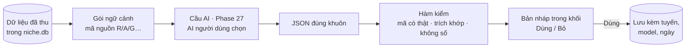

# Phase 28 · AI cho từng tính năng đã làm

> Mỗi tính năng **đã làm** có thêm **một nút AI** làm hộ đúng việc người dùng đang phải tự đọc, tự gom, tự viết.
> Chạy trên AI của người dùng qua bộ máy [Phase 27](phase-27-ai-cua-ban.md). Số vẫn từ collector — AI chỉ đọc chữ,
> gom, giải thích, viết nháp, và **mọi câu đều có mã nguồn đã kiểm bằng code**.

Chưa làm · plan 2026-10-26 · gộp Phase 28.1 + Decision Engine Pro

**Hiện có.** 4 việc AI đã code trong `web/src/lib/ai/tasks.ts`: `themes` (chủ đề than), `summary` (tóm tắt 5 câu),
`presale` (nháp test bán trước), `trustmrr` (chỉ job) + `gap-ai.ts` (Feature Gap). Hàm kiểm trích dẫn đã có
(`cleanSummary`, `cleanPresale`: câu không khớp nguồn bị loại, đếm số bị loại). Bàn quyết định 16b đã có Copy prompt →
dán JSON ngược, kiểm mã nguồn bịa. **Thiếu:** chạy 1 bấm (đang phải xuất job / copy-dán) và AI cho các tính năng còn lại.

**Thêm 2026-10-27 — 4 trang con, làm theo thứ tự**

1. [28.2 · MCP đợt 2](../web/phase-28-2-mcp-write.md) — AI bên ngoài thêm / đề xuất cho niche, project, gap; nhóm việc
   `health_niche_check`, `health_project_check`, `brief_pack` (cũng là ngữ cảnh cho nút AI)
2. [28.3 · Bộ skill Shotmatic](../web/phase-28-3-skills.md) — giữ số; mỗi nút AI chạy 1 skill, nội dung plan riêng
3. [28.4 · Nút AI đũa phép ở từng bước](../web/phase-28-4-ai-magic.md) — **bản đồ chỗ đặt** theo các bước đi tay; 4 nút đợt 1
   dưới đây + Mở rộng niche, Kiểm sức khoẻ niche, Kiểm sức khoẻ project, Brief chạy qua cùng khung này
4. [28.5 · Brief + Spec + Plan](../web/phase-28-5-brief-plan.md) — đầu ra cuối của Project, hỏi lại AI tới khi Chốt
5. [28.6 · AI Agent](../web/phase-28-6-ai-agent.md) — trang Phiên săn: gõ lệnh, AI tra / loại / gom niche bằng tool 28.2,
   cột trái là khối có sẵn theo dải ứng viên

**Cần xong trước:** [Phase 27](phase-27-ai-cua-ban.md) 26.1 (cầu AI) + 26.2 (thư mục AI). Từng dòng còn cần phase gốc của tính
năng đó (ghi ở cột "Gắn với").

## Luật chung cho mọi nút AI

- **AI không đưa số.** Số (rating, lượt tải, giá, điểm, doanh thu) chỉ từ collector. AI trả số → code bỏ
- **Mọi câu có mã nguồn** (`[R12]` review, `[Phase 28]` app, `[G5]` gap…) và code kiểm mã có thật + câu trích khớp nguyên văn;
  câu trượt bị gạch, không ẩn; hiện tỉ lệ khớp (VD 22/22)
- **AI đề xuất, người duyệt.** AI không tự đổi điểm, kết luận, trạng thái Project — hiện bản nháp + nút **Dùng** / **Bỏ**
- **Lưu lại:** mỗi kết quả lưu DB kèm tuyến, model, ngày; tra lại chỉ gửi phần mới (review mới, bài mới)
- **Tắt AI vẫn chạy:** nút AI xám "Nối AI để dùng", phần không AI giữ nguyên
- **Một khuôn JSON cho mọi tuyến** (Claude Code, Codex, Ollama, key) — dùng `--json-schema` / `--output-schema` khi
  CLI có, không thì kiểm JSON bằng code + thử lại 1 lần

## Đợt 1 — trước bản bán đầu (4 nút mạnh nhất)

Chọn theo: người dùng **mất nhiều thời gian nhất** ở đâu, và nút nào làm demo / landing "wow" được.

### 1 · Tóm tắt niche 1 bấm (gộp Phase 28.1)

- **Tính năng gốc:** Research 1 keyword · Tóm tắt niche + chủ đề than (Phase 6)
- **AI làm:** đọc review 1–3★ + mô tả + What's New của top app → **khung 6 mục**: ai dùng · đau gì nhất · đối thủ yếu chỗ
  nào · ai đang thu tiền · khoảng trống nên làm · rủi ro. Mục thiếu dữ kiện ghi "chưa đủ dữ liệu"
- **Kiểm:** mỗi câu ≥ 1 trích dẫn khớp nguyên văn; kiểm chéo chủ đề AI ↔ cụm lời chê không AI (Phase 18) → chủ đề
  không cụm nào đỡ gắn "chỉ AI thấy, nên kiểm"
- **Hiện ở:** đầu trang Research ([Phase 23](../web/phase-23-research-page.md) "đầu trang là câu trả lời")

### 2 · Bàn quyết định 1 bấm (Decision Engine Pro)

- **Tính năng gốc:** Bàn quyết định long-tail ([Phase 16](../web/phase-16-decision-board.md))
- **AI làm:** thay vì Copy prompt → dán JSON, bấm **Chấm bằng AI** → AI chấm 5 trục từng keyword trong Project, mỗi điểm
  có lý do + mã dẫn chứng, ra BUILD / TEST THÊM / BỎ
- **Kiểm:** dùng nguyên luật 16b (sai luật không ghi, mã bịa bị gạch, lệch người chấm ≥ 2 tô vàng)
- **Đo:** fake-door 16b đọc số 2026-11-23 — nút này chính là thứ fake-door đang hứa

### 3 · Gap → ý tưởng app (Reddit · Q&A · GitHub)

- **Tính năng gốc:** Reddit Gap (10), Q&A Gap (10b), GitHub Feature Request Gap (10c)
- **AI làm:** (a) **xếp chuyên mục + chủ đề** cho bài / câu hỏi / issue mà luật từ khoá xếp sai hoặc "khác" (hiện kiểm tay
  10c đạt 87 %); (b) từ top cụm gap → **3–5 ý tưởng app** dạng: vấn đề · ai gặp · bằng chứng (link bài gốc) · app hiện
  có thiếu gì · keyword nên tra tiếp → nút **Research keyword này** / **+ Collect**
- **Kiểm:** link bài gốc phải có trong DB; số 👍 / lượt xem lấy từ DB, không từ AI; so nhãn AI với luật trên 30 bài
  kiểm tay — AI phải ≥ luật mới bật mặc định

### 4 · Feature Gap tự điền

- **Tính năng gốc:** Feature Gap Matrix ([Phase 4](../web/phase-4-feature-gap.md)) — tuyến A đã code, chờ key
- **AI làm:** điền ô Có / Không / Không nói cho top 5 app × 10 tính năng từ trang store (giờ qua Claude Code / Codex,
  không cần key); đề xuất 3 tính năng nên thêm vào hàng
- **Kiểm:** ô "Có" phải có câu nguồn khớp nguyên văn từ trang store, không thì về "Không nói" (luật hiện có)

## Đợt 2 — bản cập nhật sau khi bán

| Tính năng đã làm | Nút AI thêm gì | Kiểm bằng code | Gắn với |
|---|---|---|---|
| **Explore niche** | gộp keyword cùng nghĩa, bỏ tên thương hiệu / từ lạc, đặt tên cụm, gợi ý 10 long-tail nên tra tiếp | keyword gợi ý phải có trong gợi ý Play / Google đã thu; cụm không mất keyword nào | [Phase 40](../web/phase-40-explore-tree.md) |
| **Đối thủ bị chê gì** | gộp lời chê cùng ý nhiều thứ tiếng, tách lỗi / thiếu tính năng / giá, rút câu "ước gì" từ review 3★ | mỗi cụm có câu trích khớp; đếm review từ DB | [Phase 18](../web/phase-18-competitor-complaints.md) |
| **Mức nặng chủ đề than** | gán mức nặng ×3 / ×2 / ×1 theo nghĩa thay vì từ khoá | lệch với luật từ khoá → tô vàng để người xem | Phase 9 |
| **Chấm sức khoẻ niche** | giải thích điểm bằng lời thường + **phản biện** "vì sao điểm này có thể sai" | không đổi điểm; mọi lý do trỏ về yếu tố + số có thật | [Phase 20](../web/phase-20-niche-health.md) |
| **Điểm v2 · 2 trục tự chấm** | gợi ý điểm Tiếp cận khách (kênh nào, cộng đồng nào) + lý do có link | người bấm Dùng mới ghi; link phải có trong dữ liệu gap / Reddit | Phase 9 |
| **Mô hình tiền của niche** | đọc mô tả + gói IAP phân loại các app đang "Chưa biết" | chỉ đổi khi có câu nguồn; giá từ collector | Phase 9 |
| **Doanh thu TrustMRR** | khớp tên app ↔ startup có doanh thu, gắn verified vs ước | tên + link phải có trong dữ liệu đã thu; tiền từ nguồn, không từ AI | [Phase 38](../web/phase-38-revenue.md) |
| **Theo dõi định kỳ** | đọc khác biệt giữa 2 lần chụp → 3 dòng "điều gì đổi đáng chú ý" | mọi dòng trỏ về 1 thay đổi có thật trong `project_snapshots` | [Phase 42](../web/phase-42-tracking.md) |
| **Collect vào Project** | gợi ý gom: "8 keyword này là cùng 1 app", đề xuất tên project | không tự gom — người bấm | [Phase 21](../web/phase-21-collect.md) |
| **Đánh giá Project** | viết nháp Kết luận + Bước tiếp từ ghi chú + số + bàn quyết định | nháp, người sửa rồi lưu | [Phase 22](../web/phase-22-project-manage.md) |
| **Xuất cho AI + brief** | nút **Gửi thẳng cho AI** (khỏi copy file); AI viết brief tính năng 7 mục | brief giữ mã nguồn, kiểm như 16b | [Phase 15](../web/phase-15-export.md) |
| **Evidence pack + test bán trước** | viết nháp landing fake-door + bài X / Reddit (việc `presale` có sẵn) | câu nhắc đối thủ / lời chê phải có nguồn | [Phase 43](../web/phase-43-evidence-presell.md) |

**Không thêm AI** (cố ý, không ép): Backup / restore, Tải CSV, App Mac, Google Trends (số thuần).

## Cách gắn một nút AI (giống nhau mọi tính năng)

Mỗi nút = 1 việc trong `tasks.ts` (prompt + schema + hàm kiểm) + 1 test bằng `Ask` giả + 1 lần chạy thật trên 3 niche.

**Xong khi — đợt 1**

- 4 nút chạy 1 bấm qua Claude Code **và** Codex trên 3 niche thật, ≥ 95 % câu trích khớp nguyên văn, 0 số do AI đưa
- Tóm tắt 6 mục hiện đầu trang Research; tra lại sau 7 ngày (giả lập) chỉ gửi review mới
- Bàn quyết định 1 bấm cho cùng kết quả kiểm như bản dán JSON 16b trên project RAM 5 keyword
- Gap → ý tưởng: kiểm tay 30 nhãn, AI ≥ luật từ khoá; mỗi ý tưởng có ≥ 2 link bài gốc có thật
- Không nối AI → 4 nút xám, mọi test không AI xanh

**Xong khi — đợt 2:** mỗi dòng bảng đợt 2 qua phần "Kiểm bằng code" của nó trên 3 niche thật.

**Không làm ở phase này**

- AI tự chạy theo lịch khi người dùng không bấm (tốn lượt của họ) — xét sau khi có góp ý
- AI viết số liệu, đoán lượt tải / doanh thu
- Nguồn mới (YouTube, Amazon, Maps) — Version 2

[← Phase 27](phase-27-ai-cua-ban.md) · [Plan bán app](plan-ban-app.md)
