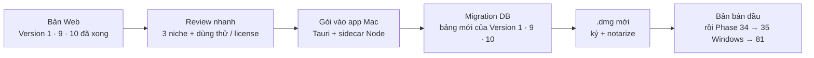

# Phase 33 · Local App 2.0

> Sau khi bản Web **xong Version 10**, đóng gói phần còn lại của Version 1 (Phase 7, 9–44) + Version 9 (analytics) + Version 10 (dùng thử, license) vào **app Mac** một lần — như Phase 17 đã làm cho Phase 1–6. Đây là **bản bán đầu tiên**.
>
> **Đổi 2026-10-26:** Version 2 (YouTube, Amazon, Maps) không gói ở đây nữa — vào app qua bản cập nhật [Phase 36](phase-36-release-auto-update.md) khi làm xong.

Chưa làm · sau Phase 17 · khi xong Version 10

## Chạy thế nào

## Làm gì

| | |
|---|---|
| :material-check-all: **Review trước khi gói** | 3 niche thật chạy hết luồng Version 1 + dùng thử / license của Version 10 ở bản Web, ghi lỗi còn lại |
| :material-package-variant: **Gói vào app** | collector mới của Version 1 (Reddit, Q&A, GitHub Gap…) vào sidecar; kiểm dependency native đi kèm |
| :material-database-arrow-up: **Migration DB** | bảng mới dùng ULID; mở app 1.x cũ lên 2.0 không mất dữ liệu |
| :material-key: **Cài đặt key** | key AI nhập trong app; lưu trong Keychain làm ở [Phase 34](phase-34-app-only.md) (cùng lớp dùng cho Windows) |
| :material-google-chrome: **Job Claude in Chrome** | xuất / nhập file job từ app (nút "Mở thư mục job") |
| :material-apple: **Phát hành** | `.dmg` mới ký + notarize, ghi What's New |

**Xong khi**

- App 1.x có dữ liệu thật → cài 2.0 → dữ liệu còn đủ, đếm từng bảng trước / sau
- Trên app: tra 1 niche ra đủ các khối của Version 1 (khối nào bị chặn thì báo đúng); dùng thử chạy, nhập key test → Pro
- Mở ≤ 5 giây, test xanh, bản web vẫn chạy

**Không làm ở phase này**

- Tính năng tra cứu mới (chỉ gói những gì Version 1, 9, 10 đã xong ở Web)
- Auto-update ([Phase 36](phase-36-release-auto-update.md)), bản Windows ([Phase 35](phase-35-windows-app.md) — làm sau 79)

Plan code chi tiết: [Phase 33](../superpowers/plans/2026-10-25-niche-radar-phase75-local-app-2.md)
