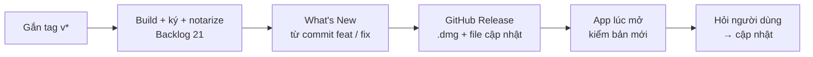

# Phase 36 · Release + auto-update

> Một lệnh trên máy (`npm run release`) ra bản cho **cả Mac và Windows**: `.dmg` + `.exe` lên GitHub Releases public kèm
> What's New. App trên máy người dùng (Mac lẫn Windows) tự thấy bản mới và hỏi trước khi cập nhật.

Chưa làm · sau Phase 35

> **Đổi 2026-10-26:** không CI (Backlog 21 không làm) — build + ký trên máy bằng 1 lệnh rồi đẩy lên **GitHub Releases
> public**, kèm `.exe` Windows ([Phase 35](phase-35-windows-app.md)). Học Wow Keywords: ra bản dày, ghi chú bằng lời
> thường, app tự cập nhật.

## Chạy thế nào

## Làm gì

| | |
|---|---|
| :material-tag: **Ra bản 1 lệnh** | `npm run release` chạy trên máy: `npm run mac` + `npm run win` → ký file cập nhật → GitHub Release (anh duyệt What's New trước khi đăng) |
| :material-text-box-outline: **What's New** | sinh từ commit `feat` / `fix` kể từ tag trước |
| :material-github: **GitHub Release** | repo Releases public riêng (code vẫn private), đính `.dmg` + `.exe` + What's New + file cập nhật + `latest.json` 2 nền tảng |
| :material-update: **Tauri updater** | (bộ tự cập nhật của Tauri) app Mac + Windows kiểm bản mới lúc mở, hỏi trước khi cập nhật |
| :material-signature: **Chữ ký file cập nhật** | file cập nhật có chữ ký, app chỉ nhận file đúng chữ ký. Khoá ký do anh tạo, giữ trên máy anh (không vào repo) |

**Xong khi**

- Cài bản `x.y.0` trên Mac **và** Windows → ra `x.y.1` → cả hai app báo có bản mới và cập nhật được, dữ liệu còn đủ
- Từ lúc chạy `npm run release` tới lúc `.dmg` + `.exe` có trên Releases không cần thao tác tay nào khác (ngoài duyệt What's New)
- What's New trên Release chỉ gồm commit `feat` / `fix`
- Người dùng bấm "Để sau" → app vẫn chạy bản cũ bình thường

**Không làm ở phase này**

- Claude tự gắn tag hay bấm phát hành khi anh chưa đồng ý
- Cập nhật ngầm không hỏi
- Linux, Mac App Store, Microsoft Store
- Deploy bản Web lên mạng

[Mục App Mac + Windows](index.md)

Plan code chi tiết: [Phase 36](../superpowers/plans/2026-10-25-niche-radar-phase81-release-auto-update.md)
