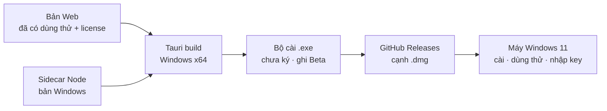

# Phase 36 · App Windows (Beta)

> Cùng app Tauri, build thêm cho **Windows 11 x64** để có thêm khách ngoài người dùng Mac. Ra **Beta chưa ký** trước
> như Wow Keywords (họ có 60 lượt tải bản Windows trong 3 ngày, 2026-10-24 → 26) — mua chứng chỉ ký Windows sau khi có đơn.

Chưa làm · plan 2026-10-26 · sau Phase 35

## Chạy thế nào

**Chưa ký** = Windows SmartScreen hiện cảnh báo "Windows protected your PC", người dùng bấm "More info → Run anyway".
Trang tải ghi rõ điều này, như Wow Keywords ghi "unsigned, so Windows may show a security warning".

## Làm gì

- **Build:** Tauri bundle Windows (NSIS `.exe`) — build trên máy Windows / máy ảo, hoặc runner Windows chỉ khi cần
  (chốt ở plan, không dựng CI đầy đủ)
- **Sidecar Node:** gói bản Node cho Windows, đường dẫn DB + backup dùng thư mục `%APPDATA%`
- **Lưu key + ngày dùng thử:** Windows Credential Manager thay Keychain
- **Tìm AI:** Claude Code / Codex / Ollama trên Windows (đường dẫn khác Mac)
- **Trang tải:** nút "Windows 11 · x64 · Beta" cạnh nút Mac, ghi cảnh báo SmartScreen + cách mở
- **File:** cấu hình bundle Windows trong `app/` · chỗ lưu key theo hệ điều hành ở lớp license (Phase 35)

**Xong khi**

- Cài `.exe` trên máy Windows 11 sạch → mở được, dùng thử chạy, tra 1 niche ra số
- Nhập key test → Pro, máy Windows tính là 1 trong 2 máy của license
- Gỡ cài đặt → không để lại server chạy nền
- Screenshot app trên Windows đã Read

**Không làm ở phase này**

- Mua chứng chỉ ký Windows trước khi có đơn
- Microsoft Store
- Windows 10, máy ARM, bản 32-bit
- Tính năng chỉ có trên Windows

[Mục App Mac + Windows](index.md)

Plan code chi tiết: [Phase 36](../superpowers/plans/2026-10-26-niche-radar-phase82-windows-app.md)
