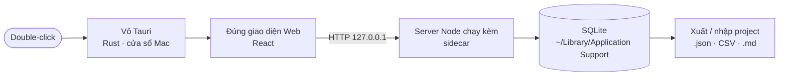

# Phase 56 · Local App 1.0 (app Mac)

> Đóng gói bản Web thành **app Mac bấm là mở** — không cần Node, không gõ lệnh. Trước là phần app của Phase 8; phần
> Project + xuất / nhập + backup ở lại Web: [Phase 8](../web/phase-8-project-data.md). Thuộc Version 13, làm sau khi hết phase Web.

Code xong sớm 2026-10-25 · thử máy mới để sau khi Web xong hết

## Chạy thế nào

## Chọn công nghệ

| | Đề xuất | Vì sao |
|---|---|---|
| Vỏ app | **Tauri** (lõi Rust) | nhẹ hơn Electron nhiều, dùng WebView sẵn của macOS |
| Giao diện | dùng lại React của bản Web | không viết 2 lần |
| Lấy dữ liệu | server Node chạy kèm (sidecar) | giữ nguyên collector đã test ở Phase 1–6 |
| Viết lại collector bằng Rust | **chưa** — chỉ xét khi gói Node làm app quá nặng | viết lại = rủi ro hỏng dữ liệu đã chạy đúng |
| Nền tảng | **macOS trước** (ký Developer ID + notarize, `.dmg`) | anh dùng Mac; Windows khi có người dùng thật |

## Làm gì

| | |
|---|---|
| :material-apple: **App Mac** | Tauri + sidecar Node, `.dmg` ký + notarize |
| :material-database: **Dữ liệu** | dùng chung định dạng Phase 8, nằm ở `~/Library/Application Support/niche-radar/` |

**Xong khi**

- Tài khoản macOS mới chưa cài Node: mở `.dmg` → bấm icon → tra được 1 keyword, Gatekeeper không cảnh báo
- Mở tới khi bấm được ≤ 5 giây · ghi số RAM lúc nghỉ (mục tiêu ≤ 300 MB)
- Xuất project → nhập máy khác: số dòng bằng nhau, nhập lại không nhân đôi
- Backup → xoá DB → restore đủ · DB thật lên ULID không mất dòng
- Test xanh, bản web `npm run dev` vẫn chạy

**Không làm ở phase này**

- Tính năng tra cứu / chấm điểm mới (đã xong ở Phase 1–7)
- Đăng nhập, sync cloud, license key — [Phase 11](../web/phase-11-account.md)
- Bản Windows, auto-update

## Kết quả (2026-10-25)

- `.dmg` 45 MB (app 119 MB), ký Developer ID + notarize — build bằng `bash scripts/build-mac.sh`
- Mở tới khi server sẵn sàng: ~0,14 giây · RAM nghỉ ≈ 200 MB (app + Node)
- Projects: trạng thái **đang xem / ứng viên / loại**, kết luận, ghi chú · xuất `.niche.json` / `.md` / CSV · nhập lại không nhân đôi
- Cài đặt → **Dữ liệu**: backup ngay, restore, mở thư mục dữ liệu
- Dữ liệu app Mac: `~/Library/Application Support/niche-radar/` (bản web vẫn ở `data/`)
- Còn lại: anh thử `.dmg` trên một tài khoản macOS mới chưa cài Node

[Spec gốc Phase 8 · Local App](../superpowers/specs/2026-10-24-niche-radar-phase8-local-app.md)
