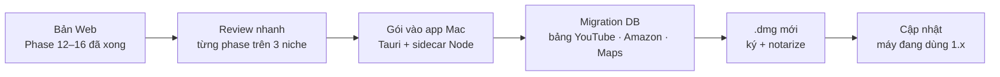

# Phase 57 · Local App 2.0

> Sau khi **hết mọi phase Web**, đóng gói phần còn lại của Version 1 (Phase 7, 9–11.2, 18) và Version 2 (Phase 12–16) vào **app Mac** một lần — như Phase 56 đã làm cho Phase 1–6.

Chưa làm · sau Phase 56 · khi Web xong hết

## Chạy thế nào

## Làm gì

| | |
|---|---|
| :material-check-all: **Review trước khi gói** | 3 niche thật chạy qua Phase 12–16 ở bản Web, ghi lỗi còn lại |
| :material-package-variant: **Gói vào app** | các collector mới vào sidecar; `yt-dlp` (nếu dùng) gói kèm hoặc bỏ |
| :material-database-arrow-up: **Migration DB** | bảng mới dùng ULID; mở app 1.x cũ lên 2.0 không mất dữ liệu |
| :material-key: **Cài đặt key** | YouTube Data API, Places API, AI — nhập trong app, lưu trong Keychain |
| :material-google-chrome: **Job Claude in Chrome** | xuất / nhập file job từ app (nút "Mở thư mục job") |
| :material-apple: **Phát hành** | `.dmg` mới ký + notarize, ghi What's New |

**Xong khi**

- App 1.x có dữ liệu thật → cài 2.0 → dữ liệu còn đủ, đếm từng bảng trước / sau
- Trên app: tra 1 niche ra đủ khối YouTube + Amazon + Maps (khối nào bị chặn thì báo đúng)
- Mở ≤ 5 giây, test xanh, bản web vẫn chạy

**Không làm ở phase này**

- Tính năng tra cứu mới (chỉ gói những gì Phase 12–16 đã xong)
- Auto-update, bản Windows (xét lại khi có người dùng ngoài)

