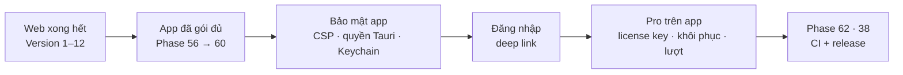

# Phase 61 · Phần riêng của app Mac (bảo mật, đăng nhập, Pro)

> Gom mọi việc **chỉ app Mac mới có** mà các phase Web 11.1, 40, 44, 49–51 đã tách ra: bản Web làm phần chung trước,
> app Mac làm phần riêng ở đây — **sau khi hết mọi phase Web** và sau khi app đã gói đủ tính năng (Phase 56 → 60).

Chưa làm · sau Phase 60 · khi Web xong hết

## Chạy thế nào

## Làm gì

| Việc | Tách từ |
|---|---|
| **Setup trong app** — Node + SQLite đã gói sẵn, chỉ kiểm phần tuỳ chọn (key AI, Ollama, Claude in Chrome) | [Phase 11.1](../web/phase-11-1-setup.md) |
| **CSP chặt** cho WebView Tauri · chỉ mở quyền Tauri cần · key AI giữ trong **Keychain** | [Phase 40](../web/phase-40-security-audit.md) |
| **Đăng nhập trong app** — mở trình duyệt đăng nhập (Google / Apple / email link) rồi quay lại app qua **deep link** | [Phase 44](../web/phase-44-firebase-auth.md) |
| **License key** mẫu RAM Rescue — kích hoạt khi không đăng nhập · **checkout** mở từ app | [Phase 49](../web/phase-49-payments.md) |
| Nút **Khôi phục mua** trong app | [Phase 50](../web/phase-50-paywall-trial.md) |
| **BYOK** key trong Keychain · hiện **lượt AI còn lại** trong app | [Phase 51](../web/phase-51-ai-cost-plans.md) |

**Xong khi**

- `.dmg` mới: CSP + quyền Tauri qua phiếu bảo mật Phase 40, key không còn trong file thường
- Đăng nhập 3 cách trên app, deep link quay lại đúng app
- Mua test → license key kích hoạt được trên app không đăng nhập · khôi phục mua chạy · lượt AI hiện đúng
- Test xanh, screenshot app đã Read

**Không làm**

- Tính năng mới không có ở bản Web
- Mac App Store / thanh toán trong app của Apple
- Làm trước khi hết phase Web

