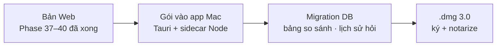

# Phase 76 · Local App 3.0

> Gói Phase 37–39 (Phase 28 gói ở Phase 75; đã soát ở [Phase 40](../web/phase-40-review-3.md)) vào **app Mac** một lần — như
> [Phase 75](phase-75-local-app-2.md) đã làm cho Version 2. Thuộc mục App: **chỉ làm khi bản Web xong Version 9**.

Chưa làm · sau Phase 75 · khi xong Version 9

## Chạy thế nào

## Làm gì

| | |
|---|---|
| :material-package-variant: **Gói vào app** | màn so sánh, ô hỏi, báo cáo vào app Mac |
| :material-database-arrow-up: **Migration DB** | bảng mới (bộ so sánh, lịch sử hỏi, kết quả kiểm trích dẫn) dùng ULID. Mở app 2.x lên 3.0 không mất dữ liệu |
| :material-apple: **Phát hành** | `.dmg` 3.0 ký + notarize, ghi What's New |

**Xong khi**

- App 2.x có dữ liệu thật → cài 3.0 → đếm từng bảng trước / sau, không mất dòng
- Trên app: so 3 niche + hỏi 1 câu + xuất 1 báo cáo chạy được, test xanh, bản Web vẫn chạy

**Không làm ở phase này**

- Tính năng mới (chỉ gói những gì Phase 37–39 đã xong)
- Auto-update ([Phase 81](phase-81-release-auto-update.md)), bản Windows

Plan code chi tiết: [Phase 76](../superpowers/plans/2026-10-25-niche-radar-phase76-local-app-3.md)
