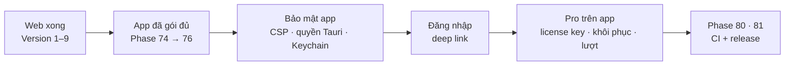

# Phase 79 · Phần riêng của app Mac (bảo mật, đăng nhập, Pro)

> Gom mọi việc **chỉ app Mac mới có** mà các phase Web 11.1, 40, 44, 49–51 đã tách ra: bản Web làm phần chung trước,
> app Mac làm phần riêng ở đây — **sau khi bản Web xong Version 10** và sau khi app đã gói bản bán đầu (Phase 75).

Chưa làm · sau Phase 75 · khi xong Version 10

> **Đổi 2026-10-26:** bỏ tài khoản → bỏ dòng **Đăng nhập trong app / deep link**. Version 10 làm **trước** App, nên
> license key, dùng thử, AI của người dùng làm luôn ở phase này. Ngày dùng thử + key lưu trong Keychain (Windows: Phase 82).

## Chạy thế nào

## Làm gì

> Bản Web xong phần dùng thử + license ở Version 10 trước, phase này gắn phần chỉ app mới có: lưu key + ngày dùng thử
> trong Keychain, mở checkout bằng trình duyệt ngoài, tìm Claude Code / Codex / Ollama trên máy.

| Việc | Tách từ |
|---|---|
| **Setup trong app** — Node + SQLite đã gói sẵn, chỉ kiểm phần tuỳ chọn (key AI, Ollama, Claude in Chrome) | [Phase 30.1](../web/phase-30-1-setup.md) |
| **CSP chặt** cho WebView Tauri · chỉ mở quyền Tauri cần · key AI giữ trong **Keychain** | [Phase 58](../web/phase-58-security-audit.md) |
| **License key** mẫu RAM Rescue — kích hoạt khi không đăng nhập · **checkout** mở từ app | [Phase 67](../web/phase-67-payments.md) |
| Nút **Khôi phục mua** trong app | [Phase 68](../web/phase-68-paywall-trial.md) |
| **BYOK** key trong Keychain · hiện **lượt AI còn lại** trong app | [Phase 69](../web/phase-69-ai-cost-plans.md) |

**Xong khi**

- `.dmg` mới: CSP + quyền Tauri qua phiếu bảo mật Phase 58, key không còn trong file thường
- Mua test → license key kích hoạt được trên app không đăng nhập · khôi phục mua chạy · lượt AI hiện đúng
- Test xanh, screenshot app đã Read

**Không làm**

- Tính năng mới không có ở bản Web
- Mac App Store / thanh toán trong app của Apple
- Làm trước khi bản Web xong Version 10
- Tài khoản, đăng nhập, deep link — bỏ 2026-10-26

Plan code chi tiết: [Phase 79](../superpowers/plans/2026-10-25-niche-radar-phase79-app-only.md)
