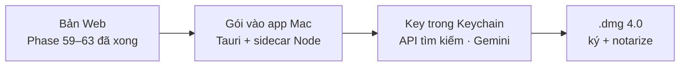

# Backlog 19 · Local App 4.0

> Gói Phase 59–62 (đã soát ở [Phase 63](../web/phase-63-review-4.md)) vào **app Mac** một lần — như
> [Backlog 18](phase-backlog-18-local-app-3.md) đã làm cho Version 3. Thuộc mục App: **chỉ làm khi bản Web xong Version 9**.

Không làm · 2026-10-26

**Không làm (chốt 2026-10-26):** tính năng mới vào app qua bản cập nhật [Phase 37](phase-37-release-auto-update.md), không gói theo version. Trang giữ lại để tra, không code.

## Chạy thế nào

## Làm gì

| | |
|---|---|
| :material-package-variant: **Gói vào app** | collector top 10, kệ AI, cột kệ yếu, nút xuất gói GEO |
| :material-console: **Engine trên máy** | `codex exec` / `claude -p` có trên máy thì dùng, không có thì ẩn engine đó, Gemini vẫn chạy |
| :material-database-arrow-up: **Migration DB** | bảng top 10, câu trả lời AI, điểm kệ (ULID). Mở app 3.x lên 4.0 không mất dữ liệu |
| :material-apple: **Phát hành** | `.dmg` 4.0 ký + notarize, ghi What's New |

**Xong khi**

- App 3.x có dữ liệu thật → cài 4.0 → đếm từng bảng trước / sau, không mất dòng
- Trên app: tra kệ Google + kệ AI cho 1 niche chạy được, test xanh, bản Web vẫn chạy

**Không làm ở phase này**

- Tính năng mới (chỉ gói những gì Phase 59–62 đã xong)
- Auto-update ([Phase 37](phase-37-release-auto-update.md)), bản Windows

Plan code chi tiết: [Backlog 19](../superpowers/plans/2026-10-25-niche-radar-phase77-local-app-4.md)
