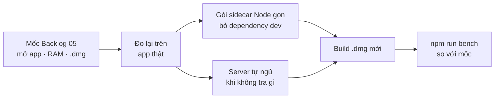

# Backlog 20 · App Mac nhẹ

> Đo và làm nhẹ **app Mac**: mở nhanh, ít RAM khi không làm gì, file cài nhỏ hơn. Đây cũng là lần đo lại cuối của
> Version 5 so với bảng mốc.

Không làm · 2026-10-26

**Không làm (chốt 2026-10-26):** performance — không ra tiền, không thêm người dùng; mốc 2026-10-25 đã ổn (mở ~0,14 s, RAM nghỉ ≈ 200 MB). Trang giữ lại để tra, không code.

## Chạy thế nào

## Làm gì

| | |
|---|---|
| :material-timer-outline: **Đo trên app thật** | thời gian mở + RAM khi rảnh, đo trên app đã cài, không phải bản dev |
| :material-package-variant-minus: **Sidecar gọn** | sidecar Node (server chạy kèm trong app) bỏ các dependency chỉ dùng lúc dev |
| :material-sleep: **Server tự ngủ** | không tra gì thì server nghỉ, có việc thì dậy |
| :material-apple: **Build lại** | `.dmg` mới ký + notarize, đo dung lượng |
| :material-chart-line: **Đo lại cả Version 5** | `npm run bench` trên 3 niche chuẩn, ghi số mới cạnh mốc |

**Xong khi**

- App mở ≤ 3 giây
- RAM khi rảnh và dung lượng `.dmg` nhỏ hơn mốc
- Test xanh, bản Web vẫn chạy
- Cả bảng mốc: mọi chỉ số bằng hoặc tốt hơn, không chỉ số nào tệ đi quá 10%

**Không làm ở phase này**

- Viết lại collector bằng Rust (chỉ xét khi số đo ra Node là nút cổ chai, ghi vào pending)
- Auto-update, bản Windows
- Tính năng mới

[Tổng quan Version 5](../web/version-5.md)

Plan code chi tiết: [Backlog 20](../superpowers/plans/2026-10-25-niche-radar-phase78-light-mac-app.md)
