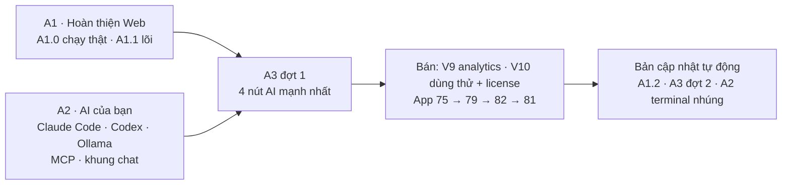

# Plan bán app Mac + Windows (2026-10-26)

> Đã có người trả tiền cho loại tool này ([Wow Keywords](../doi-thu-tham-khao.md#wow-keywords) $79, Mac + Windows,
> chạy trên AI của người dùng). Niche Radar đi đúng hướng đó: **app tải về, AI là của bạn, dữ liệu nằm trên máy bạn.**
> Trang này gom lộ trình còn lại thành 3 phase **A1 · A2 · A3** rồi tới bán.

Plan 2026-10-26 · đang làm A1

**Vì sao đặt tên A1–A3:** số Phase 1–82 cũ vẫn giữ (link không gãy); A1–A3 là lớp gom ở trên, mỗi dòng trỏ về phase
gốc. **A2 (bộ máy AI) đi trước A3 (AI cho từng tính năng)** vì nút AI nào cũng cần bộ máy để chạy.

## Thứ tự

A1 và Bước 0 của A2 làm song song được.

## 3 phase

| Phase | Làm gì | Trạng thái |
|---|---|---|
| [A1 · Hoàn thiện Web](phase-a1-hoan-thien-web.md) | gom mọi việc Web dang dở của Version 1: 13 mục xong · 5 việc chờ chạy thật · 8 mục lõi trước bán · 10 mục để bản cập nhật | Đang làm |
| [A2 · AI của bạn](phase-a2-ai-cua-ban.md) | cầu AI gọi `claude` / `codex` / OpenCode / Ollama người dùng đã có (cách của Markdown Viewer), thư mục AI có sẵn skill, niche-radar MCP + nút thêm 1 bấm, khung chat, terminal nhúng | Chưa làm |
| [A3 · AI cho từng tính năng](phase-a3-ai-tinh-nang.md) | đợt 1: tóm tắt niche 1 bấm · bàn quyết định 1 bấm · gap → ý tưởng app · Feature Gap tự điền; đợt 2: 12 tính năng còn lại | Chưa làm |
| Bán | [Version 9](../web/version-9.md) analytics · [Version 10](../web/version-10.md) dùng thử + license · App [75](phase-75-local-app-2.md) → [79](phase-79-app-only.md) → [82](phase-82-windows-app.md) → [81](phase-81-release-auto-update.md) | Sau A3 đợt 1 |

## Phase cũ đi đâu

| Phase cũ | Giờ nằm ở |
|---|---|
| 7, 10, 16, 16b, 74 (code xong, chờ chạy thật) | A1.0 |
| 12, 13, 14, 15, 20, 9c (en), 30.1, 29, 27 | A1.1 |
| 18, 19, 21, 22, 23, 24, 28, 30.2, 9 (ứng viên), 9c (es) | A1.2 |
| 25 Cài đặt AI · 26 MCP · 38 Hỏi dữ liệu · 69 AI của người dùng | A2 |
| 17 Tóm tắt niche (AI) · Decision Engine Pro (Version 12) · phần AI của 12, 18, 21 | A3 |

**Giữ nguyên**

- Tắt AI vẫn chạy đủ phần không AI — AI là thêm, không phải chân đế
- Không bán AI, không trả tiền AI thay người dùng, không tài khoản
- ⛔ KO LÀM vẫn như chốt 2026-10-26 ([Appendix](../appendix.md#khong-lam-chot-2026-10-26))

