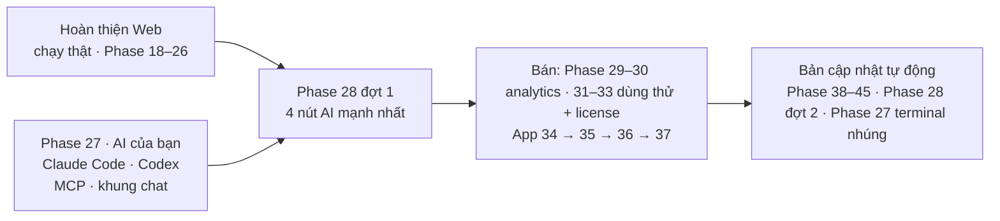

# Plan bán app Mac + Windows (2026-10-26)

> Đã có người trả tiền cho loại tool này ([Wow Keywords](../doi-thu-tham-khao.md#wow-keywords) $79, Mac + Windows,
> chạy trên AI của người dùng). Niche Radar đi đúng hướng đó: **app tải về, AI là của bạn, dữ liệu nằm trên máy bạn.**
> Trang này gom lộ trình còn lại thành **Hoàn thiện Web (Phase 18–26) → Phase 27 → Phase 28** rồi tới bán (Phase 29–37).

Plan 2026-10-26 · đang làm Hoàn thiện Web · Phase 18

**Đánh số lại 2026-10-26:** số phase giờ là **thứ tự làm** (1–63); phase không làm bỏ số, thành Backlog 01–21; link số
cũ tự chuyển trang. A1 cũ → Hoàn thiện Web (Phase 18–26 trước bán, 38–45 sau bán) · A2 cũ → Phase 27 · A3 cũ → Phase 28. Phase 19 Ai là khách hàng chèn sau 18 (từ issue #1).
**Phase 27 (bộ máy AI) đi trước Phase 28 (AI cho từng tính năng)** vì nút AI nào cũng cần bộ máy để chạy.

## Thứ tự

Hoàn thiện Web và Bước 0 của Phase 27 làm song song được.

## Các bước

| Bước | Làm gì | Trạng thái |
|---|---|---|
| [Hoàn thiện Web](hoan-thien-web.md) | gom mọi việc Web dang dở: 5 việc chờ chạy thật · Phase 18–26 trước bán · Phase 38–45 vào bằng bản cập nhật | Đang làm |
| [Phase 27 · AI của bạn](phase-27-ai-cua-ban.md) | cầu AI gọi `claude` / `codex` / OpenCode người dùng đã có (cách của Markdown Viewer), thư mục AI có sẵn skill, niche-radar MCP + nút thêm 1 bấm, khung chat, terminal nhúng | Đang làm · Bước 0, Cầu AI, MCP xong |
| [Phase 28 · AI cho từng tính năng](phase-28-ai-tinh-nang.md) | đợt 1: tóm tắt niche 1 bấm · bàn quyết định 1 bấm · gap → ý tưởng app · Feature Gap tự điền; đợt 2: 12 tính năng còn lại | Chưa làm |
| [Phase 28.6 · AI Agent](../web/phase-28-6-ai-agent.md) | trang Phiên săn: chat ghim bên phải ra lệnh (tra, long-tail, loại, gom niche) qua tool 28.2, dải ứng viên neo dữ liệu, hoàn tác từng hành động | Chưa làm |
| Bán | [Version 9](../web/version-9.md) analytics (Phase 29–30) · [Version 10](../web/version-10.md) dùng thử + license (Phase 31–33) · App [34](phase-34-local-app-2.md) → [35](phase-35-app-only.md) → [36](phase-36-windows-app.md) → [37](phase-37-release-auto-update.md) | Sau Phase 28 đợt 1 |

## Số cũ → số mới (đánh số lại 2026-10-26)

| Số cũ | Giờ là |
|---|---|
| 1–9 · 9c · 10 · 10b · 10c · 11 · 16 · 16b · app 74 | Phase 1–9 · 10 · 11 · 12 · 13 · 14 · 15 · 16 · 17 (đã xong / code xong) |
| 12 · (mới) Ai là khách hàng · 13, 14, 15, 20, 30.1, 29, 27 | Phase 18 · 19 · 20–26 (Hoàn thiện Web trước bản bán) |
| A2 · 26 MCP · 38 Hỏi dữ liệu · 25 Cài đặt AI · 69 AI của người dùng | Phase 27 · trang con 27.3 · 27.4 · 27.6 · 27.7 |
| A3 · 17 Tóm tắt niche (AI) | Phase 28 · trang con 28.1 |
| 64, 65 · 66, 67, 68 · app 75, 79, 82, 81 | Phase 29–30 · 31–33 · 34–37 |
| 18, 19, 21, 22, 23, 24, 28, 30.2 | Phase 38–45 (Hoàn thiện Web sau bản bán) |
| 70–73 · 31a, 31–35 · 37, 39, 40 · 41–45 | Phase 46–49 · 50–55 · 56–58 · 59–63 |
| KO LÀM: 30, 59, 62, 63, 46–48, 50–53b, 54, 57, 58, 60, 61 · app 76, 77, 78, 80 | Backlog 01–17 · Backlog 18–21 |

**Giữ nguyên**

- Tắt AI vẫn chạy đủ phần không AI — AI là thêm, không phải chân đế
- Không bán AI, không trả tiền AI thay người dùng, không tài khoản
- ⛔ KO LÀM vẫn như chốt 2026-10-26 ([Appendix](../appendix.md#khong-lam-chot-2026-10-26))

