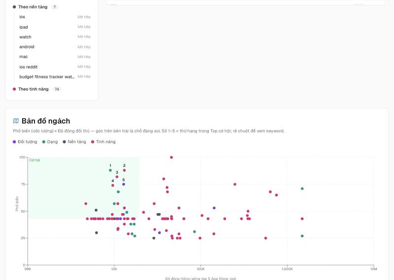

# Cách dùng

## Chạy app

```bash
cd web
npm install
cp .env.example .env.local   # tuỳ chọn: key Claude cho Feature Gap tuyến A
npm run dev                  # mở http://localhost:3200
```

Đứng ở gốc repo thì `npm run setup` rồi `npm run dev` cũng được (lối tắt sang `web/`).
Dữ liệu nằm ở `web/data/niche.db` (app Mac: `~/Library/Application Support/niche-radar/`). Xoá file này = xoá sạch lịch sử.

## Explore một niche (tìm ngách)

1. Trang chủ → bấm **Explore niche** → gõ niche (tiếng Anh, ví dụ `meal planner`) → chọn nước → **Explore**.
2. Chờ khoảng 6 phút cho 100 keyword. Trang tự cập nhật: lấy gợi ý (≈ 1 phút), rồi đếm đối thủ từng keyword (≈ 3 giây/keyword).
3. Đọc kết quả:
    - **Cây ngách** — keyword gom theo đối tượng / dạng / nền tảng / tính năng. "Mở tiếp" để đào sâu một nhánh.
    - **Bảng keyword** — sắp theo điểm cơ hội. Chấm màu độ đông: xanh < 0.4 · vàng 0.4–0.7 · đỏ > 0.7.
    - **Bản đồ ngách** — góc trên bên trái (phổ biến cao, ít đối thủ) là chỗ đáng soi.
    - **Top cơ hội** — 10 keyword điểm cao nhất, bấm **Research sâu** (tối đa 5 cái một lần).
4. **Tải CSV** để mở bằng Numbers/Excel. **Mở rộng thêm** / **Mở tiếp** để lấy thêm ≤ 50 keyword.



### Điểm cơ hội đọc thế nào

```
điểm = phổ_biến × (1 − độ_đông)
phổ_biến  0–100 : được Play/Google gợi ý ở càng nhiều truy vấn, hạng càng cao → càng cao
độ_đông   0–1   : log10(1 + tổng rating 5 app top App Store) / 6   (1 triệu rating ≈ 1.0)
```

!!! warning "Ước lượng, không phải lượt tìm thật"
    Độ đông đang lấy từ App Store, nên keyword chỉ mạnh trên Play có thể bị chấm "ít đông" sai.
    Phase 2 (App Store Search) sẽ tách độ đông riêng cho iOS và Play.

## Research 1 keyword

Trang chủ → **Research 1 keyword** → gõ keyword → **Research**. Kết quả cache 24 giờ; nút
"Tra lại (bỏ cache)" để lấy mới. Nguồn nào lỗi thì có nút **Thử lại** riêng nguồn đó.
Nút **Đọc review 1–2★** gom câu than lặp lại của top 3 app Play (cache 7 ngày).

## Gap hỏi đáp (Reddit · Stack Exchange · Hacker News · GitHub)

Menu **Thêm → Gap hỏi đáp**, 5 tab. Tab **Reddit**: Chưa nhập gì thì đầu trang là **bảng ví dụ** (số minh hoạ) để thấy kết quả trông thế nào.
Ngay dưới: chọn subreddit → mở **Top 12 tháng** và **Top 30 ngày** → Cmd + S mỗi trang → thả 2 file vào bất kỳ đâu trên
trang → bảng ví dụ đổi thành bảng gap thật; bấm dòng xem bài gốc, **Tải .md**. Muốn nhiều bài hơn hoặc JSON lỗi → mở
mục **Thêm nguồn** (8 trang search + cách lưu HTML dự phòng). Chi tiết: [Phase 11](web/phase-11-reddit-gap.md).

Tab **Stack Exchange** / **Hacker News**: bấm **Lấy dữ liệu** — app tự gọi API miễn phí (không key), chạy nền ≈ 1–2 phút,
câu đã lấy trong 7 ngày thì bỏ qua. Stack Exchange cho 300 lệnh / ngày / IP, một lần đủ 3 site ≈ 60 lệnh; muốn nhiều hơn
thì tạo key ở StackApps và đặt `STACKEXCHANGE_KEY` trong `web/.env.local`. Tab **Gộp** cộng cả ba nguồn theo chủ đề.
Chi tiết: [Phase 12](web/phase-12-qa-gap.md).

Tab **GitHub**: bấm **Lấy App Mac menu bar** (hoặc App Mac · Chrome extension · Plugin Obsidian), hoặc dán `owner/repo` của
đối thủ → app lấy issue ≥ 5 👍 từng repo, chạy nền. Không token GitHub cho 10 lệnh / phút (nhóm ≈ 40–50 repo ≈ 5 phút); dán
token chỉ đọc ở **Cài đặt → Token GitHub** thì 30 lệnh / phút. Bảng chỉ giữ **tính năng** bị từ chối hoặc còn mở ≥ 1 năm, xếp
theo điểm; 2 khung gấp "Theo chủ đề", "Theo repo"; **Tải .md**. Tab này không cộng vào Gộp. Chi tiết: [Phase 13](web/phase-13-github-gap.md).

## Cho Claude Code / Codex đọc dữ liệu (MCP)

**Cài đặt → Cho AI của bạn đọc dữ liệu (MCP)** → bấm **Thêm vào Claude Code** hoặc **Thêm vào Codex** (trang hiện đúng lệnh
sẽ chạy trước khi bấm). Mở phiên Claude Code / Codex mới rồi hỏi thẳng, ví dụ "So 3 niche tôi tra gần nhất trong Niche Radar —
niche nào đáng làm nhất, trích nguồn từng số". AI chỉ **đọc**: niche đã tra, đối thủ, lời chê đã lưu, Explore, project, bàn
quyết định, bảng gap. Claude Desktop / Cursor / Windsurf: mở mục "dán tay" ở cuối khối, copy JSON vào file cấu hình MCP của app đó.
Dời repo hoặc cài app bản mới → khối báo "Đang trỏ bản cũ", bấm **Cập nhật**. Chi tiết: [Phase 27](app/phase-27-ai-cua-ban.md).

## Khi bị chặn

Play, Trends, Google gợi ý không có API chính thức → gọi dồn dập sẽ bị chặn tạm (thường 10–30 phút).
Một người, mạng nhà, **vài chục lần tra/ngày là ổn**. Bị chặn thì đợi rồi bấm Thử lại.

## Lệnh hay dùng

Chạy ở gốc repo (lối tắt) hoặc trong `web/` / `app/`:

| Lệnh (gốc repo) | Trong folder | Làm gì |
|---|---|---|
| `npm run dev` | `web/` · `npm run dev` | chạy app (web 3200 + API 3201) |
| `npm run check` | `web/` · `npm test` · `npm run typecheck` · `npm run lint` | kiểm code |
| — | `web/` · `npm run smoke -- "<niche>" US` | gọi thật 4 nguồn, in số dòng lấy được |
| — | `web/` · `npx tsx scripts/mcp-smoke.ts [niche.db]` | chạy niche-radar MCP như Claude Code gọi: liệt kê tool, gọi thử 3 tool |
| `npm run mac` | `app/` · `npm run build` | build app Mac → `app/dist/*.dmg` (ký + notarize) |
| `npm run docs` | — | mở trang tài liệu này ở http://127.0.0.1:3210 |
| `npm run docs:build` | — | build tài liệu ra `site/` |
