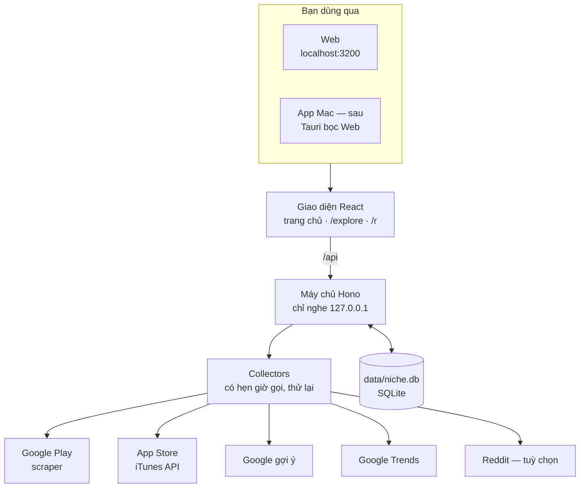
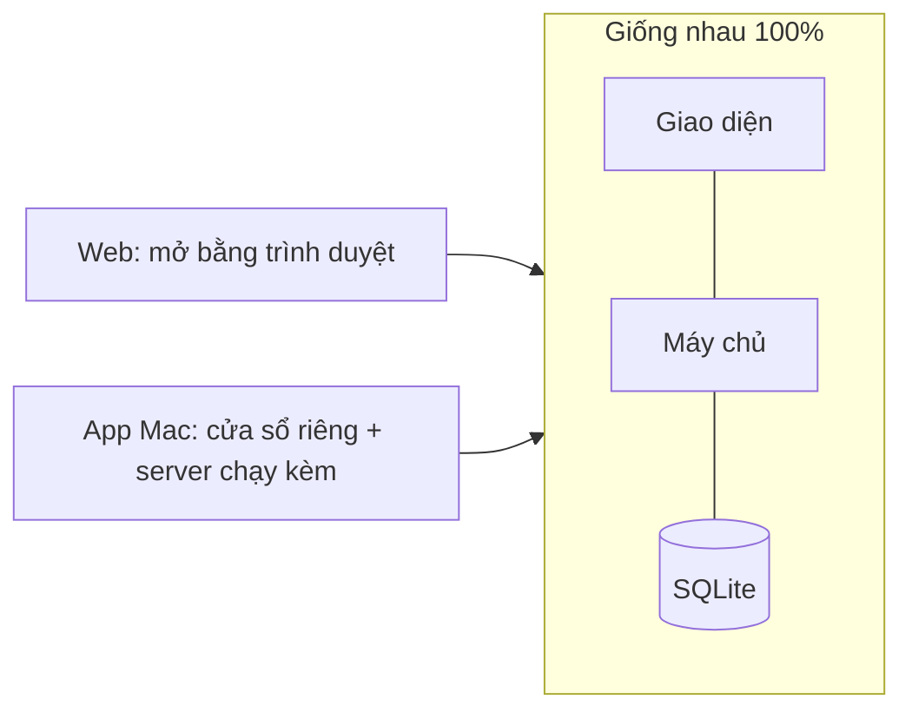

# Hệ thống chạy thế nào

> Tất cả chạy **trong máy bạn**. Giao diện → máy chủ nhỏ → các nguồn → lưu vào một file SQLite.

## Sơ đồ



## Web và App dùng chung



## Xài gì

| Phần | Dùng gì |
|---|---|
| Giao diện | Vite · React 19 · React Router · Tailwind · Recharts |
| Máy chủ | Hono trên Node |
| Lưu trữ | SQLite · better-sqlite3 · Drizzle |
| Test | Vitest (115 test) · `npm run smoke` gọi thật |
| Tài liệu | MkDocs Material (trang này) |
| App Mac (sau) | Tauri — không Electron |
| AI | không dùng |

## Nguồn dữ liệu (đều miễn phí)

| Nguồn | Lấy được | Giới hạn |
|---|---|---|
| :material-google-play: Google Play | app, số cài (100K+), rating, review, gợi ý | không công bố, dồn dập bị chặn tạm |
| :material-apple: App Store | app, số rating, giá theo nước | ~20 request/phút |
| :material-google: Google gợi ý | keyword người ta gõ | không công bố |
| :material-trending-up: Google Trends | độ quan tâm 12 tháng, related | chặt nhất |
| :material-reddit: Reddit | bài "is there an app…" | cần key cá nhân |

Bộ nhớ đệm: kết quả research 24 giờ · gợi ý tìm kiếm 7 ngày · review 7 ngày.

<details markdown>
<summary>Thư mục code</summary>

```
src/client/      trang: HomePage · ExplorePage · RunPage
src/components/  bảng, bản đồ, cây ngách, Trends, Reddit…
src/collectors/  gọi từng nguồn
src/lib/         logic thuần có test (explore, điểm, complaints…)
src/server/      API Hono
src/db/          bảng + migration
```
</details>
