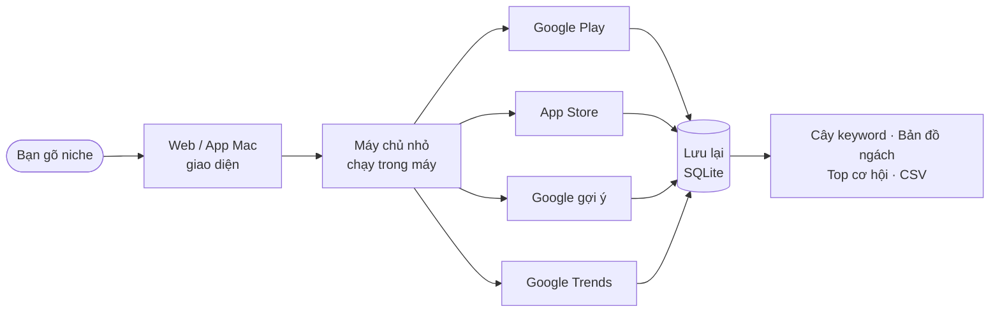

---
hide:
  - navigation
  - toc
---

# niche-radar — Master Plan

> Gõ một niche → biết **keyword nào còn trống**, **đối thủ yếu ở đâu**, **nhu cầu lên hay xuống**.

Chọn niche đáng làm app từ Google Play, App Store, Google Trends, Reddit, Q&A, TrustMRR — không AI vẫn chạy, AI là tuỳ chọn.
**Chốt 2026-10-26:** bán dưới dạng **app Mac + Windows tải về, dùng thử rồi mua license** (học mô hình phân phối của
[Wow Keywords](doi-thu-tham-khao.md#wow-keywords)). Bản Web vẫn chạy local để test tính năng.

<b>100</b>keyword mỗi lần explore

<b>~6 phút</b>cho 100 keyword đủ số liệu

<b>3</b>nguồn: Play · App Store · Trends

<b>0 đ</b>Phase 1–5: không AI, không API trả phí

**Theo dõi tiến độ:** trang này là bản nội bộ — mở nhanh ở
[nvminhtu.github.io/niche-radar-docs](https://nvminhtu.github.io/niche-radar-docs/). Chip ở mỗi phase và màu ở menu
trái (xanh = xong, vàng = đang làm) là trạng thái thật.

**Đánh số lại 2026-10-26 — số phase = thứ tự làm.** Đã xong 1–17 → [Hoàn thiện Web](app/hoan-thien-web.md) trước bản bán 18–26 → [Phase 27](app/phase-27-ai-cua-ban.md) AI của bạn (Claude Code, Codex, Ollama chạy trong app, MCP, khung chat) → [Phase 28](app/phase-28-ai-tinh-nang.md) nút AI cho từng tính năng → bán 29–37 → sau bản bán 38–45 → 45–62. Phase không làm thành **Backlog 01–21**. Bảng số cũ → mới: [Plan bán app](app/plan-ban-app.md#so-cu-so-moi-anh-so-lai-2026-10-26).

## Thứ tự: Phase 1 → 63 · ⛔ KO LÀM = Backlog 01–21

### :material-web: 1 · Web local — làm + test tính năng

- Code ở `web/` · chạy: `npm run dev` → mở `localhost:3200`
- Hoàn thiện Web 18–26 (xong) → AI 27–28 (đang làm) → **Version 9** analytics (29–30) → **Version 10** dùng thử + license (31–33)
- Sau App: 38–45 hoàn thiện tiếp → Version 11 marketing (46–49) → Version 2, 3, 4 (50–63), 12 (vào app qua bản cập nhật)
- Hoàn thiện Web 18–26 code xong 2026-10-26 (bản 0.10.0) · Phase 27 AI đang làm (MCP + khung chat xong) · chờ chạy thật: 7, 11, 15, 16, 17, 20, 23, 24
- [Mở lộ trình Web →](web/index.md)

### :material-laptop: 2 · App Mac + Windows — thứ để bán

- **Bọc lại đúng giao diện Web** bằng Tauri → không viết 2 lần · code ở `app/`
- Gói khi bản Web **xong Phase 33**: 34 → 35 → 36 (Windows Beta) → 37 (GitHub Releases + tự cập nhật)
- Tải miễn phí → dùng thử N ngày → mua đứt → license key, 2 máy, không tài khoản
- Chờ xong Phase 33 · Phase 17 đã có .dmg từ trước
- [Mở lộ trình App →](app/index.md)

**⛔ KO LÀM (chốt 2026-10-26)** — không ra tiền, không thêm người dùng: bỏ số phase, thành **Backlog 01–21**: Account (01–04) ·
**Version 5** Performance (05–07) · **Version 6** test tự động (08–12) · **Version 7** CI (13–14) · **Version 8** security / refactor (15–17) ·
App (18–21). Trang giữ lại để tra. [Danh sách + lý do](appendix.md#khong-lam-chot-2026-10-26)

## Chạy thế nào

Mọi thứ chạy trong máy bạn. Tra lại cùng niche trong 24 giờ lấy từ bộ nhớ, không gọi lại.
Chi tiết: [Hệ thống chạy thế nào](he-thong.md).

## Lộ trình tóm tắt

| Bước | Nội dung | Phase | Trạng thái |
|---|---|---|---|
| Đã xong | Google Play, App Store, Trends, Feature Gap, AI, validate, Project, i18n, Reddit / Q&A / GitHub Gap, Export, Bàn quyết định, app Mac 1.0 | 1–17 | Xong · 7, 11, 15, 16, 17 chờ chạy thật |
| Hoàn thiện Web | lời chê, ai là khách hàng, sức khoẻ niche, collect, project, trang Research, setup, UI, review cụm | 18–26 | Xong 2026-10-26 · 5 việc chờ anh |
| AI | AI của bạn (MCP, khung chat, Cài đặt AI) · AI cho từng tính năng | 27–28 | Đang làm · 27: Cầu AI, Thư mục AI, MCP, Khung chat xong 2026-10-26 · còn Cài đặt AI · 28 chưa làm |
| Bán | Version 9 analytics · Version 10 dùng thử + license · app Mac + Windows + tự cập nhật | 29–37 | Chưa làm |
| Sau bản bán | doanh thu, backup tự động, Explore, hồ sơ đối thủ, theo dõi, evidence, so sánh niche, tutorial | 38–45 | Chưa làm |
| Version 11 | Marketing: định vị, landing, kênh, lịch 6 tuần | 46–49 | Chưa làm |
| Version 2 | Demo site + YouTube, Amazon, Google Maps | 50–55 | Chưa làm |
| Version 3 | So sánh đối thủ + AI Cite | 56–58 | Chưa làm |
| Version 4 | Kệ Google, kệ AI, gói GEO | 59–63 | Chưa làm |
| Version 12 | Tính năng mới — mới ghi plan | — | Chưa đánh số |
| ⛔ KO LÀM | Account · V5 Performance · V6 test tự động · V7 CI · V8 security / refactor · App 3.0 / 4.0 / app nhẹ / CI | Backlog 01–21 | Không làm |

Việc chưa xếp phase hoặc không làm: [Appendix](appendix.md). Mỗi phase đi theo [Quy trình build](quy-trinh-build.md).

## Trông như thế này

<figure class="frame" markdown>

</figure>

**Không làm (cố ý)**

- AI tự đưa ra con số — AI (Phase 4, 6) chỉ đọc chữ và trích dẫn
- Lượt tìm "thật" — store không công khai, "phổ biến" là ước lượng
- Tài khoản, đăng nhập, host server cho nhiều người — app chạy trên máy, bán bằng license key

[Bản Master Plan đầy đủ (chữ)](superpowers/specs/2026-10-24-niche-radar-master-plan.md)
