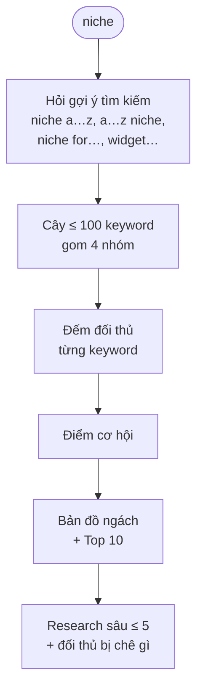

# Phase 1 · Google Play

> Từ một niche, mở ra **mọi keyword người ta gõ trên Play** và chấm điểm từng ngách.

Code xong · đã ở main · đang làm thêm UI Loading + Flow niche

<b>100</b>keyword lần đầu (mở tiếp +50)

<b>~6,3 phút</b>budget tracker, US, đủ số liệu

<b>4</b>nhóm ngách tự gom

<b>115</b>test tự động xanh

## Chạy thế nào

## Làm được gì

| | |
|---|---|
| :material-file-tree: **Cây ngách** | keyword gom theo đối tượng · dạng · nền tảng · tính năng; "Mở tiếp" để đào sâu (tối đa 3 tầng) |
| :material-table: **Bảng keyword** | số app Play / App Store, độ đông, điểm cơ hội — sắp xếp, lọc được |
| :material-chart-scatter-plot: **Bản đồ ngách** | phổ biến × độ đông — góc trên bên trái là chỗ đáng soi |
| :material-trophy: **Top 10 cơ hội** | bấm "Research sâu" (≤ 5 keyword) |
| :material-emoticon-angry: **Đối thủ bị chê gì** | câu than lặp lại trong review 1–2★ của top 3 app Play |
| :material-download: **CSV** | mở bằng Numbers / Excel |
| :material-progress-clock: **Loading rõ ràng** *(đang làm)* | bảng tiến độ từng nguồn (keyword 3/6) · "còn ~X phút" từ lịch sử chạy · xong có checklist ✓/✗ + số kết quả · đóng tab vẫn chạy, quay lại thấy ở Lịch sử + huy hiệu "đang chạy" |
| :material-sitemap: **Flow niche** *(đang làm)* | thanh bước đầu trang (Research → Explore → Mở rộng → Research sâu) · sơ đồ nhánh gốc → lá · chốt lá làm long-tail niche = **FLOW niche 1, 2…** · thoát ra vào lại vẫn đúng bước |

<figure class="frame" markdown>

</figure>

## Điểm cơ hội

**điểm = phổ biến × (1 − độ đông)**

- **Phổ biến** (0–100): keyword được Play/Google gợi ý ở càng nhiều truy vấn, hạng càng cao → càng cao.
- **Độ đông** (0–1): tổng rating 5 app top App Store, thang log (1 triệu rating ≈ 1).
- Ước lượng, **không phải lượt tìm thật**.

## Lỗi đã sửa khi chạy thật

- Play không có gợi ý cho một chữ (vd `water reminder q`) → thư viện văng lỗi, hỏng cả lần explore. Đã sửa.
- Điểm phổ biến chỉ ra 80 hoặc 100 → đổi cách tính, giờ trải 25 → 100.
- Nhãn bản đồ chồng nhau → thay bằng số 1–5 khớp bảng Top cơ hội.

**Còn lại để xong hẳn**

- UI Loading + Flow niche (Task 10–11): đi thật `bubble game` 2 tầng, chốt 2 FLOW, đóng tab rồi mở lại vẫn đúng tiến độ
- Xoá stash cũ `phase2-wip-codex-2-20261024-1019` (khi anh đồng ý)

[Plan code chi tiết Phase 1](superpowers/plans/2026-10-24-niche-radar-phase1-explorer.md)
