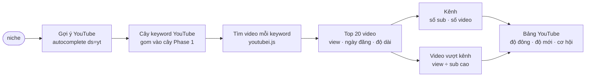

# Phase 12 · YouTube Search

> Gõ một niche → biết **người ta tìm gì trên YouTube**, video nào đang hút view, kênh nhỏ nào thắng kênh to —
> **không dùng AI**, chỉ cào số.

Chưa làm · sau MVP (Phase 1–11)

## Chạy thế nào

## Chọn thư viện (kiểm lại lúc làm)

| Cách | Là gì | Ưu | Nhược |
|---|---|---|---|
| **`youtubei.js`** (đề xuất) | thư viện Node gọi API nội bộ của YouTube (InnerTube) — không cần key | đủ: tìm, chi tiết video, kênh, comment, phụ đề | không chính thức, YouTube đổi là gãy |
| YouTube Data API v3 | API chính thức, key miễn phí | ổn định | quota 10.000 đơn vị/ngày, 1 lần tìm = 100 → ~100 lần tìm/ngày |
| `yt-dlp` | công cụ dòng lệnh (Python) | rất bền, cộng đồng sửa nhanh | phải cài thêm, gói vào app Mac nặng hơn |

Đề xuất: `youtubei.js` làm chính; Data API là **dự phòng tuỳ chọn** khi có key. Đo endpoint còn chạy trước khi code
(như Phase 2).

## Làm gì

| | |
|---|---|
| :material-magnify: **Gợi ý YouTube** | autocomplete riêng của YouTube làm nguồn keyword thứ 4 — gắn nhãn `YT` trong cây keyword |
| :material-video: **Top video mỗi keyword** | view · ngày đăng · độ dài · kênh — chỉ cho Top 10 keyword (như Trends) |
| :material-account-group: **Độ đông YouTube** | tổng view top 20 + số kênh lớn (> 100k sub) → thang 0–1 |
| :material-clock-fast: **Độ mới** | bao nhiêu video top đăng trong 12 tháng — niche đang sống hay đã nguội |
| :material-rocket-launch: **Video vượt kênh** | view ÷ sub cao (kênh nhỏ mà video to) → dấu hiệu nhu cầu thật, nội dung còn thiếu |
| :material-download: **CSV** | như Phase 1 |

**Luật cào**

- Gọi thưa (≥ 2 giây / request), cache 24 giờ, chỉ Top 10 keyword
- Bị chặn → dừng nguồn đó, báo trên UI, các nguồn khác vẫn chạy — không vượt captcha, không dùng proxy xoay
- Số view / sub ghi kèm **ngày lấy**

**Xong khi**

- 3 niche thật có cây keyword YouTube + bảng top video + cột "video vượt kênh"
- Một lần chạy không bị chặn; test xanh; screenshot đã Read

**Không làm ở phase này**

- Đọc nội dung video / comment bằng AI — [Phase 13](phase-13-youtube-ai.md)
- Tải video về máy
- Ước doanh thu kênh từ view

