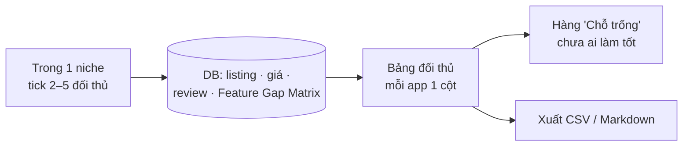

# Phase 19 · So sánh đối thủ

> Đặt **2–5 đối thủ** cạnh nhau (app Play / iOS, sản phẩm Amazon nếu có): giá, sao, tính năng, bị chê gì, ra bản mới
> lúc nào. Để biết **app mình đánh vào ai và hơn ở đâu**. **Không AI.**

Chưa làm · sau Phase 18

## Chạy thế nào

## Làm gì

| | |
|---|---|
| :material-checkbox-multiple-marked: **Chọn đối thủ** | tick từ bảng đối thủ của niche. Gợi ý sẵn: top 3 theo lượt tải + 1–2 app bị chê nhiều nhất |
| :material-cash: **Tiền** | free / trả phí / có IAP · giá từng gói iOS · khoảng giá Play · gói tháng hay năm |
| :material-star-half-full: **Chất lượng** | sao, số rating, tỷ lệ review 1–2★, lần cập nhật cuối, có cả 2 store không |
| :material-view-grid: **Tính năng** | lấy từ Feature Gap Matrix (Phase 4): có / không / nửa vời, mỗi ô có link listing |
| :material-emoticon-angry: **Bị chê gì** | 3 chủ đề than nhiều nhất mỗi app (Phase 6, 13, 15), kèm số lần + 1 câu nguyên văn có link |
| :material-target: **Chỗ trống** | hàng cuối: tính năng người dùng xin nhiều mà ≤ 1 đối thủ làm tốt |
| :material-file-export: **Xuất** | CSV + Markdown, dán vào phần đối thủ của `/app-research` |

**Luật**

- Không ước doanh thu. Chỉ hiện giá công khai + TrustMRR verified (nếu có)
- Câu than là câu nguyên văn đã lưu, không viết lại

**Xong khi**

- 2 niche thật × 4 đối thủ có bảng đủ hàng, ô thiếu ghi "chưa có"
- Mỗi câu than bấm mở đúng review gốc (kiểm tay 10 câu)
- Hàng "Chỗ trống" ra ≥ 1 dòng cho ít nhất 1 niche

**Không làm ở phase này**

- Cào thêm đối thủ ngoài danh sách đã có
- Theo dõi đối thủ đổi giá / ra bản mới theo thời gian
- AI viết kết luận ([Phase 21](phase-21-ai-cite-report.md))

