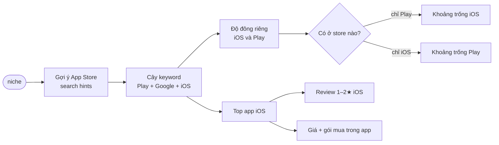

# Phase 2 · App Store

> Cùng câu hỏi như Phase 1 nhưng cho **iOS** — keyword, đối thủ, bị chê gì, **giá + gói mua trong app**.

Xong 2026-10-24 · đạt "Xong khi" 3/3 niche · đã merge main

## Chạy thế nào

## Làm gì

| | |
|---|---|
| :material-magnify: **Gợi ý App Store** | nguồn keyword thứ 3 cho Explorer — *đã code* |
| :material-account-group: **Độ đông riêng từng store** | tách cột iOS / Play |
| :material-emoticon-angry: **Review 1–2★ iOS** | gộp vào "Đối thủ bị chê gì" cùng Play — *đã code* |
| :material-cash: **Cột tiền** | `Free` · `Trả tiền $X` · `IAP $a–$b` · `Sub ~$X/tháng` · `chưa đo` — *đã code* |
| :material-swap-horizontal: **Khoảng trống Play ↔ iOS** | keyword / app chỉ có ở một store — *đã code nhãn "chỉ 1 store"* |

Doanh thu **verified** (TrustMRR và các trang tương tự) tách sang [Phase 5](phase-5-verified.md).

**Xong khi**

- 3 niche thật có câu than cả Play + iOS
- Cột tiền có số cho ≥ 4/5 top app iOS
- Test xanh, chạy thật không bị chặn, screenshot đã Read

**Không làm ở phase này**

- Ước doanh thu app từ số rating / lượt cài (chỉ dùng số verified ở Phase 5, hoặc ghi `chưa đo`)
- Giá nhiều nước cùng lúc

[Plan code Phase 2](superpowers/plans/2026-10-24-niche-radar-phase2-appstore-money.md)
