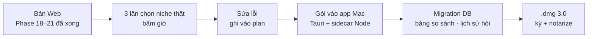

# Phase 22 · Review + Local App 3.0

> Dùng Version 3 **chọn niche thật 3 lần** ở bản Web, sửa lỗi, rồi gói Phase 18–21 vào **app Mac** một lần —
> như Phase 17 đã làm cho Version 2.

Chưa làm · sau Phase 21

## Chạy thế nào

## Làm gì

| | |
|---|---|
| :material-timer-outline: **3 lần chọn thật** | mỗi lần: so 3 niche → so 4 đối thủ → báo cáo → evidence pack. Bấm giờ, mục tiêu ≤ 30 phút |
| :material-bug-check: **Sửa lỗi** | lỗi gặp khi chọn thật → sửa ở bản Web trước |
| :material-package-variant: **Gói vào app** | màn so sánh, ô hỏi, báo cáo vào app Mac |
| :material-database-arrow-up: **Migration DB** | bảng mới (bộ so sánh, lịch sử hỏi, kết quả kiểm trích dẫn) dùng ULID. Mở app 2.x lên 3.0 không mất dữ liệu |
| :material-apple: **Phát hành** | `.dmg` 3.0 ký + notarize, ghi What's New |

**Xong khi**

- 3 lần chọn thật xong, ≥ 2 lần ≤ 30 phút, mỗi lần có evidence pack
- App 2.x có dữ liệu thật → cài 3.0 → đếm từng bảng trước / sau, không mất dòng
- Trên app: so 3 niche + hỏi 1 câu + xuất 1 báo cáo chạy được, test xanh, bản Web vẫn chạy

**Không làm ở phase này**

- Tính năng mới (chỉ gói những gì Phase 18–21 đã xong)
- Auto-update, bản Windows

