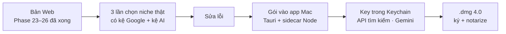

# Phase 27 · Review + Local App 4.0

> Dùng Version 4 **chọn niche thật 3 lần** có kệ Google + kệ AI ở bản Web, sửa lỗi, rồi gói Phase 23–26 vào
> **app Mac** một lần — như Phase 22 đã làm cho Version 3.

Chưa làm · sau Phase 26

## Chạy thế nào

## Làm gì

| | |
|---|---|
| :material-timer-outline: **3 lần chọn thật** | mỗi lần: so 3 niche có 2 cột kệ → chọn 1 → xuất gói GEO → chạy `geo.py` làm mốc. Ghi chi phí AI mỗi lần |
| :material-bug-check: **Sửa lỗi** | sửa ở bản Web trước |
| :material-package-variant: **Gói vào app** | collector top 10, kệ AI, cột kệ yếu, nút xuất gói GEO |
| :material-console: **Engine trên máy** | `codex exec` / `claude -p` có trên máy thì dùng, không có thì ẩn engine đó, Gemini vẫn chạy |
| :material-database-arrow-up: **Migration DB** | bảng top 10, câu trả lời AI, điểm kệ (ULID). Mở app 3.x lên 4.0 không mất dữ liệu |
| :material-apple: **Phát hành** | `.dmg` 4.0 ký + notarize, ghi What's New |

**Xong khi**

- 3 lần chọn thật xong, mỗi lần có gói GEO đã chạy `geo.py` làm mốc, chi phí dưới trần
- App 3.x có dữ liệu thật → cài 4.0 → đếm từng bảng trước / sau, không mất dòng
- Trên app: tra kệ Google + kệ AI cho 1 niche chạy được, test xanh, bản Web vẫn chạy

**Không làm ở phase này**

- Tính năng mới (chỉ gói những gì Phase 23–26 đã xong)
- Auto-update, bản Windows

