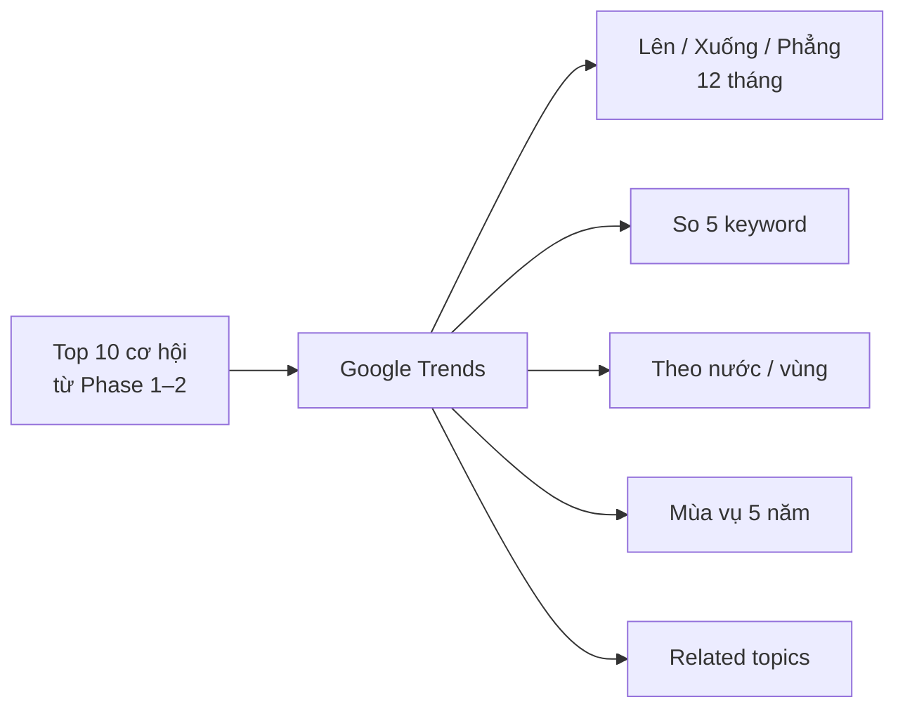

# Phase 3 · Google Trends

> Biết nhu cầu **đang lên hay xuống**, ở **nước nào**, có **mùa vụ** không.

Có cơ bản · 12 tháng + related queries cho 1 keyword (từ v1)

## Chạy thế nào

## Làm gì

| | |
|---|---|
| :material-trending-up: **Cột xu hướng** | lên / xuống / phẳng cho từng keyword Top 10 |
| :material-chart-line: **So 5 keyword** | cùng một biểu đồ (giới hạn của Trends) |
| :material-earth: **Theo nước / vùng** | nước nào quan tâm nhất |
| :material-calendar-sync: **Mùa vụ 5 năm** | đỉnh theo mùa (back-to-school, đầu năm…) |
| :material-tag-multiple: **Related topics** | chủ đề liên quan ngoài related queries |

Chỉ hỏi Trends cho **Top 10** — Trends chặn rất nhanh nếu hỏi nhiều. Chống bị chặn: gom request, cache dài cho
dữ liệu 5 năm, backoff.

**Xong khi**

- Top 10 của 3 niche thật có cột xu hướng, một lần chạy không bị Trends chặn
- So 5 keyword + theo nước + mùa vụ chạy được trên 1 niche thật

**Không làm ở phase này**

- Hỏi Trends cho cả 100 keyword
- Số lượt tìm thật (Trends chỉ cho chỉ số tương đối 0–100)

