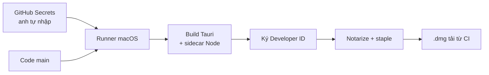

# Phase 37 · Build app Mac trên CI

> Bản `.dmg` không build trên máy anh nữa mà trên **runner macOS** (máy Mac ảo của GitHub). CI tự ký bằng chứng chỉ của
> anh và gửi Apple **notarize** (Apple soát + đóng dấu), để file tải về mở được ngay.

Chưa làm · sau Phase 36

## Chạy thế nào

## Ai làm gì

| | |
|---|---|
| **Anh** | tạo / xuất chứng chỉ Developer ID, mật khẩu notarize (app-specific password) và nhập vào **GitHub Secrets** |
| **Claude** | viết workflow đọc secret theo tên, không bao giờ đọc, in hay đổi giá trị secret |

## Làm gì

| | |
|---|---|
| :material-file-code: **Workflow** | file mới `.github/workflows/build-mac.yml`, chạy trên runner macOS |
| :material-package-variant: **Build** | build app Tauri + sidecar Node giống bản `.dmg` làm tay ở các Local App trước |
| :material-key-variant: **Secret** | chứng chỉ Developer ID + mật khẩu notarize chỉ lấy từ GitHub Secrets, nạp vào keychain tạm của runner, xoá khi xong |
| :material-certificate: **Ký + notarize** | ký Developer ID → notarize → staple (gắn dấu Apple vào file) |
| :material-download: **Kết quả** | `.dmg` đã ký đính vào kết quả CI để tải về thử |

**Xong khi**

- `.dmg` tải từ CI mở trên máy sạch không bị Gatekeeper chặn
- Log CI không có giá trị secret nào (chỉ thấy `***`)
- Không có chứng chỉ, mật khẩu hay key nào trong code của repo

**Không làm ở phase này**

- Tạo GitHub Release, What's New, auto-update (Phase 38)
- Mac App Store
- Bản Windows / Linux
- Claude tạo chứng chỉ hoặc nhập secret thay anh

[Tổng quan Version 7](version-7.md)
