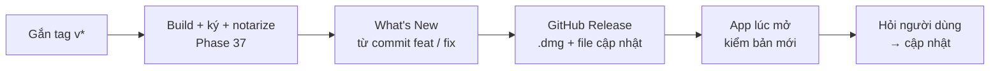

# Phase 38 · Release + auto-update

> Gắn **tag** (nhãn phiên bản như `v5.0.0`) là CI tự ra bản: `.dmg` lên GitHub Releases kèm What's New. App trên máy
> người dùng tự thấy bản mới và hỏi trước khi cập nhật.

Chưa làm · sau Phase 37

## Chạy thế nào

## Làm gì

| | |
|---|---|
| :material-tag: **Tag ra bản** | workflow chạy khi có tag `v*` → dùng lại bước build Phase 37 |
| :material-text-box-outline: **What's New** | sinh từ commit `feat` / `fix` kể từ tag trước |
| :material-github: **GitHub Release** | tạo Release, đính `.dmg` + What's New + file cập nhật |
| :material-update: **Tauri updater** | (bộ tự cập nhật của Tauri) app kiểm bản mới lúc mở, hỏi trước khi cập nhật |
| :material-signature: **Chữ ký file cập nhật** | file cập nhật có chữ ký, app chỉ nhận file đúng chữ ký. Khoá ký do anh tạo, lưu ở GitHub Secrets |

**Xong khi**

- Cài bản `x.y.0` → ra tag `x.y.1` → app báo có bản mới và cập nhật được, dữ liệu còn đủ
- Từ lúc gắn tag tới lúc `.dmg` đã ký có trên Releases không cần thao tác tay
- What's New trên Release chỉ gồm commit `feat` / `fix`
- Người dùng bấm "Để sau" → app vẫn chạy bản cũ bình thường

**Không làm ở phase này**

- Claude tự gắn tag hay bấm phát hành khi anh chưa đồng ý
- Cập nhật ngầm không hỏi
- Bản Windows / Linux, Mac App Store
- Deploy bản Web lên mạng

[Tổng quan Version 7](version-7.md)
