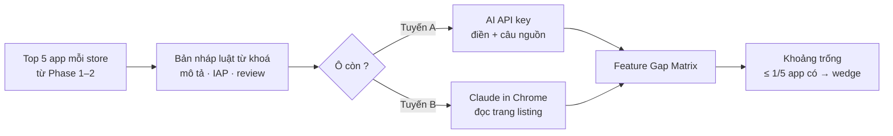

# Phase 4 · Feature Gap Matrix

> Biết **đối thủ đang thiếu tính năng gì** — chỗ để app mình khác biệt (wedge).

Xong 2026-10-24 · tuyến A chờ key

## Chạy thế nào

## Bảng trông thế nào

| Tính năng | App A | App B | App C | … |
|---|---|---|---|---|
| Offline | Có | Có | Không | |
| Không quảng cáo | Trả phí | Không | Có | |
| Widget | Có | ? | Không | |
| Mua một lần | Không | Không | Không | ← **khoảng trống** |

*Bảng minh hoạ, không phải dữ liệu thật.* Mỗi ô `Có / Không / Trả phí / Không nói / ?` đều kèm **câu nguồn** + link.
**Không nói** = AI hoặc Claude in Chrome đã đọc hết trang store mà không thấy nhắc — khác `?` (chưa ai đọc).

## Làm gì

| | |
|---|---|
| :material-format-list-checks: **Hàng mặc định** | offline · không quảng cáo · widget · đồng bộ · mua một lần · subscription · dùng thử · AI · xuất dữ liệu · không cần tài khoản (sửa được) |
| :material-text-search: **Bản nháp không AI** | luật từ khoá trên mô tả + IAP + review → điền ô chắc chắn, còn lại `?` |
| :material-key: **Tuyến A — AI API key (tối thiểu)** | một provider, key trong `.env.local`, tắt mặc định; AI điền ô `?`, bắt buộc trả câu nguồn |
| :material-google-chrome: **Tuyến B — Claude in Chrome** | tool xuất *matrix job* `.json` → Claude mở từng trang listing đọc → nhập kết quả lại. Không cần key trong app |
| :material-lightbulb-on: **Cột "Khoảng trống"** | ≤ 1/5 app có và ≤ 1/5 ô `?` → **Khoảng trống tính năng** (đối thủ nói rõ không có nhiều hơn) hoặc **Khoảng trống định vị** (không ai quảng cáo — chỗ để app mình nói to) |

**Xong khi**

- 3 niche có matrix 5 app × 10 hàng, ≤ 20% ô còn `?`, mọi ô có câu nguồn — **đạt**: budget tracker · habit tracker · pomodoro timer đều 0% `?` (2026-10-24)
- Chạy được cả tuyến A và tuyến B ít nhất 1 lần — tuyến B **đạt** (đọc 30 trang store); tuyến A code + test xong, **chưa chạy thật** vì máy chưa có `ANTHROPIC_API_KEY`

**Không làm ở phase này**

- Lớp AI đầy đủ (chọn provider, trần chi phí, trang cài đặt, AI miễn phí trong trình duyệt) — [Phase 6](phase-6-ai-web.md)
- AI tự điền ô không có câu nguồn

