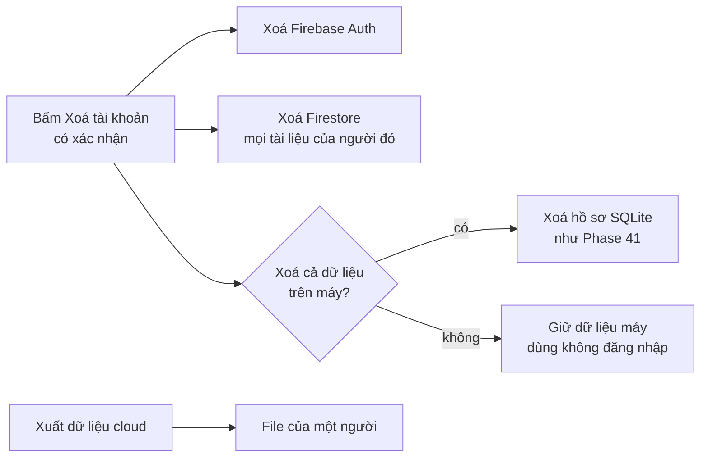

# Phase 47 · Riêng tư + xoá tài khoản

> Người dùng **xoá được tài khoản**, xoá cả trên cloud, và đọc được **trang Privacy** ghi đúng thứ app gửi đi. Đây là
> điều kiện để mở bán ở Version 10.

Chưa làm · sau Phase 46

## Chạy thế nào

## Làm gì

| | |
|---|---|
| :material-account-remove: **Xoá tài khoản** | xoá Auth + Firestore, rồi hỏi có xoá dữ liệu trên máy không |
| :material-download: **Xuất dữ liệu cloud** | tải về mọi thứ trên Firestore của một người |
| :material-file-document: **Privacy Policy** | ghi đúng thứ được gửi đi: tài khoản, project / ghi chú lên Firestore, 7 sự kiện GA4 ở [Phase 46](phase-46-analytics-errors.md), báo lỗi |
| :material-shield-check: **Quy tắc Firestore** | rà lại quy tắc chỉ chủ đọc / ghi từ Phase 45, test lại |
| :material-file-code: **File** | mới: route xoá / xuất trong `src/server/`, trang Privacy (chỗ đặt chốt ở plan) |

**Xong khi**

- Xoá tài khoản → Firestore còn 0 tài liệu của người đó
- Đăng nhập lại bằng tài khoản vừa xoá → không còn dữ liệu cũ
- Privacy Policy khớp danh sách sự kiện Phase 46 (đối chiếu từng dòng)
- Chọn "giữ dữ liệu máy" → project trên máy vẫn mở được
- Test quy tắc Firestore xanh

**Không làm ở phase này**

- Thanh toán, gói Pro: [Version 10](version-10.md)
- Giữ lại bản sao dữ liệu đã xoá trên cloud

[Tổng quan Version 9](version-9.md)
