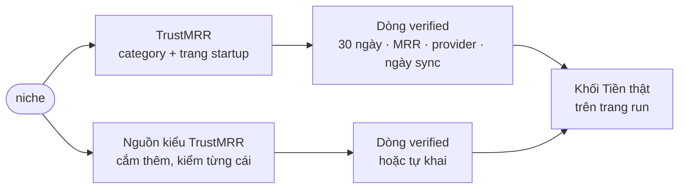

# Phase 5 · Verified Sites

> Biết **ai đang thu tiền thật** trong ngách — doanh thu lấy từ cổng thanh toán, không phải ước tính.

Đang làm · TrustMRR bản đầu (trang công khai, chưa API key)

## Chạy thế nào

## Làm gì

| | |
|---|---|
| :material-shield-check: **TrustMRR** | doanh thu lấy từ cổng thanh toán (Stripe, RevenueCat, Lemon Squeezy…) của sản phẩm cùng ngách: 30 ngày · MRR · provider · **ngày sync** · nhãn `verified`. Không key: đọc trang công khai; có key (tuỳ chọn): tìm theo từ khoá |
| :material-alert: **Cảnh báo sync cũ** | sync > 30 ngày → "số 30 ngày có thể là 0 giả, xem MRR" |
| :material-puzzle-plus: **Nguồn tương tự TrustMRR** | mỗi nguồn 1 collector, cùng khuôn dòng. Trước khi code mỗi nguồn: còn sống không · số lấy từ cổng thanh toán hay tự khai · có trang/API công khai không |
| :material-tag: **Nhãn độ tin** | `verified` chỉ khi số từ cổng thanh toán; nguồn tự khai → `tự khai`, không bao giờ `verified` |
| :material-link-variant: **Ghép với niche** | từ khoá + category, luôn ghi "**khớp gần đúng**" |

## Nguồn sẽ kiểm (chưa kiểm — điền khi làm)

| Nguồn | Kiểu | Trạng thái |
|---|---|---|
| TrustMRR | cổng thanh toán | ✅ bản đầu 2026-10-24 — 1/3 niche có dòng, 2/3 "không có" + ngày |
| Trang "Open Startup" công khai của founder (dashboard Stripe / Baremetrics / ProfitWell public) | cổng thanh toán | chưa kiểm |
| Sàn bán startup có số đã xác minh | tuỳ sàn | chưa kiểm |

**Xong khi**

- Khối Tiền thật có ≥ 1 dòng cho 2/3 niche thật (hoặc ghi rõ "không có sản phẩm cùng ngách" + ngày tra)
- Mỗi nguồn thêm vào có ghi kết quả kiểm (sống / verified hay tự khai) trước khi code

**Không làm ở phase này**

- Coi số TrustMRR là khớp chính xác ngách
- Dịch vụ ước tính trả phí (Sensor Tower, AppTweak…)
- Nguồn chỉ có số tự khai mà dán nhãn `verified`

