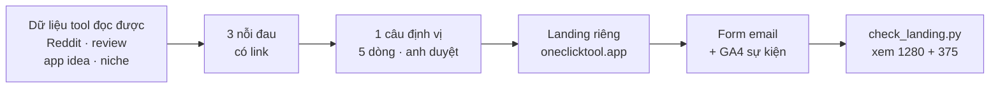

# Phase 52 · Định vị + landing + email

> Viết **một câu** nói rõ niche-radar cho ai, giải quyết gì, khác tool khác ở đâu. Rồi dựng **chỗ của mình**:
> landing riêng + form email + đo lượt bấm. Có chỗ này trước thì mọi bài đăng sau mới đếm được người về.

Chưa làm · sau Phase 51

## Chạy thế nào

## Câu định vị (5 dòng)

Theo Pha 1 của `/app-gtm`. Anh duyệt 5 dòng này **trước** khi dựng landing — sai định vị thì mọi bài sau đều phí.

| Dòng | Điền gì |
|---|---|
| **Cho ai** | một nhóm hẹp, gọi được tên chỗ họ tụ tập (vd indie dev / người làm app nhỏ đang tìm niche) |
| **Việc họ cần xong** | chọn được 1 niche đáng làm, có số, không đoán |
| **Họ đang dùng** | tool khác, tự mò tay, hoặc không làm gì |
| **Khác một câu** | nhiều nguồn + AI có trích dẫn + chạy trên máy |
| **Bằng chứng** | link thread / review thật. Không có link thì định vị là đoán |

## Làm gì

| | |
|---|---|
| :material-target: **Định vị** | 5 dòng ở bảng trên, ghi vào `marketing/gtm.md` qua `/app-gtm` (Pha 0 điểm xuất phát + Pha 1) |
| :material-emoticon-sad-outline: **3 nỗi đau** | lấy từ chính dữ liệu Reddit / review mà tool đọc được về "app idea", "niche". Mỗi nỗi đau có link nguồn |
| :material-web: **Landing riêng** | `/oneclicktool-landing` trên oneclicktool.app (tiếng Anh): hook · video demo quay từ app thật · 3 nỗi đau · tính năng · giá khớp [Version 10](version-10.md) · FAQ · CTA |
| :material-email-outline: **Form email** | form trên landing + mồi một dòng. Anh tự mở tài khoản dịch vụ email |
| :material-chart-line: **GA4 sự kiện** | `download`, `checkout_click`, `generate_lead`. Link đo nguồn dạng `?utm_source=<kênh>&utm_campaign=niche-radar` |
| :material-check-decagram: **Kiểm** | `check_landing.py` tới 0 lỗi, mở trang xem tận mắt ở 1280 và 375 |

**Xong khi**

- 5 dòng định vị có bằng chứng, anh duyệt
- Landing live, `check_landing.py` qua, đã xem ở 1280 + 375
- Gửi 1 email test → vào đúng danh sách
- Bấm thử nút tải / mua / gửi email → GA4 thấy đủ 3 sự kiện `download`, `checkout_click`, `generate_lead`

**Không làm ở phase này**

- Đăng bài ở kênh nào (để Phase 53–55)
- Bịa số người dùng, lời khen của khách trên landing
- Đổi giá so với [Version 10](version-10.md)
- Quảng cáo trả tiền

[Tổng quan Version 11](version-11.md)
