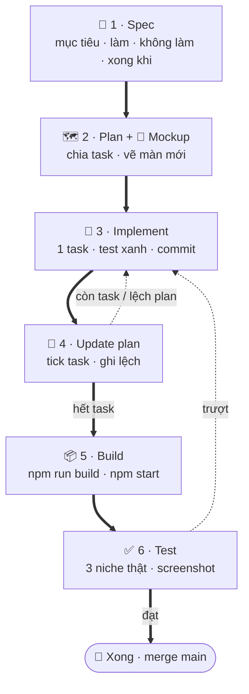

# Quy trình build

> Mỗi phase đi đúng **6 bước, theo thứ tự này**. Không nhảy bước, không code khi chưa có plan.

📄 Spec ➜ 🗺️ Plan + 🎨 Mockup ➜ 🔨 Implement ⇄ 🔁 Update plan ➜ 📦 Build ➜ ✅ Test ➜ 🚀 Xong

**⇄** = làm task → cập nhật plan → làm task tiếp, lặp tới hết task · ✅ trượt "Xong khi" → quay lại 🔨

## 6 bước

1

### 📄 Spec — chốt làm gì

- **Làm:** viết phase vào [Master Plan](superpowers/specs/2026-10-24-niche-radar-master-plan.md) §3: **mục tiêu ·
  làm gì · không làm gì · xong khi** (đo được). Trang tóm tắt `phase-N-*.md` cho site.
- **Ra file:** master plan §3 Phase N + `docs/phase-N-*.md`.
- **Qua bước khi:** anh chốt phạm vi. Việc ngoài phạm vi → master plan §4 "Đang pending".

2

### 🗺️ Plan + 🎨 Mockup — chia task, vẽ màn mới

- **Plan code:** `docs/superpowers/plans/YYYY-MM-DD-niche-radar-phaseN-<tên>.md` — Global Constraints, Tasks dạng
  checkbox, mỗi Task nêu file đụng tới + test cần viết. Khung theo plan Phase 1.
- **Mockup:** chỉ cho màn mới / khối mới. Claude viết prompt vào `design/mockups/phaseN/image-prompts.md`, **Codex sinh
  ảnh** (`codex exec`) vào `design/mockups/phaseN/`, Claude mở từng ảnh ra soát. Không tự vẽ bằng SVG/HTML.
- **Qua bước khi:** anh xem plan + mockup, đồng ý.

3

### 🔨 Implement — làm từng task

- Nhánh `phaseN-<tên>` cắt từ `main`.
- Mỗi Task: viết test → code → `npm test && npm run typecheck && npm run lint` **xanh** → commit.
- UI bám mockup bước 2.

4

### 🔁 Update plan & Implement — giữ plan đúng với code

- Xong Task → tick checkbox, ghi 1–2 dòng vào mục **Tiến độ** của plan.
- Gặp lệch (bug thật, endpoint chết, đổi cách làm) → **sửa plan trước, code sau**. Ghi rõ "thêm ngoài plan: vì sao".
- Việc mới ngoài phạm vi → master plan §4, **không làm lén**.
- Còn task → quay lại 🔨. Hết task → 📦.

5

### 📦 Build — chạy bản build, không phải bản dev

- `npm run build` → `npm start` (một process, cổng 3200) — mở được, không lỗi console.
- `npm run docs:build` (strict) — site tài liệu không gãy link.

6

### ✅ Test — đo thật, nhìn tận mắt

- `npm test` + `npm run smoke -- "<niche>" US` (gọi thật các nguồn).
- Chạy thật **3 niche**, ghi số đo (số keyword, thời gian, lỗi, ngày) vào mục **Kết quả chạy thật** của plan.
- Screenshot 1280 + 375 của mọi màn đổi → **mở ra xem**, so với mockup.
- Đối chiếu từng dòng **Xong khi** ở bước 1. Trượt dòng nào → quay lại 🔨.
- **Đạt** → cập nhật chip trạng thái (master plan §3 + `phase-N-*.md`) → merge `main` khi anh đồng ý.

## Luật

- **Không plan, không code.** Chưa có file plan bước 2 thì chưa mở nhánh.
- **Build xanh ≠ xong.** Xong = đạt hết "Xong khi" + screenshot đã xem.
- **Plan luôn khớp code.** Đọc plan là biết code đang ở đâu.
- **Số đo có ngày + nguồn.** Không đo được ghi `chưa đo`.
- **Merge `main` cần anh đồng ý.**
- **UI chưa có tính năng thì disable, không xoá.** Nút / ô / mục thuộc phase chưa làm vẫn hiện nhưng xám, không bấm được,
  ghi `Phase N` + tooltip "chưa làm" (class `soon-chip`, danh sách ở `src/lib/features.ts`). Làm xong phase thì bật lên.

## Đang ở bước nào

| Phase | Đang ở bước | Việc tiếp |
|---|---|---|
| 1 · Google Play Research | ✅ **6 · Test** — code xong, commit `6a5954b` | merge `main` khi anh đồng ý |
| 2 · App Store + Tiền thật | 📄 **1 · Spec** xong (master plan §3) | 🗺️🎨 viết plan code + mockup cột tiền / review iOS / khối TrustMRR |
| 3 · Trends + Feature Gap Matrix | 📄 Spec có trong master plan | — |
| 4 · Tích hợp AI | 📄 Spec có trong master plan | bắt đầu bằng 1–2 tuần dùng thật |
| 5 · Chấm điểm + Validate | 📄 Spec có trong master plan | — |
