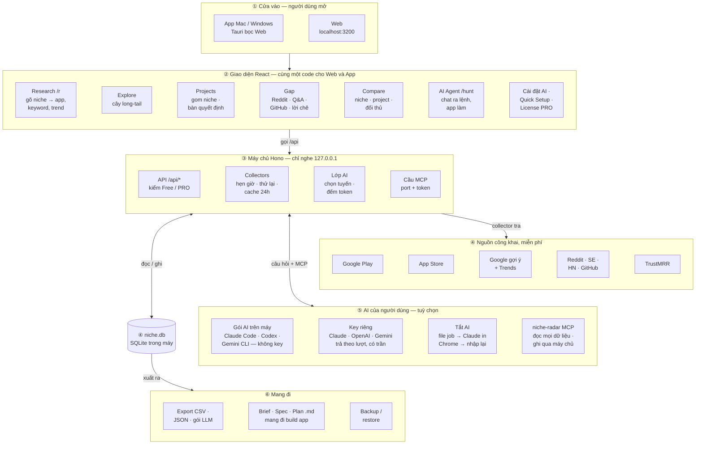
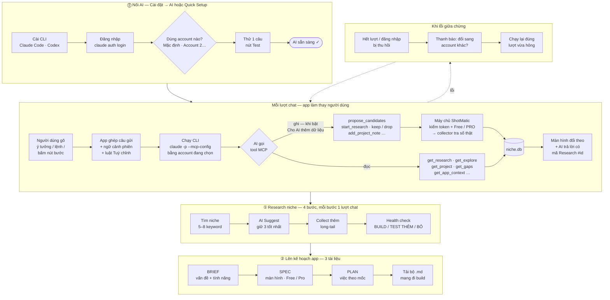

---
hide:
  - navigation
  - toc
---

# Sơ đồ ShotMatic

> Hai sơ đồ, trang rộng hết màn hình: **① toàn app** (mọi phần chạy trong máy bạn) và **② AI Agent** (AI bấm nút thay
> người dùng qua MCP). Cập nhật 2026-10-31. Plan phần còn thiếu của AI Agent: [Phase 28.19](web/phase-28-19-ai-agent-full-flow.md).

## ① Toàn app

Tất cả chạy **trong máy**: giao diện → máy chủ nhỏ (chỉ nghe `127.0.0.1`) → các nguồn công khai → một file SQLite.
AI là tầng tuỳ chọn (⑤) — tắt AI thì mọi số vẫn có, chỉ mất phần đọc + viết hộ.

**Đọc sơ đồ:** đọc từ trên xuống: ① mở app → ② bấm trên giao diện → ③ máy chủ chạy → ④ lấy số từ nguồn, lưu SQLite → ⑤ nhờ AI nếu bật → ⑥ mang kết quả đi. Mọi ghi vào dữ liệu — kể cả do AI — đều đi qua
máy chủ (cùng hàm kiểm với giao diện), MCP không tự ghi SQLite.

## ② AI Agent — từ lúc nối AI tới bộ tài liệu

Ba chặng: **⓪ nối AI** (cài · đăng nhập · chọn account · thử 1 câu) → **① research niche** → **② lên kế hoạch app**.
Mỗi lượt chat: app gọi CLI của người dùng kèm MCP → AI gọi tool → máy chủ chạy collector thật → giao diện đổi theo.

**Đã có:** chat ra lệnh, 7 bước 2 chặng, tool đọc + ghi, Hồ sơ app cho người đã có app (Phase 28.6 → 28.18).
**Còn thiếu:** chọn / đổi account ngay trong app, tự gợi ý đổi account khi hết lượt, AI chạm tới các màn còn lại
(Compare, Theo dõi, Export) — plan ở [Phase 28.19](web/phase-28-19-ai-agent-full-flow.md). Trong sơ đồ, ô
**Dùng account nào?** và khối **Khi lỗi giữa chừng** là phần của 28.19, hôm nay app luôn dùng account mặc định của máy.
