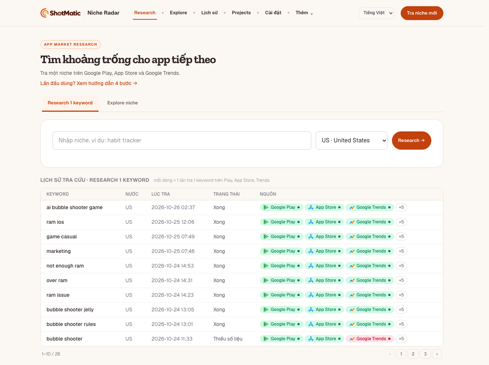
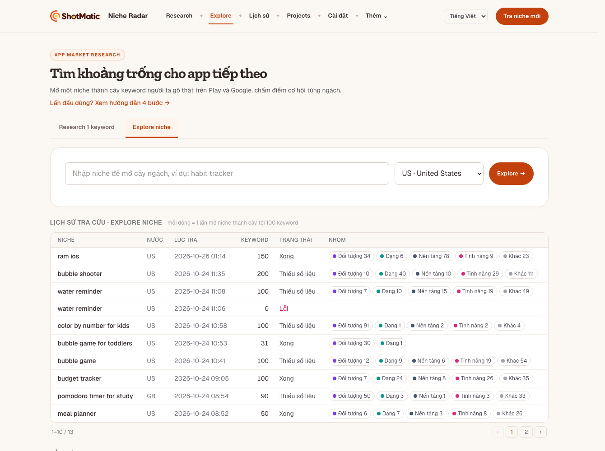

# ShotMatic — Tách rõ "Research 1 keyword" và "Explore niche" — Plan

> Ứng viên **Phase 9 · Small Features Update** (1 file plan / tính năng). Chỉ sửa chữ, thứ tự, nối luồng trên giao diện —
> **không** đổi cách thu dữ liệu. **Trạng thái: chờ anh duyệt, chưa code.** Ngày viết: 2026-10-26.

## Vấn đề

Trang chủ có 2 tab nằm cạnh nhau, **cùng một ô nhập, cùng ô chọn nước, cùng nút cam, cùng ví dụ `habit tracker`**.
Đổi tab thì chỉ đổi 1 dòng chữ nhỏ dưới tiêu đề. Người dùng thường nhìn vào không thấy 2 cái khác gì nhau.
Thanh menu trên còn có **Research** và **Explore** — trùng tên với 2 tab, bấm vào cũng chỉ là đổi tab.

*Hiện tại — tab Research 1 keyword (chụp 2026-10-26, 1340px).*

*Hiện tại — tab Explore niche. Khác tab trên đúng 3 chỗ: dòng chữ dưới tiêu đề, placeholder, chữ trên nút.*

## Hai tính năng thật sự làm gì (đọc từ code)

### Research 1 keyword — "Keyword này có đáng làm không?"

- **Đầu vào:** 1 keyword cụ thể + nước.
- **Làm gì:** lấy keyword đó + 5 keyword gần nhất từ gợi ý tìm kiếm của Google Play (tổng 6). Chạy song song 3 nguồn:
  Google Play (tìm + đọc chi tiết từng app đối thủ), App Store (iTunes Search), Google Trends.
- **Ra gì:** trang kết quả dài — Keyword × Store (đã có ai làm chưa), danh sách đối thủ (rating, lượt tải, lần cập nhật,
  mô hình tiền), Google Trends, Feature Gap, Sức khoẻ niche (điểm), đối thủ bị chê gì, tóm tắt AI.
- **Mất bao lâu (đo trong DB máy, 2026-10-26):** Google Play 24–97 giây ở đa số lượt (lâu nhất 253 giây),
  App Store 3–41 giây, Trends 2–7 giây. Cả lượt thường **1–2 phút**. Tra lại cùng keyword trong 24 giờ thì lấy cache.
- **Code:** `web/src/lib/run-research.ts`, trang `/r/:id` (`RunDashboard.tsx`).

### Explore niche — "Trong chủ đề này có những ngách nào, ngách nào còn trống?"

- **Đầu vào:** 1 chủ đề rộng + nước.
- **Làm gì:** hỏi gợi ý tìm kiếm của **Google Play, Google, App Store** cho chủ đề + từng chữ cái a–z + mẫu
  ("for kids", "widget", "offline"…) — khoảng 71 truy vấn. Giữ tới **100 keyword** người ta gõ thật (mở sâu thêm: 50 / lần,
  tối đa 3 tầng). Với **từng** keyword chỉ đo sơ: số app trên Play, số app trên App Store, tổng rating top 5 App Store.
  **Không** có Trends, không đọc chi tiết đối thủ, không đọc review.
- **Ra gì:** cây keyword chia 5 nhóm (Đối tượng · Dạng · Nền tảng · Tính năng · Khác), độ đông, điểm cơ hội *ước lượng*,
  bản đồ ngách. Tick tối đa 5 keyword → **Research sâu** = chạy Research 1 keyword cho từng cái, lần lượt.
- **Mất bao lâu (đo trong DB máy):** `ram ios` 236 giây, `bubble shooter` 702 giây → **4–12 phút**
  (App Store cho 1 truy vấn / 3 giây là chỗ chậm).
- **Code:** `web/src/lib/explore.ts`, `collectors/suggest.ts`, `collectors/explore-metrics.ts`, trang `/explore/:id`.

## So sánh bằng lời thường

| | Research 1 keyword | Explore niche |
|---|---|---|
| Trả lời câu hỏi | Keyword này có đáng làm không? | Chủ đề này chia ra những ngách nào? |
| Gõ vào | 1 keyword cụ thể, 2–5 từ (`habit tracker for adhd`) | 1 chủ đề rộng, 1–2 từ (`habit tracker`) |
| Ra | 1 keyword, đọc rất kỹ | ~100 keyword, đo sơ từng cái |
| Nguồn | Play (chi tiết) · App Store · Trends · review | Gợi ý Play + Google + App Store · đếm app |
| Thời gian | 1–2 phút | 4–12 phút |
| Dùng khi | Đã có ý cụ thể, cần quyết làm / bỏ | Mới có hướng, chưa biết ngách nào |
| Bước trong luồng | **Bước 2** (thu hẹp, chấm) | **Bước 1** (mở rộng, tìm) |

**Chỗ trùng (gây rối):**

- Cùng ô nhập, cùng ví dụ `habit tracker`, cùng ô nước, cùng kiểu nút → nhìn như 1 tính năng 2 tên.
- Cả hai đều gọi Google Play + App Store, đều dùng gợi ý tìm kiếm (Research lấy 5, Explore lấy 100).
- Cả hai gọi thứ gõ vào là "niche" (placeholder đều ghi "Nhập niche…").
- Thanh menu **Research / Explore** trùng tên tab; nút cam **New niche search** luôn về tab Research.
- 2 bảng lịch sử trông giống nhau.

**Chỗ khác thật (cần nói ra trên màn hình):** độ rộng (1 vs 100 keyword) · độ sâu (kỹ vs sơ) · thời gian (1–2 vs 4–12 phút) ·
thứ tự dùng (Explore trước, Research sau). Hai cái **không thay nhau** — là 2 bước nối tiếp.

## Mục tiêu · làm · không làm

- **Mục tiêu:** người mới nhìn trang chủ ≤ 5 giây biết bấm cái nào, không cần đọc hướng dẫn.
- **Xong khi:** 2 tab có tên, chữ giải thích, placeholder, ví dụ, nút **khác nhau rõ** · menu trên không còn trùng tên tab ·
  từ kết quả cái này sang cái kia bằng 1 nút có chữ rõ · đủ chữ trong `vi` / `en` / `es` · `npm run check` xanh ·
  screenshot 2 tab ở 1340px + 375px đã Read · cùng 1 câu hỏi "cái nào dùng khi nào" anh trả lời được sau 5 giây.
- **Làm:** mục 1–6 dưới đây.
- **Không làm:** đổi cách thu dữ liệu, số keyword, thời gian chạy · gộp 2 tính năng thành 1 lượt chạy · thêm Trends vào
  Explore · đổi điểm cơ hội / điểm sức khoẻ · đổi 2 bảng lịch sử ngoài tiêu đề · gợi ý tự động bằng AI ·
  landing shotmatic.app · deploy demo site (demo tự có chữ mới ở lần export + deploy sau).

## Đề xuất tách

### 1. Đặt lại tên — gọi theo việc, đánh số bước

| Chỗ | Hiện tại | Đề xuất (vi) | Đề xuất (en) |
|---|---|---|---|
| Tab 1 (đứng **trước**) | Explore niche | **① Tìm ngách** | **① Find sub-niches** |
| Tab 2 | Research 1 keyword | **② Chấm 1 keyword** | **② Check a keyword** |
| Nút tab 1 | Explore → | Tìm ngách → | Find sub-niches → |
| Nút tab 2 | Research → | Chấm keyword → | Check keyword → |

- Đổi thứ tự: **Tìm ngách đứng trước**, vì đi từ rộng tới hẹp (tài liệu `docs/cach-dung.md` cũng đã viết Explore trước).
- Chữ "niche" chỉ dùng cho chủ đề rộng; ở tab 2 gọi là "keyword". URL giữ nguyên (`/?mode=explore`, `/r/:id`,
  `/explore/:id`) để link cũ không gãy.

### 2. Chữ giải thích dưới mỗi tab (thay dòng chữ nhỏ hiện tại)

Mỗi tab có 1 khối 2 dòng ngay trên ô nhập:

- **① Tìm ngách** — *Dùng khi bạn mới có một chủ đề rộng.* Tool hỏi gợi ý tìm kiếm của Play, Google, App Store → ra tới
  100 keyword người ta gõ thật, chia nhóm, đếm sơ số app để thấy ngách nào còn vắng. **Mất 4–12 phút.**
- **② Chấm 1 keyword** — *Dùng khi bạn đã có 1 keyword cụ thể.* Tool đọc kỹ đối thủ trên Play + App Store, Google Trends,
  review bị chê → ra điểm sức khoẻ để quyết làm hay bỏ. **Mất 1–2 phút.**

Dưới 2 tab thêm 1 dòng nhỏ: *Chưa biết chọn? Chủ đề rộng → ① Tìm ngách. Ý cụ thể → ② Chấm 1 keyword.*

### 3. Placeholder + ví dụ bấm được

| Tab | Placeholder | 3 ví dụ (bấm để điền) |
|---|---|---|
| ① Tìm ngách | Chủ đề rộng, 1–2 từ — vd: water reminder | `habit tracker` · `meal planner` · `bubble shooter` |
| ② Chấm 1 keyword | Keyword cụ thể, 2–5 từ — vd: habit tracker for adhd | `habit tracker for adhd` · `water reminder for kids` · `meal planner offline` |

Ví dụ tab 2 cố ý **dài hơn** tab 1 — nhìn ví dụ là thấy khác nhau.

**Nhắc nhẹ (không chặn):** gõ 1–2 từ ở tab ② → hiện dòng *"Đây là chủ đề rộng — thử ① Tìm ngách trước?"* kèm link đổi tab.
Gõ ≥ 4 từ hoặc có "for …" ở tab ① → *"Đây đã là keyword cụ thể — ② Chấm 1 keyword nhanh hơn."* Chỉ đếm từ, không gọi mạng.

### 4. Thanh menu trên — bỏ trùng

- **Research** + **Explore** → đổi thành **Tìm ngách** + **Chấm keyword**, đúng thứ tự và đúng tên 2 tab (bấm = mở đúng tab).
  Không còn 2 bộ tên cho cùng một thứ.
- Nút cam **New niche search / Tra niche mới** → **Tìm ngách mới**, mở tab ①.
- **Lịch sử** giữ nguyên (đang tự theo tab đang mở).

> Phương án khác đã cân nhắc: bỏ hẳn 2 mục menu, chỉ giữ tab trên trang chủ (menu gọn hơn) — nhưng mất đường vào nhanh
> từ trang kết quả. Chọn giữ menu, chỉ đổi tên cho khớp. **Anh chọn nếu muốn ngược lại.**

### 5. Nối luồng giữa 2 bước

- Trang kết quả **Tìm ngách** (`/explore/:id`): nút **Research sâu →** đổi thành **Chấm kỹ N keyword đã chọn →**
  (N = số đang tick, tối đa 5). Thêm 1 dòng: *"Bước tiếp: tick 1–5 keyword điểm cao, tool chấm kỹ từng cái (1–2 phút / cái)."*
- Trang kết quả **Chấm 1 keyword** (`/r/:id`): nút **Explore từ đây →** đổi thành **Tìm ngách quanh keyword này →**.
  Lượt chấm mở ra từ một cây ngách thì đầu trang ghi **"Từ ngách: <chủ đề> ←"** bấm về lại cây (dữ liệu `node_runs` đã có,
  `flow-path.ts` đã tính đường đi — chỉ thêm chữ).
- Thanh bước `FlowSteps` đổi nhãn theo tên mới: Tìm ngách · Mở rộng · Chấm kỹ.

### 6. Chỗ còn ghi tên cũ — sửa cùng lúc

- `web/src/client/HomePage.tsx` — tab, thứ tự, khối giải thích, tiêu đề lịch sử.
- `web/src/components/SearchForm.tsx` — placeholder, ví dụ, nút, nhắc nhẹ.
- `web/src/components/AppShell.tsx` — menu + nút cam.
- `web/src/components/ExploreDashboard.tsx`, `NicheMap.tsx`, `ExploreButton.tsx`, `FlowSteps.tsx`, `ProgressPanel.tsx` — nhãn nút / bước.
- `web/src/client/GuidePage.tsx`, `AboutPage.tsx`, `web/src/lib/features.ts` — tên tính năng.
- `web/src/locales/vi.ts` · `en.ts` · `es.ts` — mọi chữ mới đi qua khoá dịch (không viết cứng như `HomePage` đang làm).
- `docs/cach-dung.md`, `README.md`, `CHANGELOG.md` (dòng **Web** dưới `[Unreleased]`).
- Test: `web/tests` — sửa test đang so chữ cũ; thêm test cho hàm đếm từ của "nhắc nhẹ".

## Cần anh chốt

1. Tên: **Tìm ngách / Chấm 1 keyword** (en: Find sub-niches / Check a keyword) — đồng ý hay muốn tên khác?
2. Thứ tự: **Tìm ngách đứng trước** và là tab mặc định khi mở trang chủ?
3. Menu: giữ 2 mục (đổi tên cho khớp) hay bỏ hẳn, chỉ để tab?
