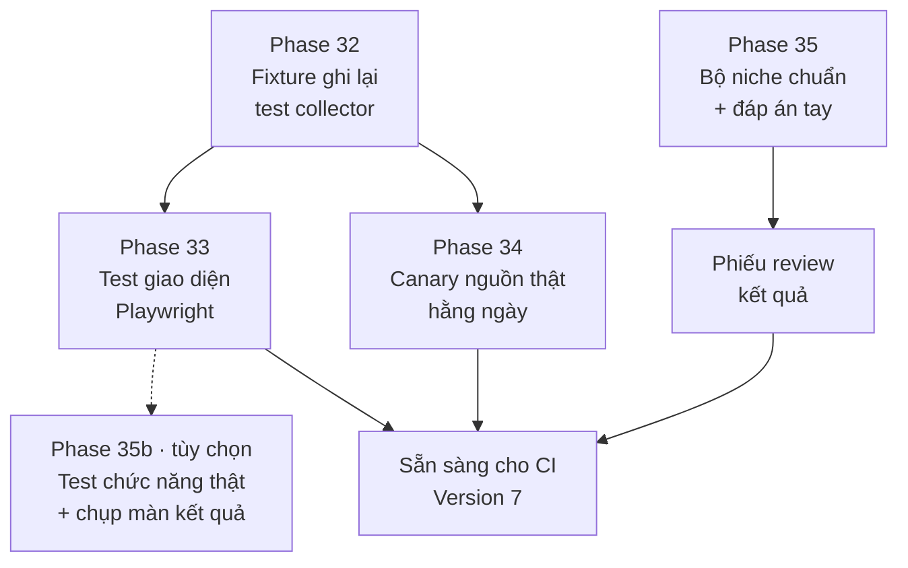

# Version 6 · Automation Test + Review Results

> Hai việc: **test tự động** để sửa code không sợ hỏng, và **review kết quả nghiên cứu** để biết tool có
> **trả lời đúng** không. Tool chọn niche mà ra số sai thì chạy nhanh hay đẹp cũng vô ích.

Chưa làm · sau Version 5

## Mục tiêu

- **Bắt lỗi code trước khi tới tay mình:** mọi luồng chính có test tự động, chạy không cần mạng.
- **Biết khi nguồn đổi:** Google / Apple đổi trang → biết trong 1 ngày, không phải khi đang chọn niche.
- **Biết tool đúng tới đâu:** có **bộ niche chuẩn** với đáp án kiểm tay. Mỗi bản mới chấm lại và ra **phiếu review**
  (đúng bao nhiêu, sai ở đâu).

**Thước đo Version 6 xong:** một lệnh chạy toàn bộ test (đơn vị + giao diện) xanh không cần mạng · canary chạy hằng ngày
trên máy · phiếu review của bộ niche chuẩn ra tự động, có điểm so với lần trước.

## Chạy thế nào

## Các phase

| Phase | Làm gì |
|---|---|
| [32 · Test collector bằng fixture](phase-32-fixture-tests.md) | ghi lại phản hồi thật của từng nguồn, test chạy trên bản ghi, đo độ phủ |
| [33 · Test giao diện (E2E)](phase-33-e2e-tests.md) | Playwright chạy luồng chính trên bản Web + so ảnh chụp |
| [34 · Canary nguồn thật](phase-34-source-canary.md) | mỗi ngày gọi thật 1 lượt nhỏ từng nguồn, báo khi nguồn đổi / bị chặn |
| [35 · Review kết quả](phase-35-review-results.md) | bộ niche chuẩn + đáp án tay, chấm tự động, phiếu review mỗi bản |
| [35b · Test chức năng + chụp kết quả *(tùy chọn)*](phase-35b-functest-screenshots.md) | search thật trên bản Web, chụp lại màn kết quả để xem tận mắt |

## Phase 32 · Test collector bằng fixture

- **Làm:** `npm run record` lưu phản hồi thật của Play, App Store, Trends, YouTube, Amazon… vào `tests/fixtures/` ·
  test collector đọc fixture, không gọi mạng · đo độ phủ (coverage), liệt kê file chưa có test · test cho lớp kiểm trích
  dẫn (Phase 20) và công thức điểm (Phase 1, 25).
- **Xong khi:** `npm test` xanh khi tắt mạng · mỗi collector có ≥ 1 test trên fixture thật · độ phủ `src/lib` + `src/collectors`
  có số, ghi vào trang này.

## Phase 33 · Test giao diện (E2E)

- **Làm:** Playwright trên bản Web, dữ liệu từ fixture: tra niche → explore → xem đối thủ → so sánh niche → hỏi dữ liệu
  (AI giả) → xuất · chụp ảnh từng màn ở 1340px và 375px, so với ảnh chuẩn.
- **Xong khi:** 5 luồng chính chạy xanh, không cần mạng · cố tình làm hỏng 1 nút → test đỏ đúng chỗ.

## Phase 34 · Canary nguồn thật

- **Làm:** mỗi ngày chạy trên máy (launchd) 1 keyword nhỏ qua mọi nguồn · so dạng dữ liệu với fixture (thiếu trường, đổi
  tên, rỗng) · lỗi → thông báo macOS + ghi `canary/log.md`.
- **Xong khi:** chạy 7 ngày liền có log · cố tình đổi fixture → canary báo "nguồn đổi dạng".

## Phase 35 · Review kết quả

- **Làm:** bộ **5 niche chuẩn**, mỗi niche có đáp án anh kiểm tay: 10 keyword đáng làm, 5 đối thủ chính, 3 chủ đề than ·
  `npm run review` chạy tool trên 5 niche → chấm: trùng bao nhiêu keyword / đối thủ / chủ đề · % trích dẫn qua kiểm ·
  % ô so sánh khớp màn chi tiết → **phiếu review** `.md` so với lần trước.
- **Xong khi:** phiếu review ra tự động, có điểm từng niche + điểm chung · chạy 2 lần cùng dữ liệu ra cùng điểm.

## Phase 35b · Test chức năng thật + chụp màn kết quả (tùy chọn)

Tùy chọn · chạy tay khi cần

- **Để làm gì:** Phase 33 chạy trên fixture nên không biết **search thật** ra màn hình thế nào. Phase này gõ keyword
  thật, đợi tool chạy xong, rồi **chụp lại màn kết quả** để anh mở ra xem ngay, không phải tự bấm lại.
- **Làm:** `npm run functest -- "<keyword>"` (bỏ trống thì lấy 1 keyword trong bộ niche chuẩn Phase 35) · Playwright mở bản
  Web, gõ keyword → bấm search → đợi run xong (có giới hạn thời gian) · chụp **cả trang** từng màn kết quả: tóm tắt run,
  bảng keyword, đối thủ, chủ đề than, so sánh niche · chụp ở 1340px và 375px · lưu vào
  `run/functest/<ngày>-<keyword>/` kèm `report.md`: bước nào qua / hỏng, thời gian từng bước, nguồn nào rỗng, link tới ảnh.
- **Kiểm tối thiểu trên kết quả thật:** bảng keyword có ≥ 1 dòng · không có ô "lỗi" / trang trắng · console không có lỗi đỏ.
  Không so ảnh với ảnh chuẩn (dữ liệu thật đổi mỗi ngày) — ảnh là để **người xem**.
- **Xong khi:** một lệnh ra đủ thư mục ảnh + `report.md` · cố tình tắt 1 nguồn → `report.md` ghi rõ nguồn đó rỗng,
  ảnh vẫn chụp được phần còn lại.
- **Không:** chạy tự động hằng ngày (việc của canary Phase 34) · đưa vào `npm test` · chạy trên CI.

**Luật**

- Test thường **không gọi mạng**. Chỉ canary gọi thật, và gọi thưa
- Đáp án chuẩn do người kiểm. AI không tự viết đáp án rồi tự chấm
- Test đỏ → sửa code, không sửa test cho xanh (trừ khi đáp án sai, ghi lý do)

## Không làm ở Version 6

- **Chạy test trên CI**: để [Version 7](version-7.md), ở đây chạy trên máy
- **Đặt mục tiêu độ phủ 100%**: chỉ phủ chỗ có logic
- **Canary gọi dày** hay chạy trên server
- **Test tải nặng** (nhiều người cùng lúc): tool vẫn là một người dùng
- **Tính năng mới**

