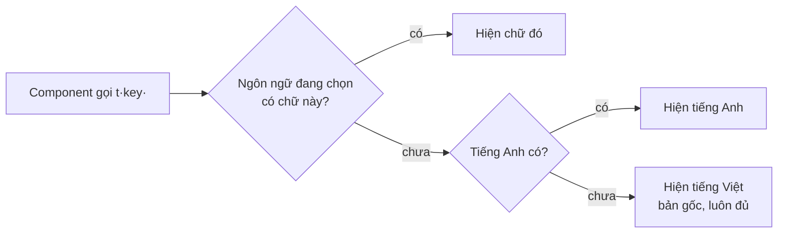

# Phase 10 · Đa ngôn ngữ (i18n)

> Dựng sẵn **khung dịch**: chữ giao diện tách ra file theo ngôn ngữ, có ô chọn ngôn ngữ. Khi cần bán cho người
> nước ngoài thì chỉ việc dịch thêm, không phải sửa lại code.

Khung xong 2026-10-25 · dịch đủ giao diện + chữ server 2026-10-26, English mặc định

## Chạy thế nào

- Ngôn ngữ có sẵn: **English** (mặc định từ 2026-10-26, cả demo lẫn app trên máy) · **Tiếng Việt** (bản gốc trong code) · **Español** (chưa dịch → hiện English).
- Chọn ở ô góc phải header hoặc **Cài đặt → Ngôn ngữ giao diện**. Lưu trên trình duyệt (`localStorage`), đổi luôn
  `<html lang>` để trình đọc màn hình và Google đọc đúng.
- Chưa tự đoán theo ngôn ngữ trình duyệt — mở lần đầu là English, đổi ở ô chọn thì nhớ trên trình duyệt đó (đổi xong tải lại trang).

## Hai cách dịch

| Cách | Dùng khi | Ví dụ |
|---|---|---|
| `t('key')` + `vi.ts` / `en.ts` | header, menu, Cài đặt (làm trước) | `t('nav.settings')` |
| `tr('Chữ tiếng Việt')` + `en-text.ts` | mọi chữ còn lại, cả ở server | `tr('Tổng rating top 10: {n}', { n })` |
| `tx('…')` + `lazyTr({...})` | bảng hằng tạo lúc import (nhãn, gợi ý) | `export const LABEL = lazyTr({ money: tx('Tiền') })` |

- Chữ server viết ra (lý do điểm, nhãn tiền, Feature Gap, gợi ý bàn quyết định, lỗi API) theo header `x-nr-lang` trang gửi kèm
  (`installLangHeader` trong `I18n.tsx`, `src/server/lang.ts`). Không có header → tiếng Việt (test giữ nguyên).
- Giá trị dữ liệu (verdict `TEST THÊM`, trạng thái project, nhóm tuổi app…) giữ tiếng Việt trong DB, chỉ dịch lúc hiện.
- Sửa chữ tiếng Việt trong `tr()` thì sửa khoá trong `en-text.ts` theo — `tests/i18n-text.test.ts` báo chữ nào thiếu bản dịch.
- Trang demo: `npm run demo:export` xuất bằng English; chữ AI đã viết sẵn trong DB dịch tay ở `web/scripts/demo-ai-en.json`.

## File nằm ở đâu

| File | Có gì |
|---|---|
| `web/src/locales/vi.ts` | bản gốc — mọi chữ đã tách ra, đủ hết. Kiểu `MessageKey` lấy từ file này |
| `web/src/locales/en.ts` · `es.ts` | bản dịch theo đúng key của `vi.ts`, được phép thiếu |
| `web/src/lib/i18n.ts` | danh sách ngôn ngữ (`LANGS`), hàm `translate`, thứ tự lấy chữ khi thiếu, `intlLocale` cho ngày / số |
| `web/src/components/I18n.tsx` | `I18nProvider` (bọc app trong `main.tsx`), `useT()`, `useI18n()`, ô chọn `LangSelect` |
| `web/tests/i18n.test.ts` | chặn key lạ, chặn chuỗi rỗng, chặn bản dịch sai biến `{n}` so với tiếng Việt |

## Dịch thêm một chỗ

1. Thêm key vào `vi.ts`, đặt tên `<chỗ>.<ý>` — ví dụ `'research.title': 'Research 1 keyword'`. Biến viết `{tên}`.
2. Trong component: `const t = useT();` rồi thay chữ cứng bằng `t('research.title')` (có biến: `t('shell.running', { n })`).
3. Thêm cùng key vào `en.ts`, `es.ts` (chưa kịp thì bỏ qua — trang tự hiện tiếng Anh / tiếng Việt).
4. `npm run check` ở gốc repo phải xanh.

## Thêm một ngôn ngữ

1. Chép `en.ts` thành `<mã>.ts` (ví dụ `ja.ts`), dịch các chuỗi.
2. Thêm 1 dòng vào `LANGS` trong `web/src/lib/i18n.ts`: `{ code: 'ja', label: '日本語', intl: 'ja-JP', messages: ja }`.
3. Sửa dòng `toEqual(['vi', 'en', 'es'])` trong `web/tests/i18n.test.ts`, chạy `npm run check`.

**Xong khi**

- Đổi ngôn ngữ ở header hoặc Cài đặt → header, menu, trang Cài đặt đổi chữ ngay, tải lại trang vẫn giữ
- Chuỗi chưa dịch tự hiện tiếng Anh, chưa có tiếng Anh thì tiếng Việt — không hiện key trần
- Test chặn key lạ / sai biến · `npm run check` xanh

**Không làm ở phase này**

- Prompt / gói gửi AI (prompt.md, brief.md, file job), evidence pack `.md`, tên cột CSV — còn tiếng Việt
- Bắt AI viết theo ngôn ngữ đang chọn (chủ đề than, tóm tắt niche) — prompt AI vẫn xin tiếng Việt
- Đường dẫn theo ngôn ngữ (`/en/...`), tự đoán theo trình duyệt, chữ phải-sang-trái
- Thư viện i18n ngoài (react-i18next…) — khung tự viết ~60 dòng là đủ; khi cần số nhiều phức tạp thì thêm `Intl.PluralRules`

[Tổng quan Web](index.md)
