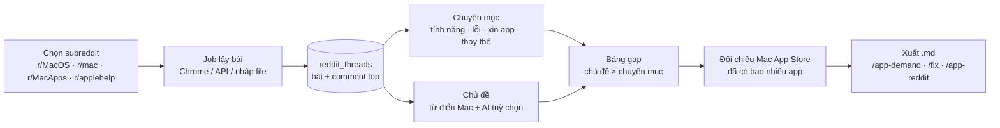

# Phase 11 · Reddit Gap

> Quét **câu hỏi top** của vài subreddit hỏi đáp (mẫu: r/MacOS) → xếp mỗi bài vào **chuyên mục** (tính năng · lỗi ·
> xin app · tìm thay thế) và **chủ đề** (Bluetooth, pin, Finder, quản lý cửa sổ…) → đếm chủ đề nào **hỏi nhiều nhất,
> được quan tâm nhất, chưa ai giải** → bảng gap kèm link bài gốc.

Code xong 2026-10-25 (tuyến C: nhập file) · chờ anh nhập ≥ 500 bài r/MacOS thật

**Vì sao làm, vì sao gấp.** Review store (Phase 1–4) chỉ cho biết người ta than app **đã có**. Reddit hỏi đáp cho biết
người ta **cần mà chưa có**: "is there a way to…", "is there an app that…", "X stopped working after update". Một chủ đề
hỏi đi hỏi lại mỗi tháng, nhiều upvote, câu trả lời top là "không có cách native" = gap. Ba chỗ dùng ngay:

- Chọn app Mac tiếp theo (`/best-app`, `/app-demand`)
- Bài cho [oneclicktool.app/fix](https://oneclicktool.app/fix) — mỗi lỗi hay gặp là một bài SEO / AEO
- Seeding Reddit (`/app-reddit`) — biết chủ đề nào đang có người hỏi để trả lời

**Đảo quyết định cũ.** Ngày 2026-10-24 Reddit bị gỡ vì "không trong plan" + cần key. Phase này đưa lại, nhưng
**khác hẳn bản cũ**: không đếm bài theo keyword, mà quét theo **subreddit** và gom thành chủ đề.

## Dùng thế nào (tuyến C — đã có)

Menu **Thêm → Reddit Gap** (hoặc nút Reddit Gap ở trang chủ). Không cần key, không cần Claude in Chrome.
Trang xếp **kết quả trước, việc lưu file sau** (sửa 2026-10-26 — bản đầu bắt lưu 10 trang rồi mới thấy gì):

1. **Đầu trang = bảng gap.** Chưa nhập gì → **bảng ví dụ** 4 dòng, ghi rõ "Ví dụ · số minh hoạ", để biết mình sẽ nhận
   được gì. Đã nhập → bảng thật: chủ đề × chuyên mục xếp theo điểm gap, lọc chuyên mục, bấm một dòng ra bài gốc.
2. **Ngay dưới = ô nhập.** Chọn subreddit (r/MacOS, r/mac, r/MacApps, r/applehelp hoặc gõ tên khác) → chỉ 2 dòng:
   **Top 12 tháng**, **Top 30 ngày**. Bấm **Mở JSON** → Chrome mở trang toàn chữ (100 bài) → **Cmd + S** → thả file vào
   **bất kỳ đâu trên trang** (cả trang nhận kéo thả) hoặc **Chọn file…**. Nhập lại file cũ chỉ cập nhật điểm / comment.
3. **Thêm nguồn** (mục gấp): 8 trang search mẫu cho bảng chắc hơn (cả 10 trang ≈ 600–1.000 bài) + cách lưu khi trang
   JSON lỗi (403, trắng, bắt đăng nhập): **HTML (dự phòng)** ở old.reddit.com, cuộn hết trang, Cmd + S, chọn
   **“Webpage, HTML Only”**. Trang www.reddit.com mới lưu HTML cũng đọc được.
4. **Đếm app Mac** tra Mac App Store theo từ khoá chủ đề (top 20 dòng, ≈ 1 giây / chủ đề, tối đa 50 → hiện "50+").
   **Tải .md**: top 20 gap + 3 link bài mẫu mỗi dòng, dán vào research hoặc đưa `/app-demand`.

**Điểm gap** = số bài × log2(2 + trung vị điểm+comment) × (1 − tỷ lệ đã giải) × (1 + tỷ lệ "không có cách gốc") ×
1 / (1 + số app Mac / 10). Chưa đếm app thì hệ số app = 1. "Không có cách gốc" chỉ đo được khi file có comment top —
file danh sách (top / search) không có comment, nên cột đó thường là "—".

**Sửa luật xếp**: `web/src/lib/reddit-rules.ts` (mẫu câu chuyên mục, ~40 chủ đề Mac, flair bỏ qua, dấu "đã giải").
Xếp lúc đọc, sửa luật là bảng đổi ngay, không phải nhập lại.

## Khả thi không — chấm trước khi code

| Câu hỏi | Trả lời (đo 2026-10-25) |
|---|---|
| Lấy dữ liệu bằng API chính thức? | **Khó.** Theo các blog bên thứ ba, từ 11/2025 Reddit đóng tự đăng ký API ("Responsible Builder Policy"): app mới phải xin duyệt, hay bị im lặng hoặc từ chối. Máy chưa có key cũ (`.env.local` không còn `REDDIT_*`). Chưa đọc được tài liệu chính chủ của Reddit — **chưa xác nhận** |
| Lấy bằng `.json` công khai (không key)? | **Không tin được.** Một blog nói từ 30/05/2026 trả 403 — chưa kiểm chứng. Và trên máy này `www.reddit.com` bị DNS trả về `127.0.0.1` (bị chặn ở mạng) nên chưa đo tay được |
| Lấy bằng Claude in Chrome (Chrome thật của anh, đã đăng nhập)? | **Khả thi nhất.** Cùng kiểu job TrustMRR ở [Phase 6](phase-6-ai-web.md): Claude mở trang top / search của subreddit, đọc tiêu đề + điểm + số comment + flair + comment top, ghi ra file `.json`, Niche Radar nhập vào. Chậm (≈ 100 bài / vài phút) nhưng không cần key. **Cần thử Chrome có vào được reddit.com không** (mạng đang chặn DNS) |
| Có đủ dữ liệu để thống kê không? | r/MacOS rất đông và hỏi đáp mỗi ngày. Top năm + top tháng + 6–8 câu search mẫu ≈ 600–1.000 bài — đủ để đếm chủ đề. Số thật: **chưa đo** |
| Phân loại không cần AI được không? | Được ở mức thô: chuyên mục bắt bằng mẫu câu ("how do I", "is there an app", "alternative to", "not working", "after updating") + flair. Chủ đề bắt bằng từ điển ~40 chủ đề Mac. Bài không khớp → thùng "khác", tuyến A (AI) gán sau nếu có key |

**Kết luận: khả thi — với điều kiện bước 0 qua.** Dữ liệu là chỗ duy nhất có thể chặn cả phase. Làm bước 0 (½ ngày)
trước: nếu không tuyến nào lấy được ≥ 500 bài r/MacOS → **dừng phase**, ghi lý do vào Appendix, không code tiếp.

## Chạy thế nào

## Làm gì

### Bước 0 · Thử đường lấy dữ liệu (½ ngày, làm trước hết)

- Thử Claude in Chrome mở `r/MacOS/top/?t=year` và một trang search — đọc được 100 bài không, có bị chặn mạng không
- Thử `.json` công khai và trang `old.reddit.com` từ mạng khác (nếu anh có)
- Ghi kết quả từng tuyến (được / 403 / chặn DNS) + ngày vào bảng dưới

**Kết quả bước 0 — lần 1 (2026-10-25, máy Mac của anh, mạng hiện tại)**

| Tuyến | Kết quả |
|---|---|
| `curl` thẳng `www.reddit.com/.../top.json` | ❌ Không kết nối — DNS trả `127.0.0.1` (mạng chặn). Không thử vòng qua IP / DNS khác (đúng luật phase) |
| Browser có sẵn trong app Claude | ❌ Bị chặn: Reddit nằm trong danh sách site không cho mở |
| Claude in Chrome | ⏸️ Chưa thử được — extension chưa kết nối (3 lần gọi đều báo "not connected") |
| `old.reddit.com` / mạng khác | ⏸️ Chưa thử |

**Lần 2 (2026-10-25, sau khi anh bật extension):** Claude in Chrome vẫn ⏸️ — danh sách Chrome đang nối với tài khoản
**trống** (0 trình duyệt), 2 lần gọi đều báo "not connected". Thường do extension đăng nhập tài khoản khác với app.

**Lần 3 (2026-10-25, sau khi anh đăng nhập đúng tài khoản):** vẫn 0 trình duyệt, vẫn "not connected". Lỗi nằm ở đường
nối extension ↔ app, chưa chạm tới Reddit — nên **chưa biết** Chrome có vào được Reddit hay không.

**Lần 4 (2026-10-25, anh mở tay):** ✅ Chrome của anh mở được `reddit.com/r/MacOS/top/?t=year`, thấy danh sách bài.
→ Mạng **không** chặn Chrome (chỉ chặn đường DNS mà `curl` dùng). Tuyến B (Claude in Chrome) **đi được về mạng**.
Claude in Chrome vẫn 0 trình duyệt nối với app → chưa đọc tự động 100 bài.

**Lần 5 (2026-10-25):** Claude in Chrome vẫn 0 trình duyệt. Anh chọn **tuyến C** (lưu file từ Chrome, nhập vào) —
đã code xong, xem phần "Dùng thế nào" ở đầu trang. Tuyến B làm sau khi extension nối được, ghi vào cùng định dạng file
`niche-radar-reddit/1`.

**Bước 0 qua một nửa.** Đã biết: Reddit vào được bằng Chrome. Chưa biết: đọc tự động được ≥ 100 bài / trang và đủ
trường (điểm, comment, flair, ngày). Việc tiếp: sửa đường nối extension ↔ app (tắt hẳn Chrome mở lại, mở khung Claude,
khởi động lại app Claude / session mới) rồi chạy job đọc 100 bài. Phương án dự phòng: tuyến C — anh lưu trang
(hoặc dán `top.json?t=year&limit=100` mở trong Chrome) thành file, Niche Radar nhập vào.

### Bước 1 · Lấy bài

- **Nguồn**: danh sách subreddit có sẵn cho Mac (r/MacOS, r/mac, r/MacApps, r/applehelp), anh thêm được
- **Lấy gì**: top năm + top tháng + search theo 6–8 mẫu câu hỏi, chỉ lấy trong subreddit đã chọn
- **Mỗi bài lưu**: id, subreddit, tiêu đề, đoạn đầu thân bài (≤ 500 ký tự), flair, điểm, số comment, ngày, link,
  3 comment top (≤ 300 ký tự mỗi cái), có flair "Solved" không
- **3 tuyến, một định dạng file**: (A) API nếu sau này có key · (B) job Claude in Chrome — mặc định · (C) nhập file
  `.json` đúng định dạng. Cả ba ghi vào cùng bảng `reddit_threads` (migration mới, backup trước như Phase 8)
- Chậm và lịch sự: ≥ 2 giây / trang, cache 7 ngày theo subreddit

### Bước 2 · Xếp chuyên mục + chủ đề (không AI)

- **Chuyên mục** (mỗi bài 1): `how-to` cách làm · `bug` lỗi / hỏng sau update · `app-request` xin app · `alternative`
  tìm thay thế · `complaint` than · `other`. Bắt bằng mẫu câu + flair, luật ghi trong một file để sửa
- **Chủ đề** (mỗi bài 1–2): từ điển ~40 chủ đề Mac (Bluetooth, Wi-Fi, pin, RAM, dung lượng, Finder, quản lý cửa sổ,
  menu bar, Spotlight, chụp màn hình, màn hình ngoài, bàn phím / phím tắt, Time Machine, iCloud, AirDrop, cập nhật macOS…)
- Bài không khớp → `other`; tuyến A (AI, đã có ở Phase 6) gán chủ đề nếu có key, ghi rõ "AI gán"

### Bước 3 · Thống kê gap

Mỗi chủ đề × chuyên mục một dòng:

- **Hỏi bao nhiêu**: số bài, số bài 90 ngày gần nhất, xu hướng theo tháng
- **Quan tâm bao nhiêu**: tổng điểm, tổng comment, trung vị điểm
- **Đã giải chưa**: % bài có flair Solved, % bài mà comment top có cụm "no native way / not possible / use an app"
- **Đã có app chưa**: số app Mac App Store khớp từ khoá chủ đề (dùng lại collector App Store Phase 2)
- **Điểm gap** = nhiều hỏi × nhiều quan tâm × ít được giải × ít app. Công thức hiện trên UI (di chuột vào cột),
  không có điểm bí ẩn

### Bước 4 · Màn hình + xuất

- Trang **Reddit Gap**: chọn subreddit → bảng chủ đề xếp theo điểm gap, lọc theo chuyên mục, bấm một dòng ra danh
  sách bài gốc (link Reddit). Một cột từ trên xuống, đọc rõ ở 1340px
- **Xuất `.md`**: top 20 gap + 3 link bài mẫu mỗi gap → dán vào `research/*.md` hoặc đưa `/app-demand`
- Gắn vào Project (Phase 8) như các nguồn khác

**Đã làm (2026-10-25, code):** bảng `reddit_threads` + `reddit_topic_apps` (migration 0014, backup tự động trước migrate) ·
đọc 4 dạng file (JSON danh sách, JSON trang một bài kèm 3 comment top, HTML old.reddit / www.reddit, file job) ·
xếp chuyên mục + chủ đề không AI · bảng gap + bài gốc + đếm app Mac + xuất `.md` · trang `/reddit` · 15 test với file mẫu
tự dựng theo cấu trúc Reddit (chưa có file Reddit thật trên máy để làm fixture — mạng chặn `curl`).

**Chưa làm trong lần này:** gắn chủ đề vào Project (Project hiện chỉ nhận keyword store) · AI gán chủ đề cho bài "Khác" ·
tuyến B (Claude in Chrome tự đọc). Ba việc này chờ có dữ liệu thật để biết có đáng không.

**Xong khi**

- Bước 0 có kết quả ghi ngày, ít nhất một tuyến lấy được ≥ 500 bài r/MacOS
- Chạy thật r/MacOS 12 tháng → bảng gap; kiểm tay 30 bài ngẫu nhiên: chuyên mục đúng ≥ 80 %, chủ đề đúng ≥ 70 %
- Top 10 gap mỗi dòng có ≥ 3 link bài thật mở được
- File `.md` xuất ra dùng ngay: chọn được **1 bài /fix** hoặc **1 ý tưởng app Mac** từ đó (output ra đô của phase)
- Test cho bộ phân loại (fixture bài thật đã ẩn tên người đăng) + test định dạng file nhập

**Không làm ở phase này**

- Đăng bài / comment lên Reddit (việc của `/app-reddit`, người làm tay)
- Lưu tên người đăng, nhắn tin, theo dõi người dùng cụ thể
- Quét toàn Reddit hoặc subreddit ngoài danh sách anh chọn; cào nhanh vượt mức lịch sự
- Vượt chặn: không đổi DNS / IP / proxy để vào Reddit khi mạng chặn — mạng chặn thì đổi tuyến hoặc dừng
- Đọc toàn bộ cây comment (chỉ 3 comment top)
- Subreddit ngoài Mac — để sau khi bản Mac chạy được (ghi Appendix)
- Đếm bài Reddit theo keyword như bản cũ đã gỡ

## Rủi ro

| Rủi ro | Cách đỡ |
|---|---|
| Không tuyến nào lấy được dữ liệu | Bước 0 trước, dừng sớm nếu trượt |
| Điều khoản Reddit cấm dùng dữ liệu cho sản phẩm bán | Bản đầu chỉ dùng nội bộ để research. Trước khi bán Pro (Phase 31+) phải đọc lại điều khoản, có thể tắt nguồn Reddit ở bản bán |
| Phân loại bằng mẫu câu sai nhiều | Kiểm tay 30 bài, sửa luật trong file; AI chỉ gán phần `other` |
| Top năm thiên về bài vui / tin tức, ít hỏi đáp | Lọc bỏ flair News / Discussion; thêm search theo mẫu câu hỏi |

Plan code chi tiết: [Phase 11](../superpowers/plans/2026-10-25-niche-radar-phase10-reddit-gap.md)
