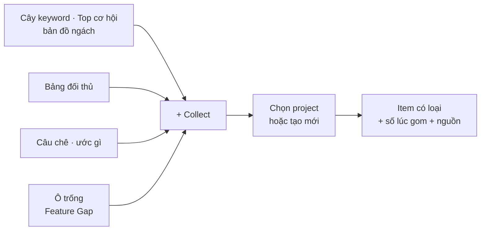

# Phase 12 · Collect niche vào Project

> Thấy gì đáng giữ ở **bất cứ chỗ nào** — keyword, ngách, đối thủ, câu chê, ô trống tính năng — bấm 1 lần là vào
> project, kèm số liệu lúc đó và nguồn. Gom nhanh, không mất dấu.

Chưa làm · plan 2026-10-25

**Hiện có (Phase 8).** Nút **+ Collect** (popover) ở kết quả Research / Explore gom niche hoặc long-tail vào một project,
copy được danh sách. Mới gom được keyword / niche, từng cái một, không ghi số lúc gom.

## Chạy thế nào

## Làm gì

| | |
|---|---|
| :material-shape: **5 loại item** | keyword · niche · đối thủ · lời chê / ước gì · khoảng trống tính năng. Mỗi loại có icon + cột riêng trong project |
| :material-gesture-tap: **Collect ở mọi chỗ** | cây keyword, bảng Top cơ hội, bản đồ ngách, bảng đối thủ, khối Đối thủ bị chê gì, ô Feature Gap "không ai có" |
| :material-checkbox-multiple-marked: **Gom hàng loạt** | tick nhiều dòng → Collect 1 lần (VD 20 long-tail từ cây keyword) |
| :material-folder-plus: **Chọn project nhanh** | popover nhớ project dùng gần nhất, gõ tên để tìm, tạo project mới ngay trong popover |
| :material-camera: **Chụp số lúc gom** | item tự lưu điểm cơ hội, số đối thủ, rating, giá… và lượt Research / Explore gốc + ngày — mở lại thấy vì sao đã gom |
| :material-note-edit: **Ghi chú 1 dòng** | ô ghi chú tuỳ chọn ngay lúc gom ("long-tail cho bản Mac") |
| :material-content-duplicate: **Không trùng** | cùng item cùng project → báo "đã có" + cập nhật số mới, không thêm dòng |
| :material-undo: **Hoàn tác** | thanh báo "Đã thêm 20 vào Project X · Hoàn tác" |

**Luật**

- Item giữ khoá ULID + nguồn gốc, đi theo gói `.niche.json` (nhập máy khác không nhân đôi — như Phase 8)
- Số chụp lúc gom không bị ghi đè khi tra lại; số mới nằm ở [Phase 21](phase-21-tracking.md)

**Xong khi**

- Gom được từ đủ 6 chỗ ở trên, mỗi loại hiện đúng cột trong project
- Gom 20 keyword 1 lần < 2 giây; gom lại → 0 dòng trùng
- Xuất / nhập project vẫn đủ item + số chụp (test round-trip)
- Test xanh, screenshot popover + project đã Read

**Không làm ở phase này**

- Sắp xếp, lọc, gộp project — [Phase 13](phase-13-project-manage.md)
- Đồng bộ project lên mạng — [Phase 61](phase-61-project-sync.md)

