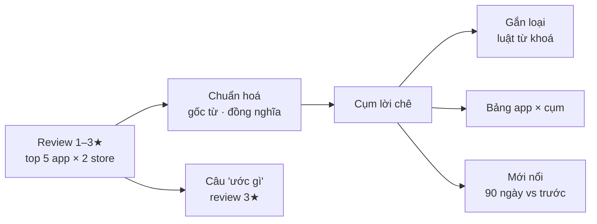

# Phase 12 · Đối thủ bị chê gì

> Từ "vài cụm từ lặp lại" thành **bản đồ lời chê**: app nào bị chê gì, chê kiểu gì, chê mới nổi hay chê cũ,
> và người dùng **ước gì** — mọi dòng có câu nguyên văn. **Không AI** (AI ở [Phase 17](phase-17-ai-summary.md)).

Chưa làm · plan 2026-10-25

**Hiện có (bản đầu ở Phase 1–2).** `complaints.ts` đếm cụm 1–3 từ trong review 1–2★ của top app Play + iOS, giữ cụm
xuất hiện ≥ 3 review, kèm câu trích. Chạy nhanh, không AI — nhưng còn trùng ý ("crash" · "keeps crashing"), không biết
app nào bị chê, không tách lỗi với thiếu tính năng, bỏ qua review 3★ (chỗ người dùng nói "ước gì").

## Chạy thế nào

## Làm gì

| | |
|---|---|
| :material-database-arrow-down: **Lấy đủ review** | top 5 app mỗi store, ≤ 200 review / app, có ngày + số sao + phiên bản; thêm review **3★** cho phần "ước gì". Cache 7 ngày như hiện tại |
| :material-merge: **Gộp cùng ý** | gốc từ (crash / crashes / crashing), bảng đồng nghĩa sửa được (`ads` = `advertisement` = `commercials`), bỏ tên app + tên thương hiệu khỏi cụm |
| :material-tag-multiple: **Loại lời chê** | luật từ khoá: Lỗi / crash · Mất dữ liệu · Ép trả phí / giá · Quảng cáo · Thiếu tính năng · Khó dùng · Đồng bộ / tài khoản · Khác. Dùng chung bảng mức nặng của Phase 9 |
| :material-table-account: **App nào bị chê gì** | bảng app × loại lời chê, ô = số review + bấm ra câu trích. Thấy ngay app nào yếu ở đâu |
| :material-trending-up: **Mới nổi** | so 90 ngày gần nhất với trước đó: cụm tăng mạnh gắn nhãn "mới nổi" (thường là bản cập nhật hỏng hoặc vừa đổi giá) |
| :material-lightbulb-on: **Người dùng ước gì** | lọc câu "wish / would be nice / please add / missing / need a way to" ở review 1–3★ → danh sách tính năng được xin, đếm số lần |
| :material-filter: **Lọc + mở gốc** | lọc theo store, app, loại, khoảng thời gian; câu trích bấm mở đúng trang review / app |
| :material-file-export: **Ra ngoài** | cụm + câu trích vào evidence pack và gói xuất ([Phase 16](phase-16-export.md)) |

**Luật**

- Mỗi cụm ≥ 3 review khác nhau, mỗi câu trích **khớp nguyên văn** review gốc (kiểm bằng code như Phase 6)
- Không dịch, không viết lại câu của người dùng
- Luật gộp và luật loại nằm trong 1 file, có test; thêm từ mới không cần sửa code

**Xong khi**

- 3 niche thật: kiểm tay top 10 cụm mỗi niche, ≥ 8/10 cụm có nghĩa (không phải từ rác)
- Gộp cùng ý làm số cụm trùng ý giảm rõ (đếm trước / sau trên cùng 3 niche, ghi số)
- Bảng app × loại đọc được ở 1340px, mọi ô bấm ra câu trích đúng app
- Danh sách "ước gì" có ≥ 5 dòng ở ít nhất 2 / 3 niche
- Test xanh, screenshot đã Read

**Không làm ở phase này**

- AI gom chủ đề / viết tóm tắt — [Phase 17](phase-17-ai-summary.md)
- So sánh 2–5 đối thủ cạnh nhau — [Phase 37](phase-37-compare-competitor.md)
- Lấy review ngoài 2 store (Reddit, YouTube…) — [Phase 10](phase-10-reddit-gap.md), [Phase 32](phase-32-youtube-ai.md)

