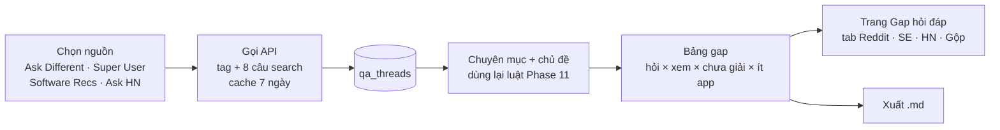

# Phase 12 · Q&A Gap (Stack Exchange + Hacker News)

> Lấy câu hỏi **xin phần mềm / hỏi cách làm** từ Ask Different, Super User, Software Recommendations và Ask HN qua
> **API chính thức, miễn phí, không cần key**. Xếp vào cùng **chuyên mục + chủ đề** như Reddit Gap. Ra bảng gap: chủ đề
> nào hỏi nhiều, nhiều người xem, mà **chưa có câu trả lời được chấp nhận**.

Xong 2026-10-26 · chạy thật 2.264 câu

**Dùng thế nào.** Menu **Thêm → Gap hỏi đáp** (trang `/reddit`, giờ có 4 tab). Tab **Stack Exchange**: chọn "Cả 3 site"
hoặc một site → **Lấy dữ liệu** (≈ 1–2 phút, chạy nền có thanh tiến độ) → bảng gap. Tab **Hacker News**: **Lấy dữ liệu**
(≈ 10 giây). Tab **Gộp**: cộng Reddit + Stack Exchange + HN. Mỗi tab có lọc chuyên mục, lọc năm, **Đếm app Mac**, **Tải .md**.

**Chạy thật 2026-10-26:** Ask Different 850 câu · Super User 770 · Software Recs 105 · Ask HN 539 (3 năm) = **2.264 câu**,
60 lệnh Stack Exchange (không phải 40 như ước — phần câu trả lời top tốn hơn) + 8 lệnh HN, không lỗi. Kiểm tay 30 câu
ngẫu nhiên (mẫu mới, sau khi sửa luật): chuyên mục đúng **28/30**, chủ đề đúng **22/30**. Chi tiết + ý tưởng chọn được:
plan, mục "Kết quả chạy thật".

**Vì sao làm.** [Phase 14](gap-sources-map.md) chấm 52 nguồn. Stack Exchange và Hacker News là hai nguồn Q&A duy nhất có
gap **Mạnh** mà gọi được bằng máy, không key, không chặn. Reddit (Phase 11) phải lưu file tay vì gọi máy bị 403.
Stack Exchange còn cho thêm hai thứ Reddit không có:

- **Lượt xem** của từng câu. Ví dụ: câu đầu bảng tag `software-recommendation` của Ask Different có 888.907 lượt xem.
  Đây là thước đo độ quan tâm tốt hơn upvote.
- **Cờ "đã có câu trả lời được chấp nhận"**: đo "chưa ai giải" mà không cần đoán bằng mẫu câu.

Anh duyệt 2026-10-26: gộp A (Stack Exchange) + C (Hacker News) thành một phase.

## Khả thi không: đo trước khi viết plan

Gọi thử từ máy làm việc ngày 2026-10-26:

- **Stack Exchange API:** chạy được, không cần key. `quota_max` 300 lệnh / ngày / IP. Lọc `filter=withbody` có thân bài.
  Key miễn phí của StackApps nâng lên 10.000 / ngày (số này theo nguồn phụ, chưa đo). Anh tự tạo key nếu cần.
- **Hacker News (Algolia):** chạy được, không cần key. "is there an app" + `tags=ask_hn` ra 92 bài, mỗi bài có
  `points`, `num_comments`, `created_at`. Rate limit không công bố.
- **Một lần chạy cần bao nhiêu lệnh:** 3 site Stack Exchange × (tag + 8 câu search) × 1 trang 100 bài ≈ 27 lệnh, cộng
  lệnh lấy câu trả lời top (100 câu hỏi / lệnh) ≈ 10 lệnh. Tổng ≈ 40 / 300 lệnh mỗi ngày. Bên HN, 8 câu × 1 trang = 8 lệnh.

**Kết luận: khả thi, không có bước nào chặn được cả phase.** Dữ liệu lấy bằng API ngay trong app, không cần lưu file
tay như Reddit.

## Chạy thế nào

## Làm gì

### Bước 1 · Lấy câu hỏi

- **Stack Exchange:** site `apple` (Ask Different), `superuser`, `softwarerecs`.
  - Tag: `software-recommendation` (Ask Different, 1.735 câu), `software-rec` (Super User, 1.118 câu), `macos`
    (Software Recs, 208 câu). Số câu đo bằng API `tags/info` ngày 2026-10-26.
  - 8 câu search dùng chung danh sách với Phase 11: "is there an app", "is there a way", "alternative to"…
  - Sắp theo `votes`. Lấy 1 trang 100 bài mỗi lệnh.
- **Câu trả lời top của Stack Exchange:** gọi `/questions/{ids}/answers?sort=votes` (100 id / lệnh), giữ 1–3 câu trả lời
  điểm cao nhất, mỗi câu ≤ 300 ký tự. Dùng để bắt câu "không có app / không làm được".
- **Hacker News:** Algolia `search` với `tags=ask_hn`, cùng 8 câu search, lấy bài 3 năm gần nhất
  (`numericFilters=created_at_i>…`). HN không có cờ "đã giải" và lượt xem, nên hai cột đó để "—".
- **Mỗi câu lưu:** nguồn (`se:apple`, `se:superuser`, `se:softwarerecs`, `hn`), id, tiêu đề, ≤ 500 ký tự thân bài,
  tag, điểm, lượt xem, số trả lời / comment, có câu trả lời được chấp nhận không, ngày, link, câu trả lời top.
  **Không lưu tên người hỏi, người trả lời.**
- **Lịch sự:** ≥ 1 giây giữa hai lệnh. Gặp `backoff` của Stack Exchange thì chờ đúng số giây. Cache 7 ngày theo
  nguồn + câu search. Hiện số lệnh Stack Exchange còn lại trong ngày.

### Bước 2 · Xếp chuyên mục + chủ đề

- **Dùng lại nguyên** `categoryOf` / `topicsOf` và file luật `reddit-rules.ts` của Phase 11 (~40 chủ đề Mac).
- Thêm luật cho chủ đề **Windows / đa nền tảng** và **dev tool** (HN hay hỏi). Thêm vào cùng file luật, không tạo file mới.
- Câu Stack Exchange gắn tag `software-recommendation` thì mặc định vào chuyên mục **Xin app**, trừ khi tiêu đề khớp
  mẫu câu của chuyên mục khác.

### Bước 3 · Bảng gap

Mỗi chủ đề × chuyên mục một dòng, giống Phase 11, thêm hai cột:

- **Lượt xem** (trung vị và tổng, chỉ Stack Exchange)
- **Chưa giải**: % câu **không** có câu trả lời được chấp nhận, hoặc câu trả lời top nói "không có app / không làm được"

**Điểm gap** = số câu × log2(2 + trung vị lượt xem / 1.000 + trung vị điểm) × (1 − tỷ lệ đã giải) × (1 + tỷ lệ "không
có cách gốc") × 1 / (1 + số app Mac / 10). Công thức hiện trên trang (di chuột vào cột). Đếm app Mac dùng lại
`countMacApps` của Phase 10.

### Bước 4 · Màn hình + xuất

- Trang `/reddit` đổi tên thành **Gap hỏi đáp**. Đường dẫn cũ `/reddit` vẫn mở được. Thêm tab **Reddit · Stack Exchange ·
  Hacker News · Gộp**.
- Tab **Stack Exchange / HN:** nút **Lấy dữ liệu** (chọn site), thanh tiến độ, số lệnh còn lại, rồi bảng gap. Một cột từ
  trên xuống như Phase 10.
- Tab **Gộp:** cộng các nguồn theo chủ đề × chuyên mục, thêm cột "có mặt ở nguồn nào". Chủ đề xuất hiện ở cả Reddit lẫn
  Stack Exchange thì đáng tin hơn.
- **Tải .md:** top 20 gap, mỗi dòng 3 link câu hỏi gốc, ghi rõ nguồn và ghi công CC BY-SA cho Stack Exchange.

**Xong khi**

- Chạy thật 3 site Stack Exchange + HN, ghi số câu lấy được và số lệnh đã dùng trong "Kết quả chạy thật" của plan.
- Kiểm tay 30 câu ngẫu nhiên: chuyên mục đúng ≥ 80 %, chủ đề đúng ≥ 70 %.
- Top 10 gap (tab Gộp) mỗi dòng có ≥ 3 link mở được.
- File `.md` chọn được **1 bài /fix** hoặc **1 ý tưởng app Mac** (output ra đô của phase).
- Test với fixture JSON thật của Stack Exchange và Algolia (đã bỏ tên người); `npm run check` xanh.

**Không làm ở phase này**

- Đăng câu hỏi / câu trả lời lên Stack Exchange hay HN
- Lưu tên hoặc id người dùng
- Đọc cả cây comment HN (chỉ dùng điểm và số comment)
- Site Stack Exchange ngoài 3 site trên (thêm sau, ghi Appendix)
- Gom chủ đề bằng AI / BERTopic (ứng viên ở Appendix). Bài không khớp vẫn vào "Khác" như Phase 11
- Tự tạo key StackApps thay anh

## Rủi ro

- **Hết 300 lệnh / ngày** → cache 7 ngày, hiện số lệnh còn lại, cho anh nhập key StackApps ở Cài đặt nếu cần.
- **Điều khoản:** nội dung Stack Exchange theo CC BY-SA, nên phải ghi nguồn ở mỗi link và trong file `.md`. Bản dùng nội
  bộ thì ổn. Trước khi bán Pro (Phase 31+) phải đọc lại điều khoản API.
- **Câu hỏi cũ:** top theo votes thiên về câu 2012–2016. Bảng có lọc "3 năm gần nhất" và cột xu hướng theo năm.
- **Từ điển chủ đề Mac không hợp HN:** HN hỏi nhiều về SaaS / dev tool, nên thêm chủ đề ở Bước 2. Phần còn lại vào "Khác".

Plan code: [2026-10-26-niche-radar-phase10b-qa-gap](../superpowers/plans/2026-10-26-niche-radar-phase10b-qa-gap.md)
