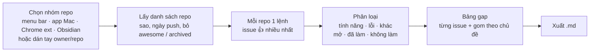

# Phase 13 · GitHub Feature Request Gap

> Chọn một nhóm repo (app Mac menu bar, app Mac, Chrome extension, plugin Obsidian…) → lấy các issue **nhiều 👍 nhất**
> qua GitHub Search API → tách ra những tính năng người dùng xin mà **maintainer không làm**: còn mở hơn 1 năm, hoặc đã
> đóng với lý do "không làm". Mỗi tính năng như vậy là một ứng viên app riêng hoặc plugin.

Xong 2026-10-26 · chạy thật 78 repo · 736 issue

**Vì sao làm.** Trong 52 nguồn của [Phase 14](gap-sources-map.md), đây là tín hiệu "cần mà chưa có" **sạch nhất**:
người dùng xin thẳng một tính năng, người khác bấm 👍, và GitHub cho sắp thẳng theo 👍. Điều khoản cũng thoáng nhất
trong các nguồn: GitHub cho dùng dữ liệu công khai để research. Hợp app Mac, dev tool và extension, đúng loại sản phẩm
đang làm.

Nó khác Reddit / Stack Exchange ở chỗ mỗi dòng là **một tính năng cụ thể** của một app cụ thể, kèm số người cùng xin.
Biết luôn đối thủ là ai và họ đã từ chối làm.

## Khả thi không: đo trước khi viết plan

Gọi thử từ máy làm việc ngày 2026-10-26:

- **Search API không token:** chạy được, giới hạn 10 lệnh / phút (header `x-ratelimit-limit: 10`). Có token cá nhân thì
  30 lệnh / phút (theo tài liệu GitHub). Token anh tự tạo; Claude không tạo, không nhập thay.
- **Không thể chỉ lọc theo nhãn `enhancement`.** Ví dụ Rectangle (app chia cửa sổ Mac): chỉ 2 issue `enhancement` còn mở,
  cả hai 0 👍, vì maintainer hay đóng issue. Lọc theo `reactions:>=5` thì ra 24 issue, đầu bảng 38 👍.
- **Nhãn "không làm" mỗi repo một kiểu.** Ví dụ "Move window to next desktop" có 22 👍 và nhãn `wontdo`, nhưng lý do đóng
  lại là "completed". Phải nhận ra bằng **cả** nhãn lẫn `state_reason = not_planned`.
- **Repo lớn có tín hiệu rõ.** `raycast/extensions` có 25 issue ≥ 10 👍. Có issue 43 👍 bị đóng "not planned".
- **Có đủ repo để chọn nhóm** (sao ≥ ngưỡng, đo bằng Search API):
  - `topic:macos` + `topic:menubar` ≥ 500 sao: 38 repo
  - `topic:macos-app` ≥ 1.000 sao: 88 repo (có lẫn repo "awesome-…", phải lọc bỏ)
  - `topic:chrome-extension` ≥ 1.000 sao: 235 repo
  - `topic:obsidian-plugin` ≥ 500 sao: 121 repo
- **Một lần chạy:** 1 lệnh / repo (100 issue nhiều 👍 nhất). Nhóm 40 repo không token ≈ 4 phút, có token < 2 phút.

**Kết luận: khả thi.** Chậm vì giới hạn 10 lệnh / phút, nên chạy nền có thanh tiến độ và cache 7 ngày theo repo.

## Chạy thế nào

## Làm gì

### Bước 1 · Chọn repo

- **4 nhóm có sẵn**, mỗi nhóm là một câu Search API (sắp theo sao, tối đa 50 repo):
  - **App Mac menu bar:** `topic:macos topic:menubar stars:>=500`
  - **App Mac:** `topic:macos-app stars:>=1000`
  - **Chrome extension:** `topic:chrome-extension stars:>=1000`
  - **Plugin Obsidian:** `topic:obsidian-plugin stars:>=500`
- **Thêm tay:** dán `owner/repo` (một dòng một repo), ví dụ repo của đối thủ đang soi.
- **Lọc bỏ:** repo archived, repo tắt issue, repo tên `awesome-…` hoặc không có issue nào ≥ 5 👍.
- **Lưu mỗi repo:** tên, sao, ngày push gần nhất, mô tả, topic, nhóm.

### Bước 2 · Lấy issue

- Mỗi repo 1 lệnh: `repo:<owner/repo> is:issue reactions:>=5`, sắp theo `reactions-+1`, 100 issue.
- **Mỗi issue lưu:** repo, số issue, tiêu đề, ≤ 500 ký tự thân, nhãn, số 👍, tổng reaction, số comment, trạng thái
  (`open` / `closed`), `state_reason`, ngày mở, ngày đóng, link. **Không lưu tên người mở hay người comment.**
- Lịch sự: theo header `x-ratelimit-remaining` / `x-ratelimit-reset`, hết lượt thì chờ tới giờ reset. Cache 7 ngày theo repo.

### Bước 3 · Phân loại

- **Loại:** **tính năng** · **lỗi** · **khác**. Bắt bằng nhãn (`enhancement`, `feature`, `feature request`, `idea`,
  `bug`…) và tiêu đề ("Feature request", "Support for", "Add", "Allow", "Option to"…). Luật nằm trong một file.
- **Số phận:**
  - **Không làm:** `state_reason = not_planned`, hoặc nhãn khớp `wont|won't|wontfix|wontdo|not planned|out of scope|declined`
  - **Đã làm:** đóng với `completed` và không có nhãn "không làm"
  - **Còn treo:** còn mở, ghi số năm
- **Chủ đề:** dùng lại `topicsOf` + luật Phase 11 (cùng chủ đề Mac). Issue không khớp thì vào "Khác".

### Bước 4 · Bảng gap

- **Bảng chính, mỗi dòng một issue tính năng chưa làm** (Không làm, hoặc Còn treo ≥ 1 năm). Có: repo, tiêu đề, 👍,
  comment, số năm, số phận, chủ đề, link.
- **Điểm gap** = log2(1 + 👍) × log2(2 + số comment) × min(3, số năm treo) × (Không làm ? 1,5 : 1). Công thức hiện trên
  trang. Nghĩa là nhiều người xin, bàn nhiều, treo lâu, đã bị từ chối thì đứng đầu.
- **Gom theo chủ đề:** số issue, tổng 👍, số repo khác nhau có cùng lời xin. Thêm số app Mac App Store đã có cho chủ
  đề đó, dùng lại `countMacApps` của Phase 10. Cùng một tính năng bị xin ở nhiều repo là tín hiệu mạnh nhất.
- **Gom theo repo:** repo nào từ chối nhiều tính năng được xin nhất, tức đối thủ "cứng đầu" nhất.

### Bước 5 · Màn hình + xuất

- Tab **GitHub** trên trang **Gap hỏi đáp** (cùng trang với [Phase 12](phase-12-qa-gap.md)). Có: chọn nhóm hoặc dán
  repo → **Lấy dữ liệu** (chạy nền, tiến độ, số lệnh còn lại) → bảng issue → 2 khung gấp "theo chủ đề" và "theo repo".
  Một cột từ trên xuống.
- Tab Gộp của Phase 12 **không** cộng GitHub vào. Dữ liệu GitHub là từng tính năng, không cùng đơn vị với câu hỏi.
- **Token GitHub (tuỳ chọn)** ở Cài đặt: chỉ cần token đọc dữ liệu công khai, không cần quyền nào. Anh tự tạo và dán.
- **Tải .md:** top 30 issue gap + top 10 chủ đề, mỗi dòng có link issue.

**Xong khi**

- Chạy thật nhóm **App Mac menu bar** và **App Mac**, ghi số repo, số issue, số lệnh, thời gian vào "Kết quả chạy thật".
- Kiểm tay 30 issue ngẫu nhiên: loại (tính năng / lỗi) đúng ≥ 85 %, số phận (không làm / đã làm / treo) đúng ≥ 90 %.
- Top 10 dòng bảng chính mở được, đúng là tính năng chưa có trong app đó.
- File `.md` chọn được **1 ý tưởng app Mac / plugin** từ một tính năng bị từ chối (output ra đô của phase).
- Test với fixture JSON thật của Search API (đã bỏ `user`); `npm run check` xanh.

**Không làm ở phase này**

- Comment, 👍, mở issue trên GitHub
- Lưu login / id người dùng GitHub
- Repo private, Discussions, Pull Request (để sau, ghi Appendix nếu cần)
- Cào trang web GitHub. Chỉ dùng REST Search API
- Tạo token thay anh
- Đọc cả cây comment của issue (chỉ đếm số comment)

## Kết quả chạy thật (2026-10-26)

Chạy trên bản sao DB thật, **không token** (Search API 10 lệnh / phút):

| Nhóm | Repo | Issue ≥ 5 👍 | Lệnh | Thời gian | Chờ hết lượt |
|---|---|---|---|---|---|
| App Mac menu bar | 34 (38 tìm thấy, bỏ archived / tắt issue) | 263 | 35 | 3,2 phút | 2,3 phút |
| App Mac | 47 (3 repo trùng menu bar dùng cache, không gọi lại) | 473 | 45 | 4,1 phút | 3 phút |

Gộp 2 nhóm: **78 repo · 736 issue** — tính năng 388 · lỗi 221 · khác 127; Đã làm 385 · Không làm 30 · Còn treo 310 · Trùng 11 →
**148 tính năng chưa làm** vào bảng.

- **Sửa sau chạy thật:** cùng một repo có cả topic `menubar` lẫn `macos-app` (vd exelban/stats) bị chuyển hẳn sang nhóm sau,
  nhóm menu bar mất issue. Repo giờ thuộc được nhiều nhóm (`groups`).
- **Kiểm tay 30 issue ngẫu nhiên** (hạt giống 7): loại đúng 22/30 → bổ sung luật (lỗi kiểu "CPU 100% usage", "memory usage",
  "not starting", "whenever…"; tính năng kiểu "Dark mode…", "Improve…", "…so I can…"; tiêu đề tiếng Trung). Mẫu **độc lập**
  (hạt giống 19, sau khi sửa luật): **loại đúng 26/30 = 87 %** (≥ 85 %), **số phận đúng 30/30** (lấy thẳng `state` +
  `state_reason` + nhãn). Lỗi còn: "We really need a new release" bị xếp tính năng. Lưu ý: "Đã làm" là theo maintainer đóng
  `completed` — có repo đóng hàng loạt bằng bot, không kiểm được từ API.
- **Top 10 bảng chính:** 9/10 đúng là tính năng app đó chưa có (CotEditor Hot Exit + Diff/merge bị từ chối · Plash nhiều màn
  hình treo 6,8 năm, 52 👍 · Moonlight clipboard chung 75 👍 + tự đổi độ phân giải 70 👍 · Ice đổi chỗ icon mới 70 👍 + Ice Bar
  chỉ màn hình máy 68 👍 · CotEditor code folding treo 11 năm · Moonlight phím tắt tuỳ chỉnh). 1 dòng sai: ImageGlass "mở nhanh
  hơn" là cải thiện tốc độ, không phải tính năng.
- **Chủ đề gắn từ luật Phase 11 còn nhiễu** (vd "Hot Exit" dính chủ đề Chậm / nóng vì chữ *hot*) — chỉ dùng để gom, đọc tiêu đề trước.

**Ý tưởng chọn từ file `.md` (output của phase):** cụm **Màn hình ngoài** đứng đầu theo số repo — 19 issue, 338 👍, 9 repo khác
nhau cùng xin (Plash: web làm hình nền trên nhiều màn hình · Ice: chỉ ẩn / Ice Bar trên màn hình máy hoặc màn có tai thỏ ·
Moonlight: tự đổi độ phân giải theo màn hình). → **App Mac menu bar "luật theo từng màn hình"**: cắm màn ngoài / rút ra thì tự
đổi bộ icon menu bar, hình nền (cả trang web), độ phân giải, bố cục. Bước kế: tra Research "multi monitor menu bar" + đếm
app Mac cho chủ đề, rồi đưa vào Project chấm ở Bàn quyết định (Phase 16).

## Rủi ro

- **10 lệnh / phút quá chậm với nhóm lớn** → tối đa 50 repo mỗi nhóm, chạy nền, cache 7 ngày. Có token thì nhanh gấp 3.
- **Search API chỉ trả tối đa 1.000 kết quả / câu** → chạy theo từng repo nên không chạm trần này.
- **Nhãn lạ không bắt được** → luật trong một file, kiểm tay 30 issue rồi bổ sung.
- **Tính năng đã có ở app khác** → cột số app Mac theo chủ đề. Mỗi tính năng tốt vẫn phải kiểm tay xem có app nào làm chưa.
- **Điều khoản:** GitHub Acceptable Use cho dùng dữ liệu công khai để research, cấm spam và bán thông tin cá nhân. Không
  lưu người dùng nên an toàn. Trước khi bán Pro (Phase 30+) đọc lại.

Plan code: [2026-10-26-niche-radar-phase10c-github-gap](../superpowers/plans/2026-10-26-niche-radar-phase10c-github-gap.md)
