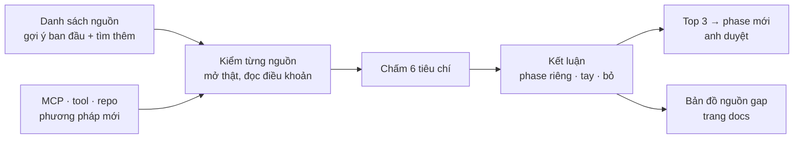

# Phase 14 · Research nguồn tìm gap

> Phase **chỉ research, không code**. Ngoài Reddit ([Phase 11](phase-11-reddit-gap.md)), dev và indie còn tìm gap,
> keyword niche ở đâu nữa? Liệt kê **hết** các nơi đó, chấm từng nơi tìm được gì, mạnh hay yếu, có nên đưa vào
> ShotMatic không. Đây cũng là chỗ gom **MCP**, **tool scrape / repo GitHub** dùng kèm được, và **phương pháp tìm
> gap / niche** mà anh chưa biết để hỏi.

Xong 2026-10-26 · top 3 đã duyệt → Phase 12 + 13

**Kết quả:** [Bản đồ nguồn gap](gap-sources-map.md) có 52 nguồn, 17 MCP, 21 repo / tool và 12 phương pháp, kiểm ngày
2026-10-26. Đề xuất 3 phase mới, tất cả dùng API miễn phí và dùng lại bảng gap của Phase 11:
**A · Stack Exchange Q&A Gap**, **B · GitHub Feature Request Gap**, **C · Hacker News Ask Gap** (có thể gộp với A).
Dự bị: X search (trả phí). Đề xuất hạ Amazon (Phase 53–54) xuống ứng viên. **Anh duyệt 2026-10-26:** A + C gộp thành [Phase 12 · Q&A Gap](phase-12-qa-gap.md), B thành [Phase 13 · GitHub Feature Request Gap](phase-13-github-gap.md).

**Vì sao cần.** Mới có 4 nguồn (Google Play, App Store, Google Trends, TrustMRR), sắp có Reddit. Các nguồn mới đã lên
lịch (YouTube, Amazon, Google Maps ở Phase 51–55) được chọn theo cảm giác, chưa so với nhau. Phase này so **mọi
nguồn** trên cùng một thang trước, rồi mới chọn cái nào đáng có phase code riêng. Như vậy không tốn công tích hợp một
nguồn yếu.

**Ra cái gì.** Một trang **Bản đồ nguồn gap** trong docs. Mỗi nguồn có chấm điểm, link, ngày kiểm và kết luận
**Làm phase riêng / Làm tay khi cần / Bỏ**. Đề xuất **top 3 nguồn** thành phase mới, anh duyệt mới đánh số.

## Chạy thế nào

## Thang chấm (mỗi nguồn)

Mỗi tiêu chí chấm **Mạnh / Vừa / Yếu**, kèm một câu lý do và link bằng chứng:

1. **Tín hiệu gap** — có cho thấy người ta *cần mà chưa có* không (câu hỏi lặp lại, xin app, chê, "ước gì"), hay chỉ cho
   thấy cái đã có
2. **Đo được độ quan tâm** — có upvote, lượt xem, số review, số tìm kiếm… để xếp hạng chủ đề không
3. **Lấy được dữ liệu** — API miễn phí · API trả phí · đọc qua Claude in Chrome · chỉ làm tay · cấm
4. **Chi phí** — miễn phí / có gói free / trả phí (ghi giá có nguồn + ngày, không đoán)
5. **Rủi ro điều khoản** — điều khoản có cấm quét, cấm dùng dữ liệu cho sản phẩm bán không
6. **Hợp loại app** — hợp app Mac, iOS / Android, SaaS web, Chrome extension, hay sản phẩm vật lý

**Kết luận** theo luật cố định, ghi trên trang: tín hiệu gap Mạnh + lấy được (không "cấm") → **Làm phase riêng**.
Tín hiệu Mạnh nhưng chỉ làm tay → **Làm tay khi cần** (ghi cách làm tay vào `/app-demand`). Tín hiệu Yếu → **Bỏ**.

## Làm gì

### 1 · Nơi tìm gap + keyword niche

Danh sách gợi ý để bắt đầu. Phase này kiểm từng cái và **tìm thêm**; chưa cái nào đã kiểm.

**Tìm kiếm và xu hướng** (người ta gõ gì):

- Pinterest Trends — xu hướng tìm kiếm trên Pinterest, mạnh với niche thiết kế, nhà cửa, cưới, kế hoạch
- TikTok Creative Center — hashtag và từ khoá đang lên
- Google Autocomplete + "People also ask" — câu hỏi thật quanh một keyword
- YouTube search suggest, Amazon autocomplete
- Exploding Topics, Glimpse, AnswerThePublic — chủ đề đang lên, gom câu hỏi (phần lớn trả phí, cần kiểm gói free)

**Cộng đồng hỏi đáp** (người ta hỏi gì, kẹt ở đâu):

- Apple Community (discussions.apple.com) — lỗi Mac / iPhone người dùng thường hỏi, rất hợp app Mac
- Stack Exchange: Ask Different (Mac), Super User — có API công khai, có vote, có "đã giải"
- Hacker News: Ask HN, bài "What do you wish existed" — có API tìm kiếm công khai
- Indie Hackers, Product Hunt discussions, Quora, nhóm Facebook, Discord, X search

**Chợ app, review, danh mục** (người ta chê gì, tìm thay thế gì):

- Mac App Store, Setapp, Raycast Store, Chrome Web Store, VS Code Marketplace, WordPress plugins, Shopify App Store,
  Figma Community
- AlternativeTo — người dùng đi tìm "alternative to X", có lượt thích
- G2, Capterra, Trustpilot — review 1–3★ của SaaS
- Product Hunt — sản phẩm mới, comment khi ra mắt

**Bằng chứng tiền** (niche nào có người trả tiền):

- TrustMRR (đã có), Acquire.com / Flippa (tin rao bán app ghi MRR), Indie Hackers products, Starter Story
- Gumroad, Etsy, Notion / Excel template marketplace — người ta mua template = có nhu cầu một app

**Yêu cầu tính năng** (người ta xin gì):

- Issue GitHub gắn nhãn feature request, xếp theo lượt 👍, ở các repo lớn trong niche
- Bảng góp ý công khai của đối thủ (Canny, Featurebase…)
- Upwork / Fiverr — việc lặp lại mà người ta trả tiền thuê làm tay

**Dữ liệu của chính mình:**

- Google Search Console của oneclicktool.app (nhất là `/fix`) — người ta gõ lỗi Mac nào mà tìm tới trang mình. MCP đã
  nối sẵn

### 2 · MCP dùng kèm AI

Gom MCP (Model Context Protocol, cổng để Claude gọi tool ngoài) giúp research. Mỗi cái ghi: làm gì, free hay trả phí
(giá có nguồn + ngày), chính chủ hay cộng đồng, dùng cho nguồn nào ở mục 1.

- **Đang có trên máy:** Google Trends, Search Console, Google Analytics
- **Cần kiểm:** Apify (actor quét Reddit / TikTok / Pinterest / Amazon), Firecrawl (đọc trang web), Exa, Tavily,
  Perplexity (tìm kiếm cho AI), Bright Data, DataForSEO (số tìm kiếm keyword), MCP cho Reddit / Hacker News /
  Product Hunt / YouTube transcript / App Store của cộng đồng
- Luật: MCP cộng đồng phải đọc code trước khi cài, không cài cái đòi quyền ghi hay gửi dữ liệu đi lạ

### 3 · Tool scrape + repo GitHub

Ghi: repo, số sao + ngày commit gần nhất (đo, không đoán), license, còn chạy không, dùng cho nguồn nào.

- **Lấy dữ liệu:** google-play-scraper, app-store-scraper, yt-dlp (metadata YouTube), Crawlee / Playwright, Scrapy,
  trafilatura (lấy chữ chính của trang)
- **Kho dữ liệu sẵn:** kho dump Reddit cho nghiên cứu (kiểu Arctic Shift) — thay cho API Reddit nếu điều khoản cho phép
- **Gom chủ đề:** BERTopic, KeyBERT, sentence-transformers — gom hàng nghìn câu hỏi thành chủ đề, thay từ điển tay ở Phase 11
- **Danh sách tổng hợp:** các repo "awesome" về indie hacking, scraping, market research

### 4 · Phương pháp tìm gap / niche (gợi ý anh chưa hỏi)

Mỗi phương pháp ghi: làm thế nào, nguồn nào, ShotMatic đã có chưa, nên thêm không.

- **SERP do diễn đàn chiếm** — tìm một câu hỏi trên Google mà top 3 là Reddit / Quora / Apple Community → chưa có trang
  hay app tốt trả lời = gap nội dung + gap app
- **Keyword "X alternative", "X vs Y", "X free"** — người đang muốn bỏ app đang dùng
- **Cụm "I'd pay for", "is there an app", "wish there was"** — tìm trên Reddit, HN, X
- **Đợt đổi nền tảng** — macOS / iOS mới (WWDC) làm hỏng app cũ hoặc mở API mới → cửa sổ niche ngắn, rất hợp app Mac
- **Tách tool lớn (unbundling)** — người dùng Excel / Notion / Photoshop chỉ cho 1 việc nhỏ, lặp lại → app nhỏ làm đúng việc đó
- **Template bán chạy** — template Notion / Excel bán tốt = quy trình người ta muốn có app
- **Extension nhiều người dùng, điểm thấp** — Chrome Web Store, Raycast, VS Code
- **Jobs-to-be-Done từ review** — đọc review theo "lúc nào dùng · để làm xong việc gì · vì sao đổi"
- **Upwork việc lặp lại** — việc người ta trả tiền thuê làm tay mỗi tuần
- **Search Console của mình** — câu tìm có lượt hiển thị cao mà trang mình chưa trả lời

**Xong khi**

- Trang **Bản đồ nguồn gap** có ≥ 30 nguồn, mỗi nguồn đủ 6 tiêu chí + kết luận + link + ngày kiểm
- ≥ 10 MCP và ≥ 10 repo / tool đã kiểm (sao, ngày commit, license, giá đo thật — chỗ chưa đo ghi `chưa đo`)
- ≥ 8 phương pháp, mỗi cái ghi ShotMatic đã có hay chưa
- Top 3 nguồn đề xuất thành phase mới, mỗi cái có lý do + phase cũ nào nên gộp / đổi (vd. so với YouTube / Amazon /
  Maps ở Phase 51–55) — anh duyệt mới đánh số
- Phần kiến thức chung (cách đọc nguồn, phương pháp) đẩy lên Product Growth Playbook bằng tiếng Anh; danh sách niche
  đang nhắm giữ riêng

**Không làm ở phase này**

- Viết code collector cho nguồn nào (để phase riêng sau khi anh duyệt top 3)
- Đăng ký tài khoản, trả phí, nhập key thay anh — gói trả phí chỉ ghi giá để anh quyết
- Cài MCP cộng đồng chưa đọc code
- Quét thử với số lượng lớn — chỉ mở vài trang để kiểm "lấy được không"
- Bịa số (giá, số sao, lượt dùng) — chưa đo thì ghi `chưa đo`

Plan code chi tiết: [Phase 14](../superpowers/plans/2026-10-25-niche-radar-phase11-gap-sources.md)
