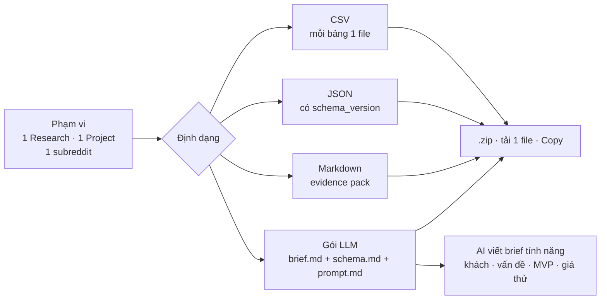

# Phase 15 · Export (CSV, JSON, gói cho LLM + brief tính năng)

> **Một nút Xuất chung** cho mọi thứ: chọn phạm vi × định dạng. Mở được bằng Excel / Sheets, đọc được bằng code,
> và có **gói dành riêng cho LLM** — dán vào Claude / ChatGPT là nó hiểu ngay niche, không vượt giới hạn token,
> rồi viết **brief tính năng** (khách · vấn đề · giải pháp khác · MVP · giá thử · 10 người đầu) dẫn nguồn từng ý.

Xong 2026-10-27 · kiểm CSV trên Google Sheets dời sang <a href="../phase-backlog-22-export-sheets/">Backlog 22</a>

**Hiện có (rải rác ở Phase 1, 7, 8).** CSV keyword ở Explore · project `.md` / CSV / `.niche.json` · evidence pack `.md`.
Mỗi chỗ một kiểu, tên cột chưa thống nhất, chưa có tài liệu định dạng, chưa có bản gọn cho AI.

**Đổi 2026-10-26.** Kéo lên làm ngay sau Phase 11 (trước 11–15), gộp **Product Brief Export** (ứng viên Version 12)
vào gói LLM. Vì đi trước Phase 18–21 nên dùng dữ liệu đang có: chủ đề than AI (Phase 6), điểm v2 (Phase 7/9),
Feature Gap đã lưu (Phase 4), item project kiểu keyword (Phase 8). Phase 18–21 xong thì gói tự giàu thêm.

## Chạy thế nào

## Làm gì

| | |
|---|---|
| :material-export-variant: **Hộp thoại Xuất chung** | cùng một hộp ở trang Research, trang Project và trang Reddit Gap; nhớ lựa chọn lần trước |
| :material-file-delimited: **CSV** | UTF-8 có BOM (Excel đọc đúng tiếng Việt), tên cột tiếng Anh `snake_case` cố định, ngày ISO, số không định dạng địa phương; mỗi bảng 1 file: keywords · competitors · complaints · gaps · trends · scores |
| :material-code-json: **JSON** | cùng dữ liệu, có `format: "niche-radar/export"` + `schema_version`, kèm mô tả cột trong [Định dạng file xuất](../export-schema.md) |
| :material-language-markdown: **Markdown** | evidence pack (Phase 7) — dán vào `research/*.md`, `/app-demand` đọc thẳng |
| :material-robot: **Gói cho LLM** | `brief.md` (front matter: niche, nước, ngày, nguồn; số chính; top đối thủ; lời chê kèm câu trích; khoảng trống tính năng; giá đối thủ; điểm + cờ) · `schema.md` giải thích từng cột · `prompt.md` việc AI phải làm |
| :material-file-document-edit: **Brief tính năng** | `prompt.md` bắt AI viết đúng khung: **khách** · **vấn đề** (từ lời chê) · **giải pháp khác** (đối thủ + cách làm tay) · **MVP** (3–5 tính năng, ưu tiên khoảng trống) · **giá thử** (từ giá đối thủ) · **cách tìm 10 người đầu** · rủi ro — mỗi ý dẫn mã nguồn `[C1]`, `[P2]`… trong brief, thiếu số thì ghi `chưa đo` |
| :material-counter: **Trần token** | chọn 8k / 32k / 128k → tool cắt bớt dòng ít giá trị trước (đuôi bảng, câu trích thứ 3+, Trends chi tiết), ghi rõ "đã cắt X dòng"; hiện ước số token trước khi xuất |
| :material-zip-box: **Đóng gói** | nhiều file → `.zip` tên `niche-radar-<phạm vi>-<ngày>.zip`; gói LLM có nút **Copy cho AI** (gộp 3 file thành 1 khối dán thẳng) |

**Luật**

- Cùng một dữ liệu thì CSV, JSON, Markdown, gói LLM ra **cùng số** (test so chéo)
- Gói LLM giữ nguồn + ngày cho mọi số; không gửi đi đâu — chỉ tạo file / copy
- Tool **không tự viết** phần nhận định của brief (khách, MVP, giá thử): chỉ đưa dữ liệu có mã nguồn + khung, AI viết
- Xuất không gọi mạng: Feature Gap chỉ lấy phần đã đọc (cache), chưa dựng thì ghi rõ
- Đổi tên cột = tăng `schema_version` + ghi CHANGELOG

**Cần xong trước:** [Phase 11](phase-11-reddit-gap.md) (đã code). Phase 18 · 13 · 14 không chặn nữa từ khi kéo lên sớm — xong thì gói tự giàu thêm.

**Task 4b xong (2026-10-26, nhánh `phase16b-reddit`)**

- Phạm vi **Reddit Gap** (`reddit:<subreddit|all>`): nút "Xuất cho AI" trên trang Reddit Gap thay nút Tải .md cũ — CSV `reddit_gaps` cùng số với bảng trên trang, JSON, `.md` y hệt bản cũ (top 20 + 3 bài mẫu), gói cho AI mã `[R1]` với prompt riêng cho dữ liệu Reddit (thiếu giá / đối thủ → `chưa đo`). Route `/api/reddit/gap.md` cũ vẫn chạy.
- Test gói Markdown đủ mọi mục, ô, số cột mà `check_demand.py` của `/app-demand` đọc

**Xong khi**

- CSV mở trong Numbers + Google Sheets không vỡ dấu, không lệch cột (3 niche thật)
- JSON của 3 niche đúng `schema_version` 1, đủ 6 bảng; nhập lại project từ `.niche.json` vẫn chạy như Phase 8
- Gói LLM 1 niche ≤ 8k token; dán vào Claude, hỏi 5 câu kiểm (top đối thủ, lời chê nhiều nhất, xu hướng…) → 5/5 đúng số
- Dán gói LLM vào Claude → ra brief tính năng đủ 7 mục, mỗi ý có mã nguồn có thật trong brief
- `/app-demand` đọc được gói Markdown không phải sửa tay — có test kiểm gói ra đúng các mục `/app-demand` đọc
- Reddit Gap xuất được CSV + Markdown cùng số với bảng trên trang

**Không làm ở phase này**

- Phạm vi 1 Explore và cả DB (Explore giữ nút CSV cũ; cả DB đã có Backup) — để sau, ghi ở Appendix
- JSONL, JSON Schema dạng file `.json` để máy kiểm — chỉ khi có tool khác cần đọc
- Nhập từ CSV (chỉ nhập `.niche.json` như cũ)
- Xuất PDF / slide, mở API cho tool khác gọi (MCP ở [Phase 27.3](phase-27-3-mcp.md))
- Tự gửi file lên AI hay tool tự viết brief bằng AI — gói chỉ là file, anh tự dán

Plan code chi tiết: [Phase 15](../superpowers/plans/2026-10-25-niche-radar-phase16-export.md)
