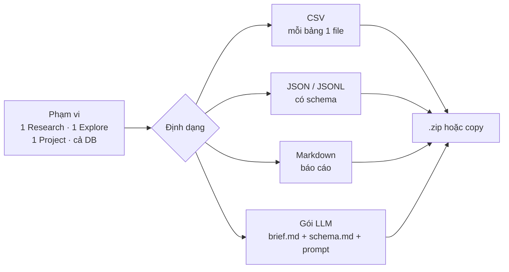

# Phase 16 · Export (CSV, JSON, gói cho LLM)

> **Một nút Xuất chung** cho mọi thứ: chọn phạm vi × định dạng. Mở được bằng Excel / Sheets, đọc được bằng code,
> và có **gói dành riêng cho LLM** — dán vào Claude / ChatGPT là nó hiểu ngay niche, không vượt giới hạn token.

Chưa làm · plan 2026-10-25

**Hiện có (rải rác ở Phase 1, 7, 8).** CSV keyword ở Explore · project `.md` / CSV / `.niche.json` · evidence pack `.md`.
Mỗi chỗ một kiểu, tên cột chưa thống nhất, chưa có tài liệu định dạng, chưa có bản gọn cho AI.

## Chạy thế nào

## Làm gì

| | |
|---|---|
| :material-export-variant: **Hộp thoại Xuất chung** | cùng một hộp ở Research, Explore, Project, Cài đặt → Dữ liệu; nhớ lựa chọn lần trước |
| :material-file-delimited: **CSV** | UTF-8 có BOM (Excel đọc đúng tiếng Việt), tên cột tiếng Anh `snake_case` cố định, ngày ISO, số không định dạng địa phương; mỗi bảng 1 file: keywords · competitors · complaints · gaps · trends · scores |
| :material-code-json: **JSON / JSONL** | cùng dữ liệu, có `format` + `schema_version`, kèm JSON Schema trong docs; JSONL cho bảng lớn (mỗi dòng 1 bản ghi) |
| :material-language-markdown: **Markdown** | báo cáo đọc được: tóm tắt, bảng chính, nguồn + ngày — dán vào `research/*.md` |
| :material-robot: **Gói cho LLM** | `brief.md` (front matter: niche, ngày, nguồn; số chính; bảng gọn top N; lời chê kèm câu trích; điểm + cờ) · `schema.md` giải thích từng cột · `prompt.md` câu hỏi mẫu ("niche này đáng làm không, vì sao, dẫn nguồn") |
| :material-counter: **Trần token** | chọn 8k / 32k / 128k → tool cắt bớt dòng ít giá trị trước (đuôi bảng, câu trích thứ 4+), ghi rõ "đã cắt X dòng"; hiện ước số token trước khi xuất |
| :material-zip-box: **Đóng gói** | nhiều file → `.zip` tên `niche-radar-<phạm vi>-<ngày>.zip`; 1 file → tải thẳng hoặc **Copy** vào clipboard |

**Luật**

- Cùng một dữ liệu thì CSV, JSON, Markdown, gói LLM ra **cùng số** (test so chéo)
- Gói LLM giữ nguồn + ngày cho mọi số; không gửi đi đâu — chỉ tạo file
- Đổi tên cột = tăng `schema_version` + ghi CHANGELOG

**Xong khi**

- CSV mở trong Numbers + Google Sheets không vỡ dấu, không lệch cột (3 niche thật)
- JSON của 3 niche qua JSON Schema; nhập lại project từ `.niche.json` vẫn chạy như Phase 8
- Gói LLM 1 niche ≤ 8k token; dán vào Claude, hỏi 5 câu kiểm (top đối thủ, lời chê nhiều nhất, xu hướng…) → 5/5 đúng số
- `/app-demand` đọc được gói Markdown không phải sửa tay

**Không làm ở phase này**

- Nhập từ CSV (chỉ nhập `.niche.json` như cũ)
- Xuất PDF / slide, mở API cho tool khác gọi (MCP ở [Phase 26](phase-26-mcp.md))
- Tự gửi file lên AI — gói chỉ là file, anh tự dán

