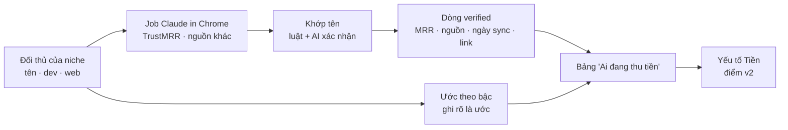

# Phase 16 · Doanh thu thật: TrustMRR + nguồn khác + AI

> Câu quan trọng nhất khi chọn niche: **có ai đang thu tiền thật không, bao nhiêu**. Phase này gom số doanh thu
> **verified** từ TrustMRR và các nguồn công khai khác, dùng AI để khớp tên đối thủ và đọc trang — và tách bạch số thật
> với số ước.

Chưa làm · plan 2026-10-25

**Hiện có (Phase 2, 5, 6, 9).** Cột Tiền (giá, gói IAP) + nhãn mô hình tiền cho từng đối thủ. TrustMRR **cấm quét** →
tra qua job Claude in Chrome theo tên đối thủ (đã ra 1 khớp gần đúng: nutrIA $18,073 MRR ở habit tracker). Phase 5
Verified Sites tạm dừng.

## Chạy thế nào

## Bước 0 — chọn nguồn (làm trước)

Mỗi nguồn ghi: có số công khai không · điều khoản cho phép đọc kiểu nào · cần đăng nhập không · độ phủ app mobile.
Nguồn nào cấm hoặc phải đăng nhập → chỉ đọc qua job Claude in Chrome do anh bấm, hoặc bỏ.

| Nguồn ứng viên | Kiểm gì |
|---|---|
| TrustMRR | đang dùng qua job — đo tỉ lệ khớp trên 10 niche |
| Trang "open startup" công khai của từng app (trang /open, /stats) | có link từ web đối thủ không, đọc được không |
| Bài chia sẻ doanh thu công khai (Indie Hackers, X của founder) | tìm theo tên app, chỉ lấy số có ngày + link |
| Bảng xếp hạng Top Grossing của store | thứ hạng làm **tín hiệu** thu tiền (không phải số tiền) |

## Làm gì

| | |
|---|---|
| :material-account-search: **Khớp tên chắc hơn** | luật (tên, tên dev, domain web) + AI xác nhận "cùng sản phẩm không" kèm lý do; điểm khớp: chắc · gần đúng · không khớp |
| :material-file-document-check: **Dòng verified đủ trường** | MRR · doanh thu 30 ngày · provider (Stripe / RevenueCat…) · ngày sync · link · ngày mình lấy |
| :material-chart-bar-stacked: **Ước theo bậc** | khi không có số thật: bậc $0 · <$1k · $1–10k · >$10k / tháng từ giá × tín hiệu (Top Grossing, số rating) — luôn nhãn **ước**, không trộn với verified |
| :material-table-star: **Bảng "Ai đang thu tiền"** | mỗi niche: đối thủ, mô hình tiền, verified / ước, nguồn. Đầu bảng 1 dòng: "3 app verified > $1k MRR" |
| :material-calculator: **Nối điểm v2** | yếu tố Tiền dùng verified khi có (độ tin "đo"), ước thì "proxy" |
| :material-clock-outline: **Làm mới** | số verified quá 30 ngày gắn "cũ", nút tạo job tra lại |

**Luật**

- Không quét trang cấm quét; không đăng nhập thay anh; job Claude in Chrome do anh bấm chạy
- **Không bịa số**: không có nguồn + ngày → không phải verified. Lượt tải không thay cho doanh thu
- AI chỉ khớp tên và đọc chữ trên trang; số lấy nguyên văn từ trang, kèm link

**Xong khi**

- Bảng Bước 0 điền đủ các nguồn ứng viên, có quyết dùng / bỏ + lý do
- 10 niche thật: đếm số đối thủ có verified, kiểm tay 10 dòng khớp tên (≥ 9 đúng)
- Bảng "Ai đang thu tiền" tách rõ verified / ước; evidence pack có bảng này

**Không làm ở phase này**

- Mua dữ liệu trả phí (Sensor Tower, Appfigures…) — chỉ khi Phase 11 back-test cho thấy cần
- Ước doanh thu bằng mô hình phức tạp; dự báo doanh thu của app mình

