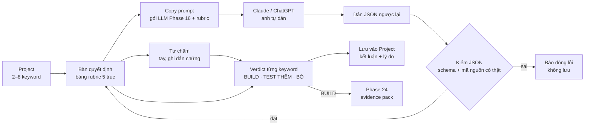

# Phase 16b · Bàn quyết định long-tail + đo nhu cầu Pro

> Trả lời câu **"chọn được 5 long-tail rồi, xong sao nữa?"**. Trong một Project, đặt các keyword cạnh nhau, chấm theo
> **rubric cố định 5 trục**, mỗi điểm phải có dẫn chứng lấy từ dữ liệu. Ra **BUILD / TEST THÊM / BỎ** cho từng keyword.
> AI chấm qua **Copy prompt → dán kết quả JSON ngược vào app**. Cùng lúc, gắn **nút Pro giả (fake-door)** để đo xem có
> ai muốn trả tiền không, trước khi đi tới Version 10.

Chưa làm · plan 2026-10-26 · từ review sản phẩm 2026-10-26 · đề xuất làm ngay sau Phase 16

**Vì sao làm.** Review sản phẩm ngày 2026-10-26 chỉ ra đoạn trống giữa "đẩy keyword vào Project" và "quyết định làm app":

- Project hiện chỉ có 3 chip (đang xem / ứng viên / loại), 1 dòng kết luận và ghi chú tự do. Không rubric, không so
  các keyword với nhau. Anh phải tự nhớ tiêu chí.
- [Phase 16](phase-16-export.md) đã có gói cho LLM, nhưng **chỉ một chiều**: anh dán ra AI, kết quả AI không quay lại
  app được.
- [Phase 24](phase-24-evidence-presell.md) có vòng BUILD / TEST THÊM / BỎ, nhưng cho **1 niche đã chọn**. Bước chọn
  1 trong N long-tail chưa có công cụ.
- [Phase 28](phase-28-compare-niche.md) so 2–4 **niche** (cả Research), không có verdict. Phase này so các **keyword
  trong 1 Project**, có verdict + dẫn chứng.
- Bán Pro nằm ở [Version 10](version-10.md) (Phase 66–69), sau App Mac. Đi tới đó mới biết có ai trả tiền là rủi ro
  lớn. Fake-door rẻ, đo được ngay trên demo site đang live.

**Cần xong trước:** [Phase 16](phase-16-export.md) (đã merge main: dataset chung, gói LLM có mã nguồn `[C1]`, `[P2]`…).
Phase 12 · 13 · 14 không chặn — xong thì rubric có thêm dữ liệu.

## Chạy thế nào

## Làm gì

### Phần A · Bàn quyết định (miễn phí, chạy ngay)

| | |
|---|---|
| :material-table-check: **Bảng rubric** | tab mới trong trang Project: mỗi keyword 1 hàng, 5 cột trục + cột verdict. 5 trục, chấm 1–5: **Nhu cầu** · **Đối thủ yếu** · **Khả năng thu tiền** · **Công sức build** (5 = ít công) · **Khả năng ASO ngách**. Bảng xếp dọc theo keyword, đọc được ở 1340px và 375px |
| :material-database-search: **Dữ liệu gợi ý mỗi ô** | ô hiện sẵn số có trong DB làm dẫn chứng: Trends 12 tháng + số gợi ý autocomplete (Nhu cầu) · sao TB top 10, số review, lần cập nhật cuối (Đối thủ yếu) · nhãn mô hình tiền, gói IAP, TrustMRR (Thu tiền) · điểm cơ hội keyword, số app khớp tên (ASO). **Công sức build** không có dữ liệu → người / AI tự chấm, bắt buộc ghi lý do (dùng lại trục "Hợp sức mình" của điểm v2) |
| :material-pencil: **Tự chấm tay** | bấm ô → chọn 1–5 + chọn dẫn chứng từ danh sách mã nguồn của gói Phase 16, hoặc gõ lý do. Không có dẫn chứng → ô ghi **chưa đo**, không tính vào tổng |
| :material-content-copy: **Copy prompt** | nút ở đầu bảng: ghép gói LLM Phase 16 (phạm vi Project, trần 8k / 32k) + rubric + luật dẫn chứng + định dạng JSON phải trả. Prompt ép: mỗi điểm 1 dẫn chứng có mã nguồn, không có thì `"chưa đo"`; chọn **1 BUILD, tối đa 1 TEST THÊM**, còn lại BỎ; 2 rủi ro lớn nhất của keyword BUILD + cách kiểm rẻ nhất (< $50, < 1 tuần); chỗ nào dữ liệu chưa đủ để kết luận |
| :material-clipboard-arrow-down: **Dán JSON ngược** | ô dán kết quả AI → kiểm theo schema `niche-radar/decision` v1: đúng keyword trong Project, điểm 1–5, mỗi dẫn chứng trỏ mã nguồn **có thật** trong gói đã copy. Dẫn chứng không có thật → ô đó gạch đỏ "dẫn chứng không có trong dữ liệu", điểm không tính. JSON sai cú pháp → báo dòng lỗi, không lưu gì |
| :material-compare: **AI vs tay** | khi có cả 2 bản chấm, ô lệch ≥ 2 điểm tô vàng để anh xem lại. Bản lưu cuối là bản anh chốt |
| :material-scale-balance: **Verdict + lưu** | mỗi keyword: BUILD / TEST THÊM / BỎ + 1 dòng lý do (bắt buộc với BỎ). Lưu vào kết luận Project + trạng thái item (BỎ = loại có lý do, khớp [Phase 15](phase-15-project-manage.md)). Mỗi lần chấm lưu thành 1 bản, xem lại được bản cũ |
| :material-rocket-launch: **Sang Phase 24** | keyword BUILD → nút "Làm evidence pack" mở đúng luồng [Phase 24](phase-24-evidence-presell.md) |
| :material-file-export: **Xuất** | bảng rubric + verdict + dẫn chứng đi theo hộp Xuất chung của Phase 16 (Markdown + CSV `decisions`) và gói `.niche.json` |

### Phần B · Fake-door đo nhu cầu Pro (chưa thu tiền)

**Fake-door** = nút cho tính năng chưa có. Người bấm thấy "đang làm, để email nhận khi mở" — đo được có ai muốn
trước khi làm thật.

| | |
|---|---|
| :material-lock-open-variant: **2 nút Pro** | (1) **"Chấm bằng AI 1 bấm"** cạnh nút Copy prompt · (2) **"Báo tôi qua email khi niche đổi"** ở khối Theo dõi của Project. Nhãn `Pro · sắp có` |
| :material-form-select: **Hộp khi bấm** | nói thật: tính năng chưa có, đang đo nhu cầu. Hỏi 1 câu giá **"Bạn sẵn sàng trả bao nhiêu?"** (Không trả · ~$5/tháng · ~$10/tháng · ~$29 một lần · Khác) + ô email. Không có nút mua, không lấy thẻ |
| :material-email-plus: **Email** | Mailchimp như demo site (`PRODUCT=niche-radar`) + tag `pro-<tính năng>` và tag mức giá đã chọn |
| :material-chart-bar: **Đếm** | GA4 sự kiện `pro_interest_click` (tính năng) và `pro_interest_email` (tính năng, mức giá). Gắn `VITE_GA_ID` cho demo site (việc còn treo từ Phase 31a). Bản chạy trên máy không gửi GA — chỉ ghi đếm vào DB của anh |
| :material-ruler-square: **Ngưỡng ghi trước** | trước khi bật, anh ghi ngưỡng vào trang này (đề xuất để anh sửa: sau 4 tuần ≥ 20 email Pro **và** ≥ 30 % trong số đó chọn mức có trả tiền) — đạt thì mở [Phase 66](phase-66-money-model.md) sớm, không chờ App Mac |
| :material-table-eye: **Kết quả** | bảng ở cuối trang này: ngày bật, số click, số email, phân bố mức giá, nguồn (GA4 + Mailchimp) + ngày đo. Chưa có số → ghi **chưa đo** |

**Luật**

- Tool **không gọi AI** ở phase này: Copy prompt + dán JSON là đường duy nhất. AI chạy trong app = tính năng Pro, chỉ
  làm khi fake-door đạt ngưỡng
- Không bịa dẫn chứng: điểm không có mã nguồn có thật trong gói → không tính, ghi `chưa đo`
- Không có "điểm tổng bí ẩn": tổng = cộng 5 trục, ô `chưa đo` không cộng, ghi rõ "3/5 trục có dữ liệu"
- Fake-door nói thật là chưa có, không thu tiền, không hứa ngày ra
- Ngưỡng ghi trước khi bật; đổi sau khi thấy số → ghi đỏ "đổi sau khi thấy số" (như Phase 24)
- Giá đối thủ trong review (credit $9, $19, $5.99…) **chưa vào `money.md`** — Phase 66 mở từng trang pricing đo lại có
  link + ngày
- Schema mới: `decision` đi theo `.niche.json` + tăng `schema_version` của Export + ghi CHANGELOG

**Xong khi**

- 1 Project thật 5 keyword: chấm tay đủ 5 trục, ra verdict, lưu, mở lại thấy đúng
- Copy prompt → dán vào Claude → dán JSON ngược: lưu được, 5/5 keyword đúng tên, mọi dẫn chứng trỏ mã nguồn có thật.
  Test thêm: JSON có 1 mã nguồn bịa → ô đó bị gạch, không tính điểm
- JSON sai cú pháp / thiếu keyword / điểm ngoài 1–5 → báo lỗi đúng dòng, không ghi DB (test tự động)
- `.niche.json` xuất → nhập lại giữ đủ bản chấm + verdict
- 2 nút fake-door chạy trên demo site live: bấm → hộp → email vào Mailchimp có đúng tag; GA4 Realtime thấy 2 sự kiện
- Bảng rubric + hộp fake-door đọc được ở 1340px và 375px, screenshot đã Read

**Không làm ở phase này**

- Gọi AI trong app (Decision Engine Pro) — chỉ khi fake-door đạt ngưỡng; ghi ứng viên ở [Version 12](version-12.md)
- Gửi email báo thay đổi thật — [Phase 23](phase-23-tracking.md) làm phần báo trong app, email sau [Version 9](version-9.md)
- Niche → Spec / ASO (PRD tóm tắt, title / subtitle / keyword field), báo cáo chia sẻ PDF / link — ứng viên Version 12
- Thanh toán, license, paywall thật — [Version 10](version-10.md)
- So nhiều niche (cả Research) — [Phase 28](phase-28-compare-niche.md)
- Đổi rubric theo từng người (trọng số tuỳ chỉnh) — dùng bản cố định trước, đổi khi có người xin

## Kết quả fake-door

| Ngày bật | Tính năng | Click | Email | Chọn có trả tiền | Nguồn + ngày đo |
|---|---|---|---|---|---|
| — | Chấm bằng AI 1 bấm | chưa đo | chưa đo | chưa đo | — |
| — | Báo email khi niche đổi | chưa đo | chưa đo | chưa đo | — |

**Ngưỡng anh chốt:** chưa ghi.
