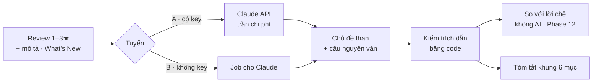

# Phase 17 · Tóm tắt niche + chủ đề than (AI)

> AI đọc review thay mình — đã chạy được qua job Claude (tuyến B). Phase này đưa nó lên mức **dùng hằng ngày**:
> chạy 1 bấm khi có key, tóm tắt theo khung cố định, kiểm chéo với lời chê không AI, mọi câu có trích dẫn đã kiểm.

Chưa làm · plan 2026-10-25

**Hiện có (Phase 6 + 9).** Tuyến B (job `.json` → Claude in Chrome / Claude Code → nhập lại) chạy thật 5 niche: 47 chủ
đề, mọi câu khớp nguyên văn, tóm tắt 5 câu có trích dẫn. Tuyến A (Claude API) đã code, **chưa chạy thật — chờ key**.
Mức nặng chủ đề ×3 / ×2 / ×1 ở Phase 9.

## Chạy thế nào

## Làm gì

| | |
|---|---|
| :material-key: **Chạy tuyến A thật** | khi có `ANTHROPIC_API_KEY`: đo token + tiền + thời gian trên 3 niche, ghi bảng; so chất lượng với tuyến B cùng dữ liệu |
| :material-format-list-checks: **Tóm tắt khung cố định** | 6 mục: ai dùng · đau gì nhất · đối thủ yếu chỗ nào · ai đang thu tiền · khoảng trống nên làm · rủi ro. Mục nào thiếu dữ kiện ghi "chưa đủ dữ liệu", không bịa |
| :material-check-decagram: **Trích dẫn đã kiểm** | mỗi câu tóm tắt ≥ 1 trích dẫn; hiện tỉ lệ khớp nguyên văn (VD 22/22); câu trượt kiểm bị gạch, không ẩn |
| :material-compare-horizontal: **Kiểm chéo** | chủ đề AI ↔ cụm lời chê không AI ([Phase 12](phase-12-competitor-complaints.md)): chủ đề AI không có cụm nào đỡ → gắn "chỉ AI thấy, nên kiểm" |
| :material-translate: **Review nhiều thứ tiếng** | review không phải tiếng Anh vẫn gom chủ đề; câu trích giữ nguyên văn gốc, tên chủ đề tiếng Việt |
| :material-cached: **Chỉ chạy phần mới** | cache theo nội dung review; tra lại chỉ gửi review mới, ghép với chủ đề cũ |
| :material-history: **Lịch sử bản tóm tắt** | giữ các lần tóm tắt theo ngày, xem chủ đề nào mới xuất hiện |

**Luật AI** (giữ như Phase 6)

- AI **không đưa số** — số chỉ từ collector; AI chỉ đọc chữ và trả trích dẫn
- Có trần chi phí mỗi lần tra; vượt trần thì dừng và báo, không chạy tiếp
- Tắt AI thì mọi tính năng khác vẫn chạy

**Xong khi**

- Bảng tuyến A vs B trên 3 niche: chất lượng · thời gian · tiền (có số đo + ngày)
- 3 niche có tóm tắt đủ 6 mục, ≥ 95% câu trích khớp nguyên văn
- Tra lại 1 niche sau 7 ngày chỉ gửi review mới (log token chứng minh)
- Test xanh (kiểm trích dẫn, ghép cache), screenshot đã Read

**Không làm ở phase này**

- Hỏi dữ liệu bằng lời — [Phase 38](phase-38-ai-cite-ask.md)
- Thêm tuyến AI mới (Gemini, OpenAI, AI trong trình duyệt) — [Phase 25](phase-25-ai-settings.md)

