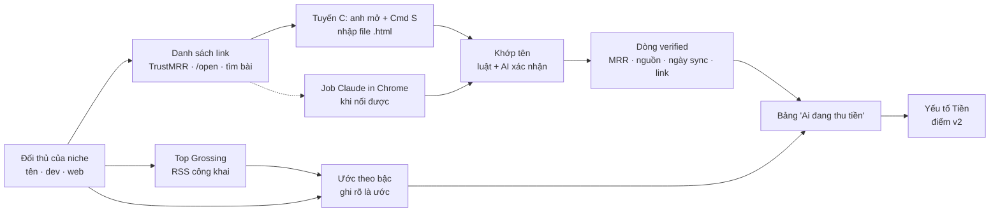

# Phase 18 · Doanh thu thật: TrustMRR + nguồn khác + AI

> Câu quan trọng nhất khi chọn niche: **có ai đang thu tiền thật không, bao nhiêu**. Phase này gom số doanh thu
> **verified** từ TrustMRR và các nguồn công khai khác, dùng AI để khớp tên đối thủ và đọc trang — và tách bạch số thật
> với số ước.

Chưa làm · plan 2026-10-25

**Hiện có (Phase 2, 5, 6, 9).** Cột Tiền (giá, gói IAP) + nhãn mô hình tiền cho từng đối thủ. TrustMRR **cấm quét** →
tra qua job Claude in Chrome theo tên đối thủ (đã ra 1 khớp gần đúng: nutrIA $18,073 MRR ở habit tracker). Phase 5
Verified Sites tạm dừng. Collector cũ (`web/src/lib/trustmrr.ts`: quét top 30 mỗi category + trang trùng tên app,
cache 7 ngày, có test) vẫn còn — dùng lại khi có API key, không viết lại từ đầu.

**Claude in Chrome không nối được** (5 lần thử tới 2026-10-25 — lý do Phase 10 phải chuyển sang tuyến C). Nên phase này
**không được chỉ dựa vào job Chrome**: thêm **tuyến C — anh tự mở trang, Cmd + S, nhập file** (giống Reddit Gap), và
tín hiệu tự động Top Grossing không cần Chrome. Job Chrome giữ làm tuyến phụ khi nào nối được.

**Cần xong trước:** [Phase 10](phase-10-reddit-gap.md) (mẫu nhập file tuyến C) · [Phase 13](phase-13-niche-health.md) (yếu tố Tiền + back-test để chạy lại)

## Chạy thế nào

## Bước 0 — chọn nguồn (làm trước)

Mỗi nguồn ghi: có số công khai không · điều khoản cho phép đọc kiểu nào · cần đăng nhập không · độ phủ app mobile.
Nguồn nào cấm quét hoặc phải đăng nhập → tool **không tự gọi**: anh tự mở trang và lưu (tuyến C), hoặc job Claude in
Chrome do anh bấm, hoặc bỏ.

| Nguồn ứng viên | Kiểm gì |
|---|---|
| TrustMRR | tuyến C: trang đã lưu (trang startup, trang tìm kiếm, top category) đọc được những trường nào; job Chrome nếu nối được — đo tỉ lệ khớp trên 10 niche |
| Trang "open startup" công khai của từng app (trang /open, /stats) | có link từ web đối thủ không, đọc được không |
| Bài chia sẻ doanh thu công khai (Indie Hackers, X của founder) | tìm theo tên app, chỉ lấy số có ngày + link |
| Bảng xếp hạng Top Grossing của store | thứ hạng làm **tín hiệu** thu tiền (không phải số tiền) — tự động, không cần Chrome |

## Làm gì

| | |
|---|---|
| :material-file-import: **Tuyến C — nhập trang đã lưu** | mỗi niche hiện danh sách link cần mở (TrustMRR theo tên đối thủ, trang /open của web đối thủ, câu tìm bài công khai); anh mở trong Chrome, Cmd + S, kéo thả nhiều file vào; tool đọc MRR / doanh thu nguyên văn + ngày sync, báo file nào đọc được gì. Nhập lại file cũ không nhân đôi |
| :material-account-search: **Khớp tên chắc hơn** | luật (tên, tên dev, domain web) + AI xác nhận "cùng sản phẩm không" kèm lý do; điểm khớp: chắc · gần đúng · không khớp |
| :material-file-document-check: **Dòng verified đủ trường** | MRR · doanh thu 30 ngày · provider (Stripe / RevenueCat…) · ngày sync · link · ngày mình lấy |
| :material-chart-bar-stacked: **Ước theo bậc** | khi không có số thật: bậc $0 · <$1k · $1–10k · >$10k / tháng từ giá × tín hiệu (Top Grossing, số rating) — luôn nhãn **ước**, không trộn với verified |
| :material-table-star: **Bảng "Ai đang thu tiền"** | mỗi niche: đối thủ, mô hình tiền, verified / ước, nguồn. Đầu bảng 1 dòng: "3 app verified > $1k MRR" |
| :material-calculator: **Nối điểm v2** | yếu tố Tiền dùng verified khi có (độ tin "đo"), ước thì "proxy" |
| :material-clock-outline: **Làm mới** | số verified quá 30 ngày gắn "cũ", nút mở lại đúng link để lưu bản mới (hoặc tạo job) |
| :material-history: **Chạy lại back-test** | yếu tố Tiền đổi từ "proxy" sang "đo" → chạy lại back-test của [Phase 13](phase-13-niche-health.md), ghi bảng điểm trước / sau |

**Luật**

- Không quét trang cấm quét: tool không tự gọi TrustMRR; anh tự mở + lưu (tuyến C) hoặc bấm job Claude in Chrome. Không đăng nhập thay anh
- **Không bịa số**: không có nguồn + ngày → không phải verified. Lượt tải không thay cho doanh thu
- AI chỉ khớp tên và đọc chữ trên trang; số lấy nguyên văn từ trang, kèm link

**Xong khi**

- Bảng Bước 0 điền đủ các nguồn ứng viên, có quyết dùng / bỏ + lý do
- Chạy được **không cần Claude in Chrome**: tuyến C nhập ≥ 10 trang đã lưu thật, đọc đúng số (kiểm tay)
- 10 niche thật: đếm số đối thủ có verified, kiểm tay 10 dòng khớp tên (≥ 9 đúng)
- Bảng "Ai đang thu tiền" tách rõ verified / ước; evidence pack có bảng này
- Back-test Phase 13 chạy lại sau khi có verified, bảng trước / sau nằm ở trang Phase 13

**Không làm ở phase này**

- Mua dữ liệu trả phí (Sensor Tower, Appfigures…) — chỉ khi Phase 13 back-test cho thấy cần
- Ước doanh thu bằng mô hình phức tạp; dự báo doanh thu của app mình

Plan code chi tiết: [Phase 18](../superpowers/plans/2026-10-25-niche-radar-phase18-revenue.md)
