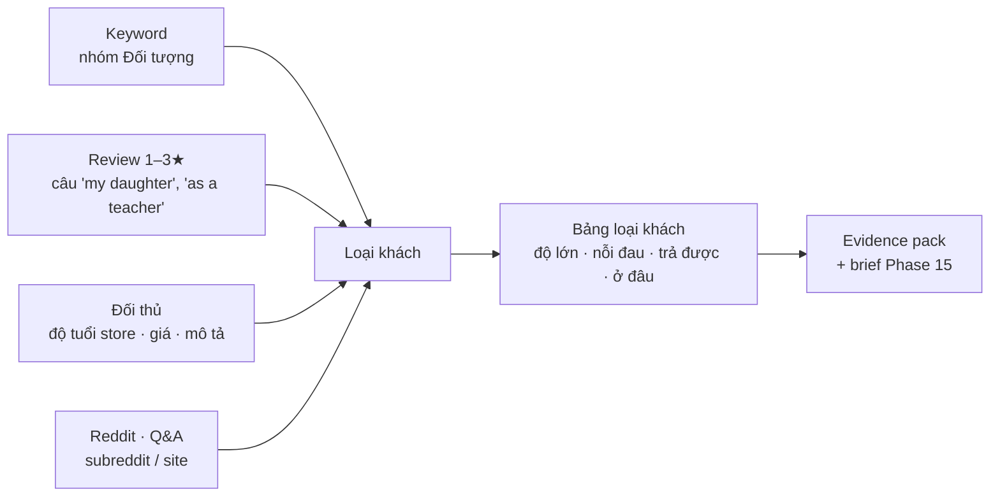

# Phase 19 · Ai là khách hàng

> Một niche có nhiều loại khách (trẻ em, phụ huynh, giáo viên, người ADHD…). Phase này trả lời **ai đang dùng, ai đang
> khó chịu, ai trả được tiền, tìm họ ở đâu** — mỗi ô có dẫn chứng. **Không đoán giới tính / độ tuổi.**

Chưa làm · plan 2026-10-26

**Từ đâu ra.** Issue [#1 "Nên có thêm chức năng Tìm loại khách hàng bán được"](https://github.com/nvminhtu/niche-radar-docs/issues/1)
(thanhtungtnt, 2026-10-26): "Có nhiều loại khách hàng: nam, nữ, tuổi… Xác định được loại khách hàng cũng là cái user cần biết."

**Vì sao đổi đề bài.** Google Play, App Store, Google Trends bản công khai **không công bố** giới tính hay độ tuổi người dùng.
Số đó chỉ có ở tool trả phí (Sensor Tower, data.ai) và cũng là ước tính. Niche Radar không bịa số, nên phase này không ra
"62 % nữ, 25–34 tuổi". Thay vào đó: **loại khách theo vai / hoàn cảnh** ("phụ huynh có con nhỏ", "giáo viên", "người ADHD"),
đo được từ keyword, review, đối thủ và cộng đồng.

**Hiện có.** Cây ngách đã gắn nhóm **Đối tượng** cho keyword theo từ điển (`kids`, `seniors`, `teachers`, `adhd`… trong
`web/src/lib/explore.ts`). Evidence pack có mục **Đối tượng** nhưng gần như toàn `TODO` (Ai · Kích hoạt · Việc cần xong ·
Ở đâu · Trả được). Brief tính năng ở [Phase 15](phase-15-export.md) có ô "khách" đang điền tay.

**Cần xong trước:** [Phase 18](phase-18-competitor-complaints.md) (review 1–3★ đủ + lịch sử review) ·
[Phase 40](phase-40-explore-tree.md) không bắt buộc (dùng cây ngách đang có)

## Chạy thế nào

## Làm gì

| | |
|---|---|
| :material-account-group: **Danh sách loại khách** | 1 file từ điển sửa được: mỗi loại có tên hiện (vi · en) + các từ khớp. Ví dụ "Phụ huynh có con nhỏ" ← `for kids`, `toddler`, `my son`, `my daughter`; "Giáo viên" ← `teacher`, `classroom`, `my students`. Thêm từ không cần sửa code. Bắt đầu từ nhóm Đối tượng đang có, tách vùng / ngôn ngữ (`uk`, `spanish`…) thành cột **Thị trường** riêng |
| :material-key-variant: **Từ keyword: loại khách nào được tìm** | gom keyword nhóm Đối tượng theo loại khách: số keyword, tổng điểm cơ hội, keyword đại diện. Đây là "nhu cầu tìm kiếm", không phải số người dùng |
| :material-comment-quote: **Từ review: ai đang dùng, ai khó chịu** | mẫu câu tự giới thiệu trong review 1–3★ (lấy từ [Phase 18](phase-18-competitor-complaints.md)): "as a teacher", "my mom", "I have ADHD", "for my kids"… → đếm review theo loại khách + lời chê hay đi kèm. Mỗi loại ≥ 3 review mới hiện, kèm câu nguyên văn |
| :material-store: **Từ đối thủ: app nhắm ai** | lưu thêm độ tuổi store (Play `contentRating`, App Store `trackContentRating` — collector đã nhận, chưa lưu), loại app; khớp mô tả app với từ điển loại khách. Mức giá đối thủ của từng loại khách → cột **Trả được** (có app thu phí sống được ở loại khách này không) |
| :material-forum: **Từ cộng đồng: tìm họ ở đâu** | nếu niche đã chạy [Phase 11 Reddit Gap](phase-11-reddit-gap.md) / [Phase 12 Q&A Gap](phase-12-qa-gap.md): bài thuộc subreddit / site nào (r/Teachers, r/ADHD, r/Parenting…) → cột **Ở đâu**. Chưa chạy → ghi "chưa đo", không đoán |
| :material-table: **Bảng loại khách** | 1 khối mới ở trang Research: hàng = loại khách; cột = keyword · review nhắc tới · lời chê chính · đối thủ nhắm · trả được · ở đâu. Mỗi ô gắn nhãn **đo được** hoặc **suy ra**, bấm ra dẫn chứng (keyword, câu review, app, bài gốc) |
| :material-file-export: **Ra ngoài** | điền mục **Đối tượng** của evidence pack (Ai · Đang xài gì thay · Ở đâu · Trả được) và ô "khách" của brief [Phase 15](phase-15-export.md) bằng loại khách mạnh nhất; còn thiếu thì để `TODO` như cũ |

**Luật**

- Không ra số giới tính / độ tuổi / thu nhập. "Tuổi" chỉ xuất hiện dưới dạng độ tuổi store của **app đối thủ** (4+, Teen…), ghi rõ là của app
- Mỗi loại khách ≥ 3 dẫn chứng khác nhau mới hiện; câu trích **khớp nguyên văn** review / bài gốc
- Mọi ô có nhãn đo được / suy ra + nguồn + ngày; thiếu nguồn thì ghi "chưa đo"
- Từ điển loại khách + mẫu câu nằm trong 1 file, có test

**Xong khi**

- 3 niche thật (gợi ý: habit tracker, bubble shooter, water reminder): mỗi niche ra ≥ 3 loại khách có dẫn chứng
- Kiểm tay 20 câu review được gắn loại khách mỗi niche: ≥ 16/20 gắn đúng (ghi số)
- Bảng loại khách đọc được ở 1340px, mọi ô bấm ra đúng dẫn chứng
- Evidence pack của 3 niche: mục Đối tượng bớt `TODO` (đếm trước / sau, ghi số)
- Test xanh, screenshot đã Read

**Không làm ở phase này**

- Đoán giới tính / độ tuổi / thu nhập người dùng, mua dữ liệu trả phí
- AI viết chân dung khách hàng (persona) — gộp vào [Phase 28.1](phase-28-1-ai-summary.md)
- Nguồn mới (YouTube, Amazon…) — [Phase 52](phase-52-youtube-ai.md), [Phase 54](phase-54-amazon-ai.md)
- Trả lời / đóng issue #1 trên GitHub — Tu tự làm

