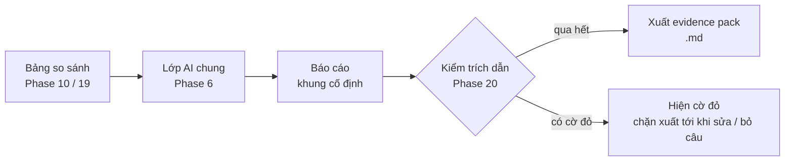

# Phase 21 · Báo cáo so sánh (AI Cite)

> Từ bảng so sánh niche (Phase 10) hoặc đối thủ (Phase 19), AI viết **một trang kết luận**: nên chọn gì, vì sao,
> rủi ro gì. Mỗi câu có trích dẫn, qua lớp kiểm của Phase 20, rồi xuất **evidence pack** cho `/app-research`.

Chưa làm · sau Phase 20

## Chạy thế nào

## Làm gì

| | |
|---|---|
| :material-file-document-outline: **Khung báo cáo cố định** | 1 · Kết luận 3 dòng · 2 · Mỗi niche / đối thủ: mạnh ở đâu, yếu ở đâu · 3 · Rủi ro (dữ liệu thiếu, nguồn chưa tra) · 4 · Câu hỏi còn mở cần đo thêm |
| :material-format-quote-close: **Trích dẫn** | mọi câu trỏ về ô bảng so sánh hoặc dòng nguồn (review, video, listing) |
| :material-shield-check: **Kiểm** | dùng lại lớp kiểm trích dẫn Phase 20. Còn cờ đỏ → không xuất được |
| :material-pencil: **Sửa tay** | anh xoá / sửa câu ngay trên trang trước khi xuất, câu sửa tay ghi "người viết" |
| :material-package-variant: **Evidence pack** | file `.md` theo khung evidence pack [Phase 7](phase-7-review-validate.md) + bảng so sánh + báo cáo, dán thẳng vào `research/` của App-AI-Skills |

**Luật**

- Kết luận chỉ là **gợi ý có lý do**. Quyết định GO vẫn ở cổng 1 của `/app-research`, không ghi `Verdict` thay người dùng
- AI không đổi thứ hạng ô thắng ở Phase 10. Khác ý thì ghi ở mục Rủi ro, kèm trích dẫn

**Xong khi**

- 2 báo cáo niche + 1 báo cáo đối thủ thật, xuất được, 0 cờ đỏ
- Kiểm tay 15 trích dẫn trong 3 báo cáo: đúng hết
- Evidence pack mở bằng `/app-research` đọc được không cần sửa

**Không làm ở phase này**

- Sinh concept app, giá, spec (việc của `/app-money`, `/app-spec`)
- Xuất PDF / slide, gửi báo cáo cho người khác

